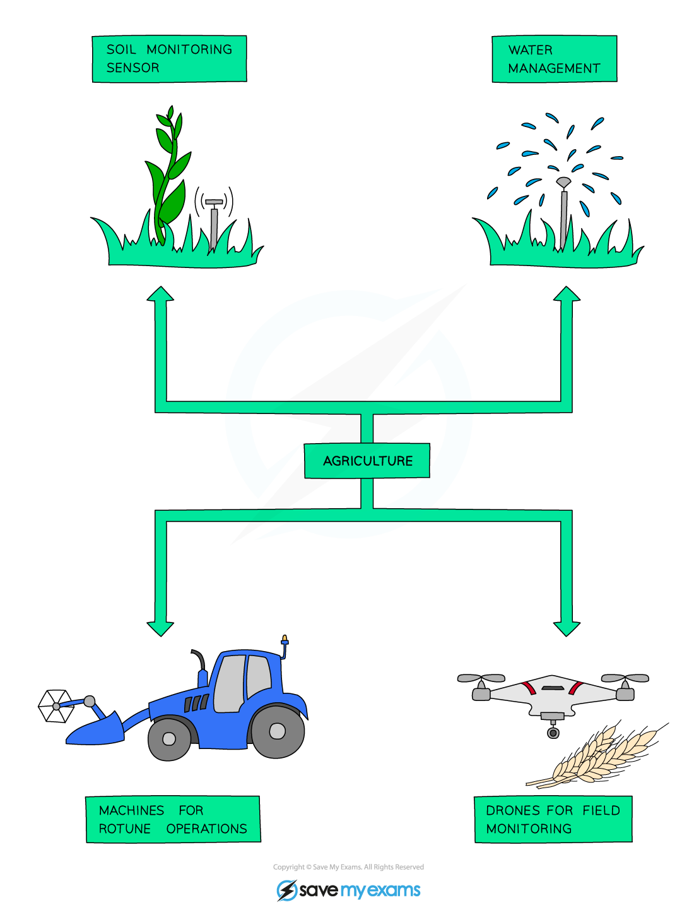
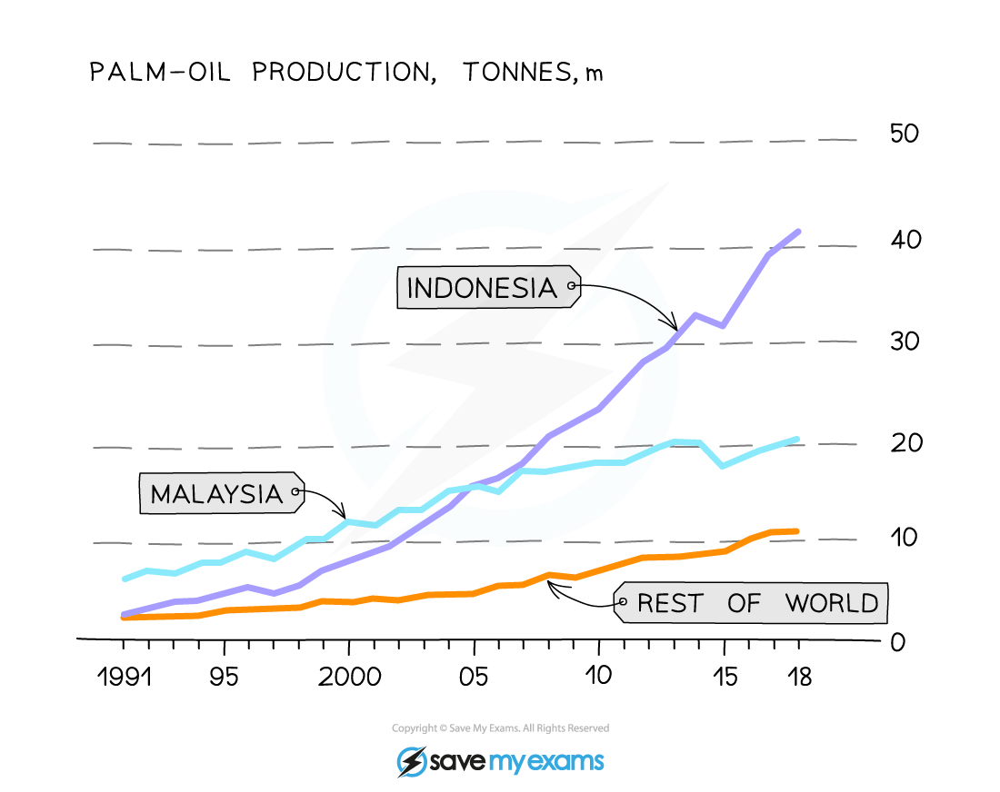

# Ensuring Food Supply

## Intensive food production

> **Spec point** — `spcpt_zF3phYzBW6x3WDGn` · Describe how humans have increased food production, limited to:
(a) agricultural machinery to use larger areas of land and improve efficiency
(b) chemical fertilisers to improve yields
(c) insecticides to improve quality and yield
(d) herbicides to reduce competition with weeds
(e) selective breeding to improve production by crop plants and livestock

## Intensive food production

- Making food production more **intensive** means producing food more **efficiently** with a finite amount of land and other resources
- Modern technology has increased food supply substantially:

  - **agricultural machinery** has replaced humans and **improved efficiency** due to the ability to farm **much larger areas** of land
  - **chemical fertilisers improve yields** by increasing the availability of soil nutrients, meaning that plants can grow larger and produce more fruit
  - **insecticides and herbicides** kill off unwanted insects and weed species, meaning that there is **less damage done** to plants by insects, and **reduced competition** from other plant species
  - [selective breeding](https://www.savemyexams.com/igcse/biology/cie/23/revision-notes/18-variation-and-selection/18-1-variation-and-natural-selection/18-1-5-artificial-selection/?_ai=internal-linking) produces breeds of animal and crop varieties that **reliably produce high yields**

*Modern agricultural processes allow for cultivation of much larger areas of land for crop plants*

### Intensive livestock farming

- Intensive farming of livestock increases energy efficiency by reducing energy inputs in relation to yield by:

  - keeping livestock in a **small area**, so reducing the energy that animals put into movement; this energy can instead be used for growth
  - feeding animals on **high energy foods**, so more energy is gained per unit of food digested
  - regularly giving medication such as **antibiotics** as a preventative measure against disease
  - keeping animals in **artificially warm environments** so that animals expend less energy regulating body temperature

#### Advantages of intensive livestock farming

- Less land is required to produce large amounts of food
- Food can be produced all year round in controlled environments
- The cost of production is lower, so food can be sold at cheaper prices

#### Disadvantages of intensive livestock farming

- Ethical issues associated with cruel treatment of animals in intensive farms
- Natural habitats may be destroyed to maximise land available for keeping livestock
- Ecological issues with intensive farming include:

  - **reduction in biodiversity** in areas where large amounts of land are used to graze cattle (as only grass is grown so in effect it becomes a monoculture)
  - overgrazing can lead to **soil erosion**
  - large numbers of cattle produce large amounts of **methane**, a greenhouse gas
  - the waste excreted by livestock can be washed into waterways, causing [water pollution](https://www.savemyexams.com/igcse/biology/cie/23/revision-notes/20-human-influences-on-ecosystems/20-1-human-impact-biodiversity-pollution-and-conservation/20-1-3-water-pollution/?_ai=internal-linking)

## Monocultures

> **Spec point** — `spcpt_w9WXxrwGq5qrD55w` · Describe the advantages and disadvantages of large-scale monocultures of crop plants
Describe the advantages and disadvantages of intensive livestock production

## Monocultures

- Monoculture farming means that **only one type of crop is grown**  on an area of farmland

  - E.g. trees for palm oil grown in the Indonesian rainforest

### Advantages of monocultures

- Monoculture farming allows for the use of **specialised machinery** for planting, weeding, and harvesting, leading to **increased efficiency** and **reduced labour costs**
- Focusing on a single crop can allow farmers to optimise conditions for that specific crop, resulting in **higher yields**

### Disadvantages of monocultures

- Monocultures **reduce** **biodiversity**
- Crop monocultures only contain **one variety** of plant, so provides food for **few species** **of herbivore**, which in turn cannot support more than a **few predator species**
- Another issue with monocultures is the **increase in pest populations**;** **if a particular pest feeds on a crop, farming it in large areas repeatedly means there is an ample supply of food for the pest, causing the population to increase
- Often farmers will spray **insecticides** onto crops to control the pests; this leads to:

  - harmless insects being killed as well
  - **pollution** by pesticides
  - **pesticide resistance**; where the same chemicals are used repeatedly for specific pests, the pests may eventually become **resistant** to them, reducing their effectiveness

*Palm oil is often grown in a monoculture; production has increased rapidly over the last 30 years*
