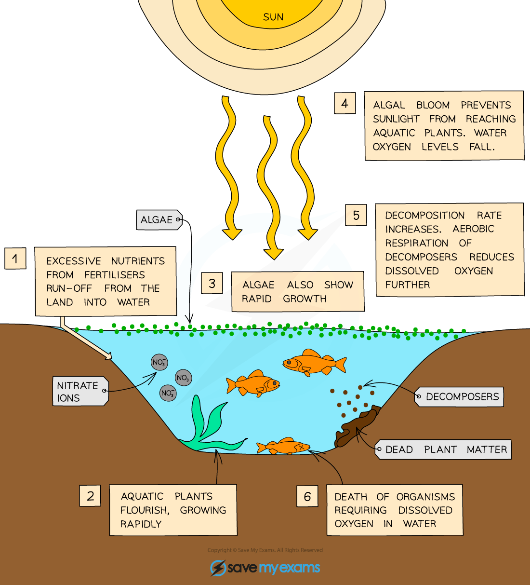

# Water Pollution

## Untreated sewage & excess fertiliser

> **Spec point** — `spcpt_4pWgsFvZ33JQKhg5` · Describe the effects of untreated sewage and excess fertiliser on aquatic ecosystems

## Untreated sewage & excess fertiliser

- Human activities have led to the pollution of land, water and air
- Pollution comes from a variety of sources, including industry and manufacturing processes, waste and discarded rubbish, chemicals from farming practices, nuclear fall-out, and untreated sewage

| **Pollutant** | **Source / Cause** | **Effect** |
|---|---|---|
| **Untreated sewage** | Lack of sewage treatment (poor infrastructure/funding) means sewage enters rivers or streams. | Increases bacteria → reduces oxygen in water → kills aquatic life. This process is known as **eutrophication**. |
| **Fertilisers** | Runoff from farmland when used in excess. | Causes algal blooms → bacteria feed → oxygen depletion → death of aquatic organisms. Another case of **eutrophication**. |
| **Methane** | Released by cattle farming, rice paddies, and landfills. | Potent **greenhouse gas**, contributes to climate change. |
| **Carbon dioxide** | Produced by burning fossil fuels or trees (land clearance). | Also a **greenhouse gas**, contributing to **global warming and climate change**. |

## Eutrophication: Extended

> **Spec point** — `spcpt_ZmKxCRs3x6cqvwFN` · Explain the process of eutrophication of water, limited to:
• increased availability of nitrate and other ions
• increased growth of producers
• increased decomposition after death of producers
• increased aerobic respiration by decomposers
• reduction in dissolved oxygen
• death of organisms requiring dissolved oxygen in water

## Eutrophication: Extended

- Runoff of fertiliser from farmland enters the water and causes **increased growth of algae** and water plants
- The resulting ‘algal bloom’ **blocks sunlight** so water plants on the bottom start to die, as does the algae when competition for nutrients becomes too intense
- As water plants and algae die in greater numbers, **decomposing bacteria increase in number** and **use up the dissolved oxygen** whilst respiring aerobically
- As a result there is less oxygen dissolved in water, so **aquatic organisms such as fish and insects may be unable to breathe** and would die

*Sequence of events causing eutrophication in lakes and rivers*
