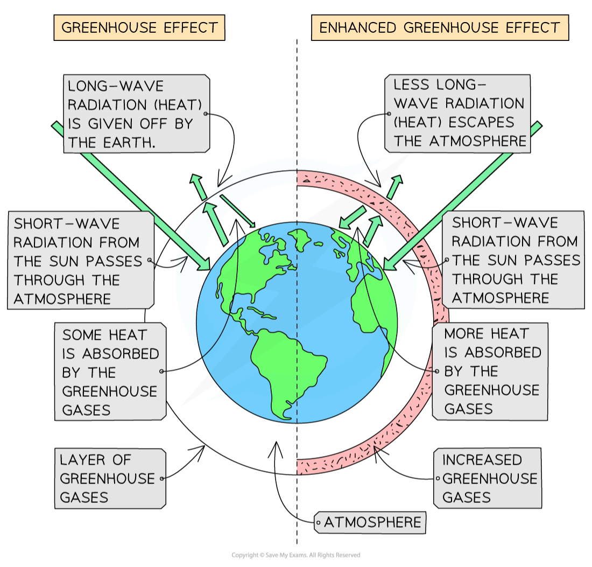

# Other Pollution

## Plastic pollution

> **Spec point** — `spcpt_9DVKDGSdMTh6XVkY` · Describe the effects of non-biodegradable plastics, in both aquatic and terrestrial ecosystems

## Plastic pollution

- Plastics have a large negative impact on both land and water habitats due to their non-biodegradability
- In marine habitats:

  - animals often try to **eat plastic** or **become caught in it**, leading to injuries and death
  - as the plastic breaks down it can **release toxins** that affect marine organisms
  - once it has broken down into **very small particles**, it is commonly ingested by animals and **enters the food chain**
- On land:

  - plastic is generally disposed of by **burying in landfills**
  - as it breaks down, it releases **toxins** into the surrounding soil and as such the **land is no good for growing crops or grazing animals** and can only be used for building on several decades after burial

## Air pollution

> **Spec point** — `spcpt_4CHT9vgyJHd5Zjrj` · Describe the sources and effects of pollution of the air by methane and carbon dioxide, limited to: the enhanced greenhouse effect and climate change

## Air pollution

### Methane and carbon dioxide

- Both **methane** and **carbon dioxide** gases **insulate** the Earth and act as a 'blanket' in the atmosphere
- Higher levels of both gases have led to global warming and climate change
- Human activity has increased levels of both gases in the atmosphere:

  - burning fossil fuels increases carbon dioxide
  - keeping livestock generates methane gas
  - global warming melts the permafrost in sub-polar regions, which results in even more trapped methane being released into the atmosphere

*Natural and enhanced greenhouse effect*
