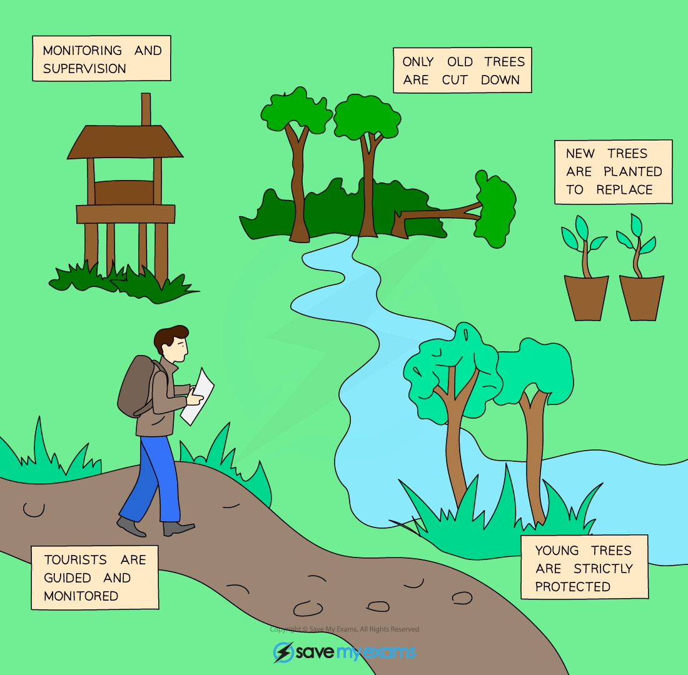

# Sustainability

## Sustainable use of resources

> **Spec point** — `spcpt_tK3dTnCmN5hGpSgd` · Describe a sustainable resource as one which is produced as rapidly as it is removed from the environment so that it does not run out
State that some resources can be conserved and managed sustainably, limited to forests and fish stocks

## Sustainable use of resources

- Humans use many resources from the Earth; some, such as food, water and wood, are **sustainable resources**
- A sustainable resource is one which is **produced as rapidly as it is removed from the environment so that it does not run out**
- Some resources, such as **fossil fuels** (coal, oil and natural gas), are **non-renewable** because what is used cannot be replaced
- These resources, once used, cannot be produced anymore and so they need to be **conserved** by **reducing the amount humans use** and finding other, **sustainable resources to replace them**
- Fossil fuels are being used as an **energy source** in increasing amounts
- In addition, they are the **raw materials** for many other products humans make - e.g. almost all **plastics** that are made start with **oil** as a raw material
- Some products, especially those made from **paper, plastic, glass or metal**, can be **reused and recycled** - this reduces waste in the environment and reduces the amounts of raw materials and energy needed to make new products
- Some resources, such as **forests and fish stocks**, can be maintained - enabling us to **harvest them sustainably** so that they will** not run out in the future**

## Sustainable production examples: Extended

> **Spec point** — `spcpt_dtVRNbqBsNz7CSCs` · Explain how forests can be conserved using: education, protected areas, quotas and replanting
Explain how fish stocks can be conserved using: education, closed seasons, protected areas, controlled net types and mesh size, quotas and monitoring

## Sustainable production examples: Extended

- Sustainable development is defined as **development providing for the needs of an increasing human population without harming the environment**
- When developing the way resources are used and managed sustainably, conflicting demands must be balanced - for example:

  - the need for **local people** to be able to utilise the resources they have in their immediate environment with the needs of **large companies** to make money from resources such as forests and fish
  - the need for balancing the **needs of humans for resources** with the **needs of the animals and plants** that live in the areas the resources are taken from (preventing [loss of habitat and extinction](https://www.savemyexams.com/igcse/biology/cie/23/revision-notes/20-human-influences-on-ecosystems/20-1-human-impact-biodiversity-pollution-and-conservation/20-1-6-endangered-species/?_ai=internal-linking))
  - the need to balance what **current populations need** with what **future populations might need** - for example, harvesting all the fish needed to feed people now might lead to overfishing, which would deplete stocks for future generations
- For development to occur sustainably, **people need to cooperate at local, national and international levels** in the planning and management of resources

### Sustaining forests

- Forests are needed to produce **paper products** and **provide wood for timber**
- Much of the world’s paper is now produced from forests which **replant similar trees when mature trees are cut**, ensuring that there will be adequate supply in the future
- Tropical hardwoods such as teak and mahogany take many years to regrow but are highly desirable for furniture
- Using these types of wood has now been made more sustainable due to the **introduction of several schemes** designed to **monitor logging companies** and track the wood produced (e.g. the Forest Stewardship Council)
- **Education** helps to ensure logging companies are aware of sustainable practices and consumers are aware of the importance of buying products made from sustainable sources

*Greater efforts are being made to manage forests sustainably so consumers know they are not causing damage to forests*

### Sustaining fish stocks

- Managing fish stocks sustainably includes: 

*Ways of controlling fishing to make it more sustainable*

  - controlling the **number of fish** caught each year (quotas)
  - controlling the **size of fish** caught (to ensure there are enough fish of a suitable age for breeding remaining)
  - controlling the **time of year** that certain fish can be caught (to prevent large scale depletion of stocks when fish come together in large numbers in certain areas to breed)
  - **restocking** (breeding and keeping offspring until they are large enough to survive in their natural habitat then releasing)
  - **educating fishermen** as to local and international laws and **consumers** so they are aware of types of fish which are not produced sustainably and can avoid them when buying fish
