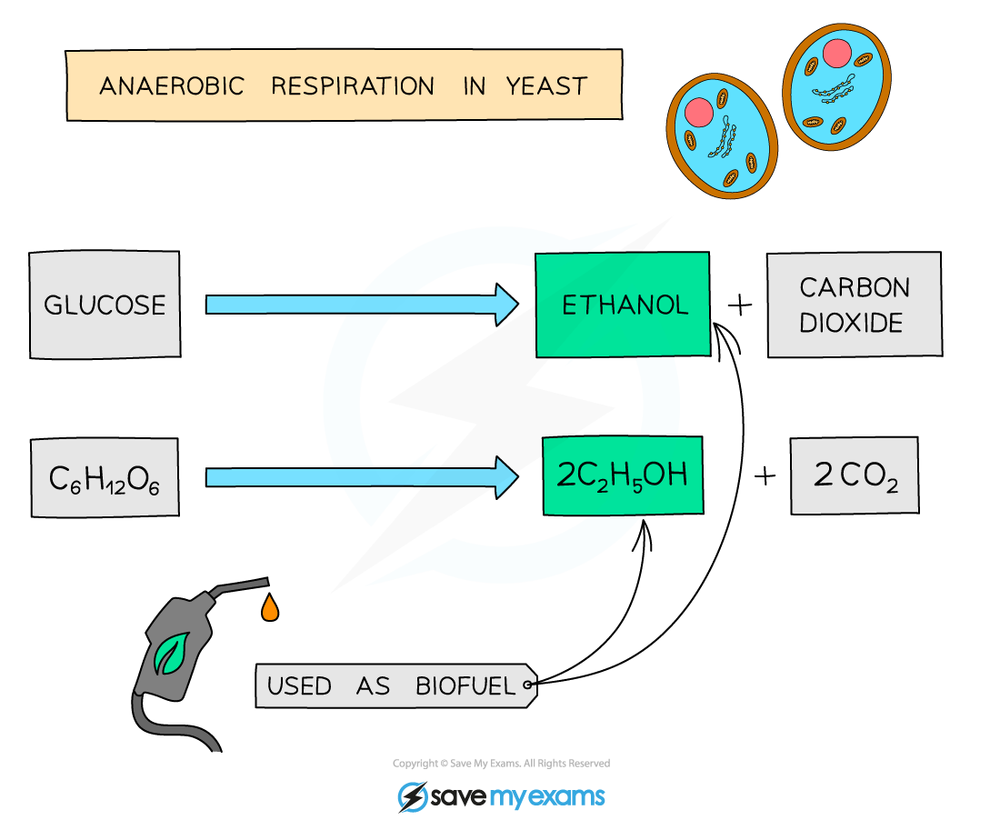
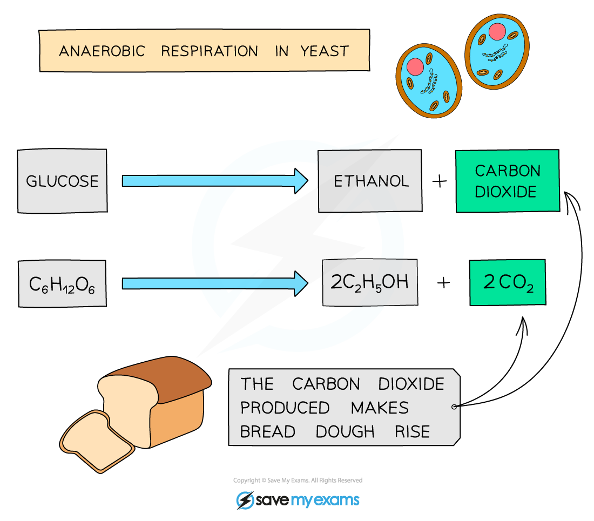
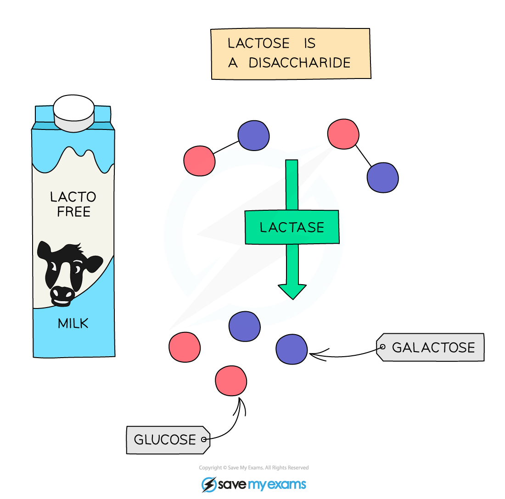
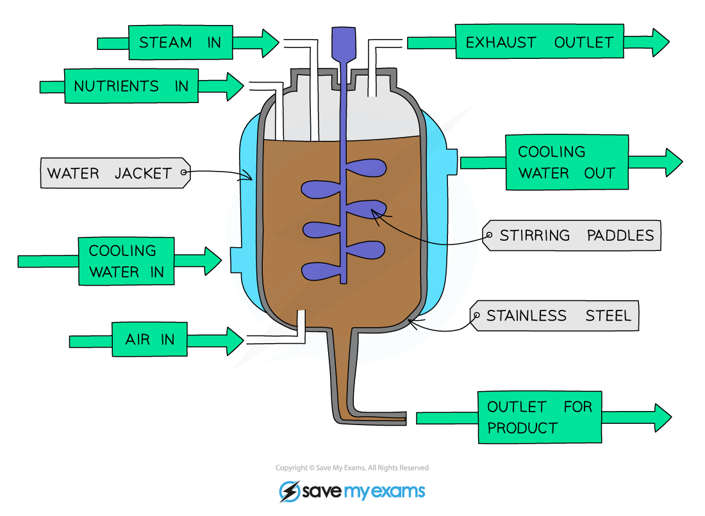

# Biotechnology

## Everyday products made with biotechnology

> **Spec point** — `spcpt_PnQVP9vCZ9pfZ9Vd` · Describe the role of anaerobic respiration in yeast during the production of ethanol for biofuels
Describe the role of anaerobic respiration in yeast during bread-making
Describe the use of pectinase in fruit juice production
Investigate and describe the use of biological washing powders that contain enzymes

## Everyday products made with biotechnology

### Biofuels

- **Yeast** is a single celled fungus that uses sugar as its food source
- [Anaerobic respiration in yeast](https://www.savemyexams.com/igcse/biology/cie/23/revision-notes/12-respiration/12-1-respiration/12-1-3-anaerobic-respiration/?_ai=internal-linking) produces **ethanol** and **carbon dioxide**, as well as releasing energy for the yeast cell

*The alcohol produced by fermentation of glucose can be used as biofuel*

- The **ethanol** produced by anaerobic respiration in yeast can be used in the production of *biofuels*

  - In countries such as Brazil, biofuel is partly replacing petrol as the fuel for vehicles
- Biofuel production using yeast can be carried out as follows:

  1. **Plant material** is broken up into small pieces and mixed with **yeast**.
  2. Yeast cells use the plant material as a *substrate* in anaerobic respiration and produce **ethanol** as a product.
  3. The liquid is separated from the remaining solids and any water is removed, leaving a **concentrated solution of ethanol**.
  4. The ethanol may then be blended with petrol, or used on its own as a fuel.
- It is possible to use the **waste parts** of crop plants, such as the stalks or outer leaves, in biofuel production, but **crops may also be grown specifically** to be harvested for making ethanol
- This is causing concern however that there is **less land available** for local people to grow food crops needed for survival

### Bread

- Yeast will **respire anaerobically** if it has access to plenty of **sugar**, even if oxygen is available
- This is taken advantage of in **bread making**, where the yeast is mixed with flour and water and respires anaerobically, producing **carbon dioxide**:

*The carbon dioxide produced by fermentation (anaerobic respiration) of glucose is what makes bread dough rise*

- The **carbon dioxide** produced by the yeast during respiration is caught in the dough, causing the bread to **rise**

### Fruit juice production

- Fruit juice is produced by squeezing the fruits to remove the juice
- Chopping the fruit up before squeezing helps to release a lot more juice, but this does not break open all the cells so **a lot of juice is lost**
- By adding an enzyme called **pectinase** to the chopped up fruit, more juice is released
- Pectinase works by breaking down a chemical called **pectin** that is found inside plant cell walls
- Once pectin is broken down, the **cell walls break more easily** and more juice can be squeezed out of the fruit
- Adding pectinase to fruits also helps to **produce a clearer juice** as larger polysaccharides like pectin can make the juice seem cloudy - once they are broken down into smaller molecules, the juice becomes clearer

### Biological washing powders

- Many stains on clothes are **organic molecules** – oil from skin, protein from blood, fat and protein from food
- Detergents that only contain soap can remove some of these stains when mixed with hot water, but it can take **a lot of time and effort and very high temperatures** to remove the stains entirely
- Biological washing powders contain **enzymes** similar to the digestive enzymes produced in the alimentary canal that help to break down large food molecules
- Using biological washing powders has several advantages, including:

  - **quickly** breaking down **large, insoluble molecules** such as fats and proteins into **smaller, soluble ones** that **will dissolve** in washing water
  - they are **effective at lower temperatures**, meaning **less energy (and money)** has to be used in order to wash clothes to get them clean as washing water does not need to be heated to higher temperatures
  - they can be used to clean **delicate fabrics** that would not be suitable for washing at high temperatures

## Other uses of biotechnology: Extended

> **Spec point** — `spcpt_WbWqFTZ6BPxx3h3J` · Explain the use of lactase to produce lactose-free milk
Describe how fermenters can be used for the large-scale production of useful products by bacteria and fungi, including insulin, penicillin and mycoprotein
Describe and explain the conditions that need to be controlled in a fermenter, including: temperature, pH, oxygen, nutrient supply and waste products

## Other uses of biotechnology: Extended

- Lactose is the **sugar found in milk**
- Human babies are born with the ability to produce **lactase**, the **enzyme** that breaks down lactose
- In certain areas of the world, many people **lose the ability to produce lactase as they get older**
- This means that they can become **lactose intolerant** and react badly to the lactose in milk and products made from milk (cheese, yoghurt etc.)
- Symptoms of lactose intolerance include **nausea, flatulence and diarrhoea** as their digestive system is upset by the lactose
- Milk can be made **lactose free** by **adding the enzyme lactase to it** and leaving it to stand for a while to allow the enzyme to break down the lactose

*Lactose-free milk is a product made from adding the enzyme lactase to dairy milk to break down the sugars in it*

### Penicillin production

- Penicillin was the **first antibiotic**, discovered in 1928 by **Alexander Fleming**
- He noticed that some bacteria he had left in a Petri dish had been killed by the naturally occurring ***Penicillium***** mould**
- The *Penicillium* mould produces a **chemical** to prevent it being infected by certain types of bacteria

*Penicillin produced by the fungus Penicillium inhibits bacterial growth*

- The chemical was isolated and named **penicillin**
- Since the discovery of penicillin, methods have been developed to **produce it on a large scale**, using an **industrial fermenter**

*A diagram of an industrial fermenter used to produce large quantities of microorganisms*

- **Fermenters** are containers used to grow (**‘culture’**) microorganisms like bacteria and fungi in **large amounts**
- These can then be used for many biotechnological processes like producing **genetically modified bacteria** and the ***Penicillium***** mould that produces penicillin**
- The advantage of using a fermenter is that **conditions can be carefully controlled** to produce large quantities of exactly the right type of microorganism

| **Condition** | **Why and how it is controlled** |
|---|---|
| Aseptic precautions | Fermenter is cleaned by steam to kill microorganisms and prevent chemical contamination, which ensures only the desired microorganisms can grow |
| Nutrients | Nutrients are needed for use in respiration to release energy for growth and reproduction of the microorganisms |
| Optimum temperature | Temperature is monitored using probes and maintained using a water jacket. This ensures an optimum environment for enzymes to increase enzyme activity and prevent denaturation |
| Optimum pH | pH is monitored using a probe to check it is at the optimum value for the microorganism being grown. The pH can be adjusted using acids and alkalis |
| Oxygenation | Oxygen is required for aerobic respiration to take place |
| Agitation | Stirring paddles are used to ensure temperature, pH, nutrients, and oxygen are all distributed evenly throughout the fermenter |
| Waste | The contents are filtered to remove waste created by the microorganisms |

### Mycoprotein – the process of creating food from a fungus

- The fungus Fusarium is cultured (grown) on an industrial scale in fermenters
- These fermenters are large vats that can be kept at the optimum pH and temperature for Fusarium to grow
- The fungus is grown in aerobic conditions (it is provided with oxygen) and provided with glucose syrup as a food source (to allow the fungus to respire)
- The fungus grows and multiplies within the fermenter
- The fungal biomass is then harvested and purified to produce mycoprotein
- Mycoprotein is a protein-rich food suitable for vegetarians e.g. it is used in QuornTM products

### Production of insulin

- Genetic modification is changing the genetic material of an organism by removing or altering genes within that organism, or by inserting genes from another organism
- The organism receiving the genetic material is said to be ‘**genetically modified**’, or is described as a ‘transgenic organism’
- The DNA of the organism that now contains DNA from another organism as well is known as ‘recombinant DNA’
- The gene for human insulin has been inserted into bacteria which then produce **human insulin** which can be collected and purified for medical use to [treat people with diabetes](https://www.savemyexams.com/igcse/biology/cie/23/revision-notes/14-coordination-and-response/14-1-coordination-response-and-homeostasis/14-1-9-homeostasis/?_ai=internal-linking)
