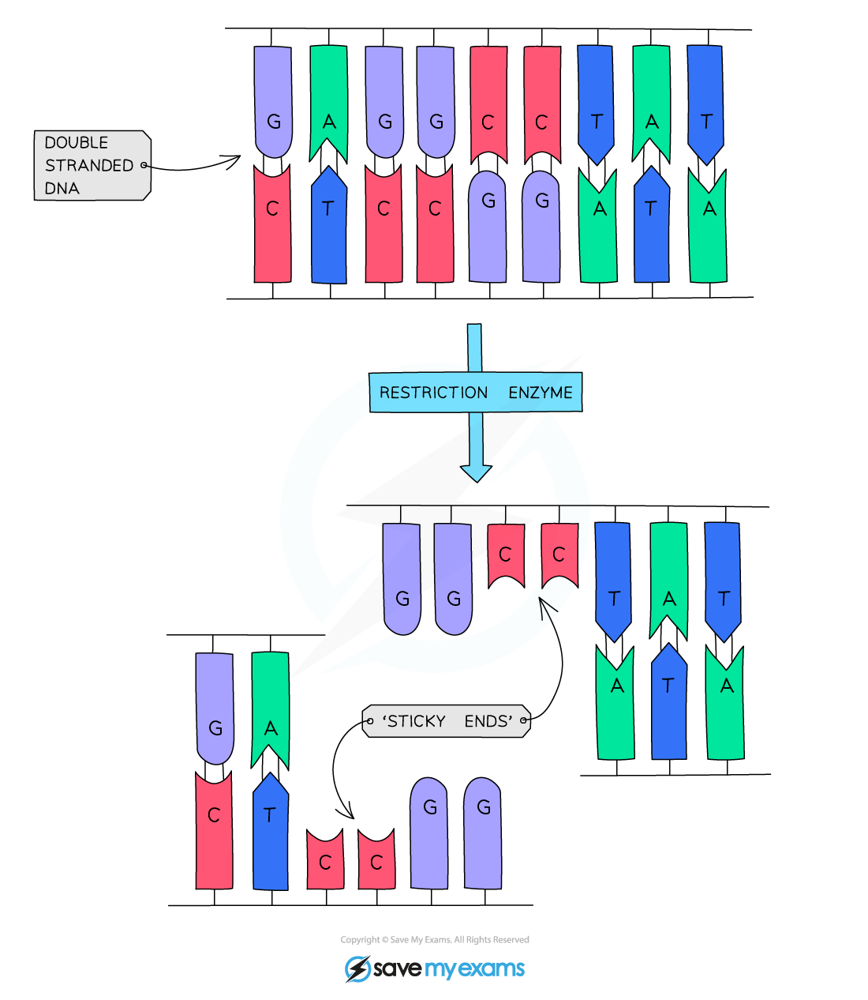
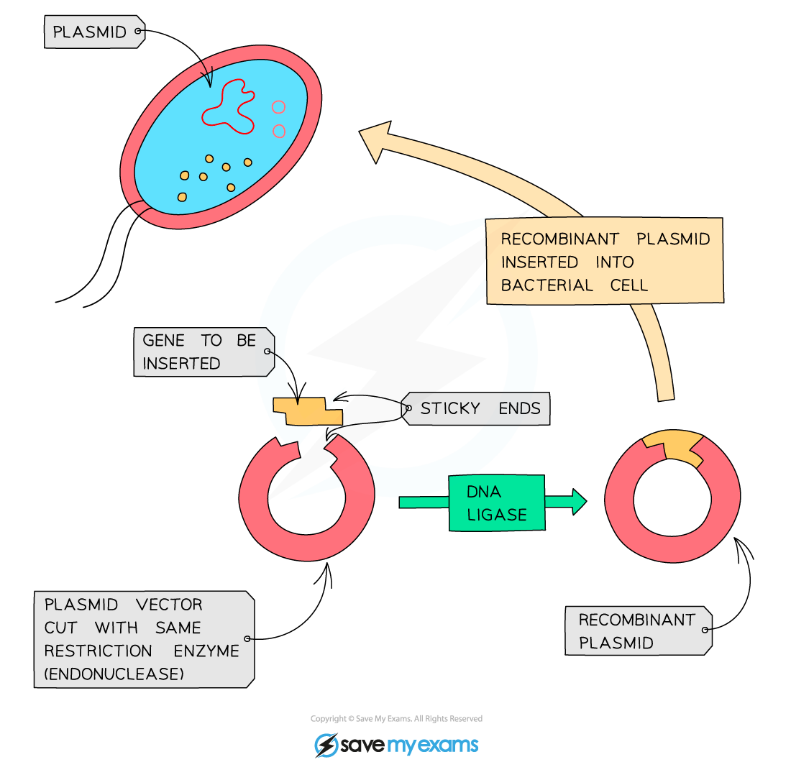

# Genetic Modification

## Genetic modification: definition

> **Spec point** — `spcpt_FgzRjZ8s7Zgrph83` · Describe genetic modification as changing the genetic material of an organism by removing, changing or inserting individual genes

## Genetic modification: definition

### Genetic modification

- Genetic modification is **changing the genetic material of an organism by removing, changing or inserting individual genes from another organism**
- The organism receiving the genetic material is said to be **‘genetically modified’, **or is described as a **‘transgenic organism’**
- The DNA of the organism that now contains DNA from another organism as well is known as **‘recombinant DNA’**

## Genetic modification: examples

> **Spec point** — `spcpt_3jGgRHHZNJTKPNJz` · Outline examples of genetic modification:
(a) the insertion of human genes into bacteria to produce human proteins
(b) the insertion of genes into crop plants to confer resistance to herbicides
(c) the insertion of genes into crop plants to confer resistance to insect pests
(d) the insertion of genes into crop plants to improve nutritional qualities

## Genetic modification: examples

- There are many examples of genetically modified organisms, including:

  - the gene for **human insulin** has been inserted into **bacteria** which then produce human insulin which can be collected and purified for medical use for diabetics
  - **crop plants**, such as soya, maize and rice, have been genetically modified to contain a gene from a bacterium that **produces a poison that kills insects**, making them **resistant to insect pests** such as caterpillars
  - **crop plants** have also been genetically modified to make them **resistant to certain herbicides** (chemicals that kill plants), meaning that when the herbicide is sprayed on the crop it only kills weeds and does not affect the crop plant
  - some crops have been genetically modified to** produce additional vitamins**, e.g. **‘golden rice’** contains genes from another plant and a bacterium which make the rice grains produce a chemical that is turned into **vitamin A** in the human body, which could help prevent deficiency diseases in certain areas of the world

## Genetic modification: examples: Extended

> **Spec point** — `spcpt_FTqhP7PkmbRgNJ9m` · Outline the process of genetic modification using bacterial production of a human protein as an example, limited to:
(a) isolation of the DNA making up a human gene using restriction enzymes, forming sticky ends
(b) cutting of bacterial plasmid DNA with the same restriction enzymes, forming complementary sticky ends
(c) insertion of human DNA into bacterial plasmid DNA using DNA ligase to form a recombinant plasmid
(d) insertion of recombinant plasmids into bacteria (specific details are not required)
(e) multiplication of bacteria containing recombinant plasmids
(f) expression in bacteria of the human gene to make the human protein

## Genetic modification: examples: Extended

### Genetic modification using bacterial production of a human protein

- The gene that is to be inserted is located in the original organism (for example, this could be the gene for human insulin)
- **Restriction enzymes** are used to isolate the required gene, leaving it with **‘sticky ends’** (a short section of unpaired bases)
- A bacterial plasmid is **cut by the same restriction enzyme leaving it with corresponding sticky ends** (plasmids are **circles of DNA** found inside bacterial cells)

*Restriction enzymes cut DNA strands at specific sequences to form ‘sticky ends’*

- The plasmid and the isolated gene are joined together by **DNA ligase enzyme**
- If two pieces of DNA have **matching sticky ends** (because they have been **cut by the** **same restriction enzyme**), DNA ligase will link them to form a single, unbroken molecule of DNA

*DNA ligase is used to join two separate pieces of DNA together*

- The genetically engineered plasmid is **inserted into a bacterial cell**
- When the bacteria reproduce the **plasmids are copied as well** and so a recombinant plasmid can **quickly be spread** as the bacteria multiply and they will then all **express the gene** and make the human protein
- The genetically engineered bacteria can be placed in a **fermenter** to reproduce quickly in controlled conditions and make **large quantities** of the human protein
- Bacteria are extremely useful for genetic engineering purposes because:

  - they contain the **same genetic code** as the organisms we are taking the genes from, meaning they can easily ‘read’ it and **produce the same proteins**
  - there are **no ethical concerns over their manipulation and growth **(unlike if animals were used, as they can feel pain and distress)
  - the **presence of plasmids** in bacteria, separate from the main bacterial chromosome, makes them **easy to remove and manipulate** to insert genes into them and then place back inside the bacterial cells

## GM Crops: Extended

> **Spec point** — `spcpt_6MHBYzRnP8T8h3Rx` · Discuss the advantages and disadvantages of genetically modifying crops, including soya, maize and rice

## GM Crops: Extended

- **Advantages:**

  - reduced use of chemicals such as herbicides and pesticides - better for the environment
  - cheaper / less time-consuming for farmers
  - increased yields from the crops as they are not competing with weeds for resources or suffering from pest damage
- **Disadvantages:**

  - increased costs of seeds - companies that make GM seeds charge more for them to cover the cost of developing them; this can mean smaller, poorer farmers cannot compete with larger farms
  - increased dependency on certain chemicals, such as the herbicides that crops are resistant to - often made by the same companies that produce the seed, and more expensive to buy
  - risk of inserted genes being transferred to wild plants by pollination, which could reduce the usefulness of the GM crop (e.g. if weeds also gain the gene that makes them resistant to herbicide)
  - reduced biodiversity as there are fewer plant species when herbicides have been used - this can impact insects and insect-eating birds
  - some research has shown that plants that have had genes inserted into them do not grow as well as non-GM plants
