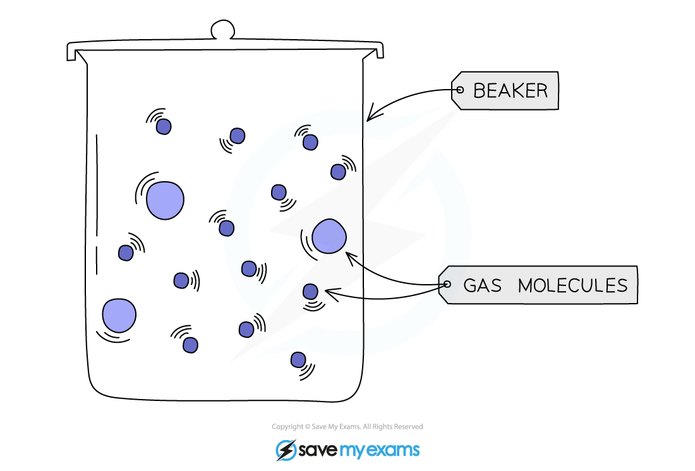

# Diffusion in Biology

## Diffusion

> **Spec point** — `spcpt_7CHvGTP5rN8kFZZD` · nan

## Diffusion

### What is diffusion in biology?

- Diffusion is the **movement of molecules** from a region of its **higher** concentration to a region of its **lower** concentration
- Molecules **move down a concentration gradient**, as a result of their **random movement** 

*Diffusion across the cell membrane*
- For **living cells**, the principle of the movement down a concentration gradient is the same, but the cell is surrounded by a **cell membrane** which can **restrict the free movement of the molecules**
- The cell membrane is a **partially permeable membrane** - this means it allows some molecules to cross easily, but others with difficulty or not at all
- The simplest sort of selection is based on the size of the molecules
- Diffusion helps living organisms to:

  - Obtain many of their **requirements**
  - Get rid of many of their **waste products**
  - Carry out **gas exchange for respiration**

### Examples of diffusion in living organisms

- Living organisms obtain **various substances** they need through **diffusion**, such as **oxygen**, **carbon dioxide**, and other **nutrients**.
- It is worth noting that plants require **oxygen** for **respiration** at all times, as well as **carbon dioxide** for **photosynthesis** when conditions for photosynthesis are right (e.g. enough light and a suitable temperature)

#### Examples of diffusion in living organisms

| Site | Molecules moving | From | To |
|---|---|---|---|
| Small intestine | Digested food products:  - Glucose - Amino acids - Fatty acids - Glycerol | Lumen of the small intestine | Blood / lymph in villi covering the wall of the small intestine |
| Leaf | Oxygen | Air spaces between mesophyll cells | Mitochondria in all cells |
| Leaf | Carbon dioxide | Air spaces between mesophyll cells | Chloroplasts in mesophyll cells |
| Leaf | Water vapour | Stomatal pores | Air outside stomata |
| Lungs | Oxygen | Alveolar air space | Blood in capillaries around alveoli |
| Lungs | Carbon dioxide | Blood in capillaries around alveoli | Alveolar air space |

### Where does the energy for diffusion come from?

- All particles move randomly at all times
- This is known as Brownian motion
- The energy for diffusion comes from the kinetic energy of this random movement of molecules and ions

*Brownian motion*
