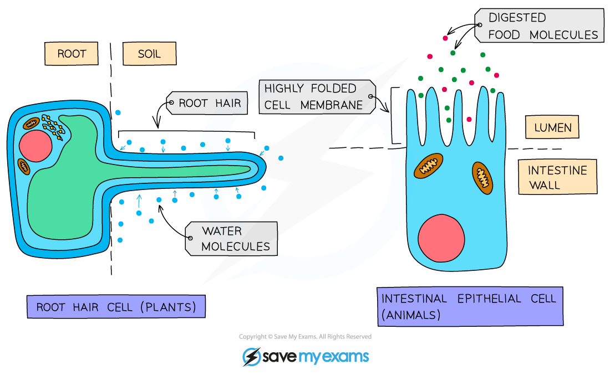
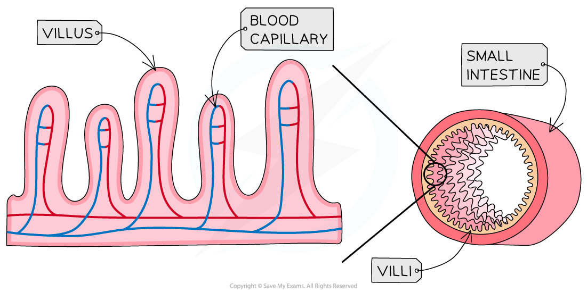

# Factors that Influence Diffusion

## Factors that influence diffusion

> **Spec point** — `spcpt_zK6sdF2666m3wDry` · Investigate the factors that influence diffusion, limited to: surface area, temperature, concentration gradient and distance

## Factors that influence diffusion

### Surface area to volume ratio

- The **bigger** a cell or structure is, the **smaller its surface area to volume ratio** is, slowing down the rate at which substances can move across its surface

  - Bigger structures have proportionally less surface area relative to their volume, which limits diffusion efficiency
- Many cells which are adapted for diffusion have **increased surface area** in some way, for example:

  - root hair cells in plants (which absorb water and mineral ions)
  - cells lining the ileum in animals (which absorb the products of digestion)

*Cell adaptations for diffusion *

*The highly folded surface of the small intestine increases its surface area*

### Distance

- The smaller the distance molecules have to travel, the higher the rate at which diffusion can occur
- This is why blood capillaries and alveoli have walls which are only one cell thick, to ensure the rate of diffusion across them is as high as possible

### Temperature

- The higher the temperature, the faster molecules move as they have more kinetic energy
- There is therefore a faster net rate of diffusion of molecules from a high to low concentration at higher temperatures

### Concentration gradient

- The greater the difference in concentration on either side of the membrane, the greater the rate of diffusion
- This is because there are more molecules on the higher-concentration side, so more molecules move from high to low concentration by random motion than move from low to high - giving a faster **net** rate of diffusion in that direction

> **Exam Hint**
> You should have carried out investigations into the factors that influence the rate of diffusion and as so should be able to use the information above to **explain experimental results** in an exam. You should also be able to **plan and carry out an experiment** which can investigate the effect of one of these factors.
