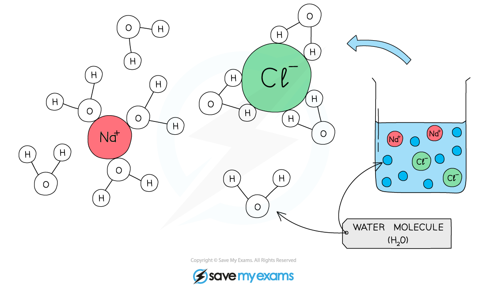

# Water

## Water as a solvent

> **Spec point** — `spcpt_tzVtFk4vscng3q7T` · Describe the role of water as a solvent in organisms with reference to digestion, excretion and transport

## Water as a solvent

- Water is important for all living organisms as **many substances are able to dissolve in it** (it is a **solvent**)
- This makes it incredibly useful and essential for all life on Earth
- Water is important as a solvent in the following situations within organisms:

  - Dissolved substances can be **easily transported** around organisms - eg [xylem and phloem of plants](https://www.savemyexams.com/igcse/biology/cie/23/revision-notes/8-transport-in-plants/8-1-transport-in-plants/8-1-1-xylem-and-phloem/?_ai=internal-linking) and dissolved food molecules in the blood
  - **Digested food molecules** are in the alimentary canal but need to be **moved to cells** all over the body - without water as a solvent this would not be able to happen
  - Toxic substances such as **urea** and substances in excess of requirements such as **salts** can dissolve in water which makes them easy to **remove from the body in urine**
  - Water is also an important part of the **cytoplasm** and plays a role in ensuring **metabolic reactions can happen** as necessary in cells

*Water as a solvent*
