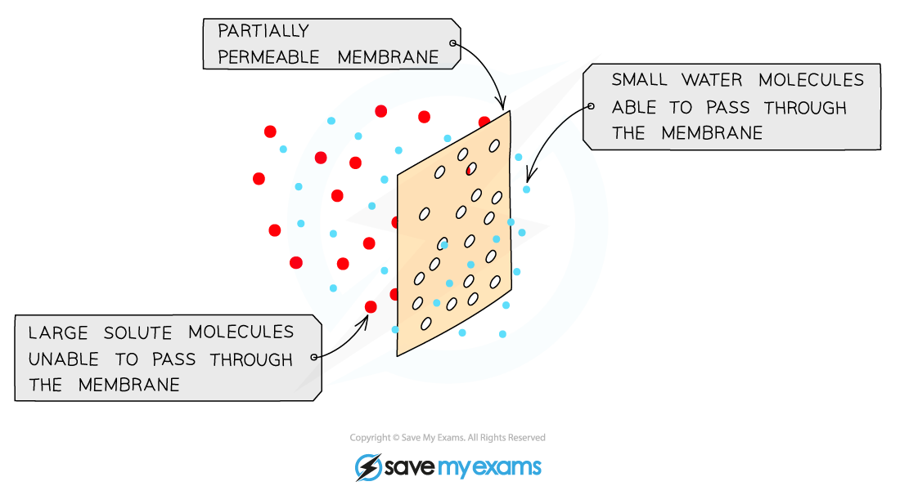

# Osmosis

## Osmosis

> **Spec point** — `spcpt_PmhYqrW5gdnXdnmp` · State that water diffuses through partially permeable membranes by osmosis
State that water moves into and out of cells by osmosis through the cell membrane

## Osmosis

- All cells are surrounded by a cell membrane which is **partially permeable**
- **Water** can move in and out of cells across the cell membrane by osmosis
- Osmosis is the diffusion of water molecules from a **dilute solution** (low solute concentration) to a **more concentrated solution** (high solute concentration) across a **partially permeable membrane**

  - The cell membrane is partially permeable which means it allows **small molecules** (like water) through but not larger molecules (like solute molecules)
- In doing this, water is moving down the **concentration gradient from where there is more water to where there is less**

*Osmosis and the partially permeable membrane*

> **Exam Hint**
> If you are taking the extended exam papers, you should be able to explain the process of osmosis with reference to water potential gradients, as detailed in the revision note page titled ['Osmosis in Animals & Plants'](https://www.savemyexams.com/igcse/biology/cie/23/revision-notes/3-movement-into-and-out-of-cells/3-1-diffusion-osmosis-and-active-transport/3-1-6-osmosis-in-animals-and-plants/).
