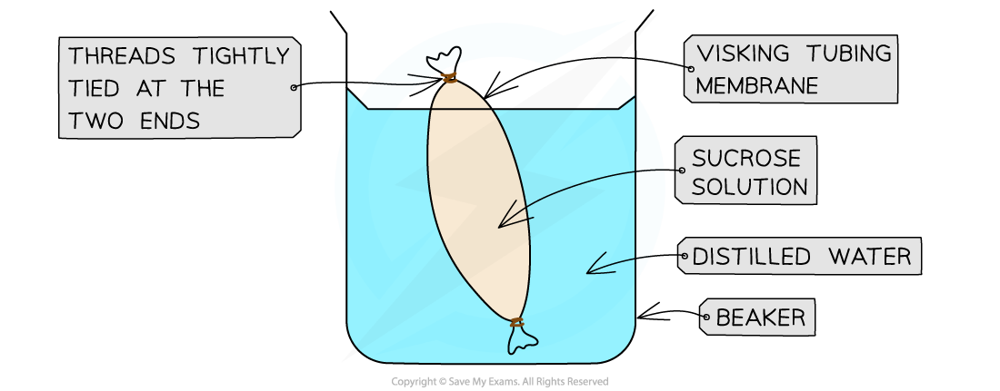

# Osmosis Experiments

## Osmosis experiments

> **Spec point** — `spcpt_m26wn5DRF5xHfB5p` · Investigate osmosis using materials such as dialysis tubing
Investigate and describe the effects on plant tissues of immersing them in solutions of different concentrations

## Osmosis experiments

### Immersing plant cells in solutions of different concentrations

- The most common osmosis practical involves cutting **cylinders of root vegetables** such as potato or radish and placing them into **distilled water** and **sucrose solutions** of increasing concentration
- The cylinders are weighed before placing into the solutions
- They are left in the solutions for 20 - 30 minutes and then removed, dried to remove excess liquid and reweighed

![Diagram illustrating how the mass of two individual radish pieces of almost equal initial size changes after they have been placed into two different solutions (one in a dilute sugar solution and the other in a concentrated sugar solution for 4 hours). The radish in the dilute solution has increased in mass and length as a result of water moving into the radish by osmosis, in contrast to the other radish piece which has decreased in mass and length after being placed in the more concentrated sugar solution.](../../../assets/d3fe2221b613-osmosis-in-plant-tissue.png)

*Potatoes are usually used in osmosis experiments to show how the concentration of a solution affects the movement of water, but radishes can be used too*

- If the plant tissue gains mass:

  - Water must have moved into the plant tissue from the solution surrounding it by osmosis
  - The solution surrounding the tissue is more dilute than the plant tissue (which is more concentrated)
- If plant tissue loses mass:

  - Water must have moved out of the plant tissue into the solution surrounding it by osmosis
  - The solution surrounding the tissue is more concentrated than the plant tissue (which is more dilute)
- If there is no overall change in mass:

  - There has been no **net** movement of water as the concentration in both the plant tissue and the solution surrounding it must be equal
  - Water is still moving into and out of the tissue - it's just that the movement in each direction is balanced, so there's no overall change

### Investigating osmosis using dialysis tubing

- **Dialysis tubing** (sometimes referred to as Visking tubing) is a non-living **partially permeable** membrane made from cellulose
- Pores in this membrane are small enough to **prevent the passage of large molecules** (such as **sucrose**) but allow **smaller molecules** (such as **glucose and water**) to pass through by **diffusion **and **osmosis**
- This can be demonstrated by:

  - filling a section of dialysis tubing with concentrated sucrose solution
  - suspending the tubing in a boiling tube of water for a set period of time
  - noting whether the water level outside the tubing decreases as water moves into the tubing via osmosis
- Water moves from a region of [higher water potential](https://www.savemyexams.com/igcse/biology/cie/23/revision-notes/3-movement-into-and-out-of-cells/3-1-diffusion-osmosis-and-active-transport/3-1-6-osmosis-in-animals-and-plants/?_ai=internal-linking) (dilute solution) to a region of lower water potential (concentrated solution), through a partially permeable membrane

*An example setup of a dialysis tubing experiment*
