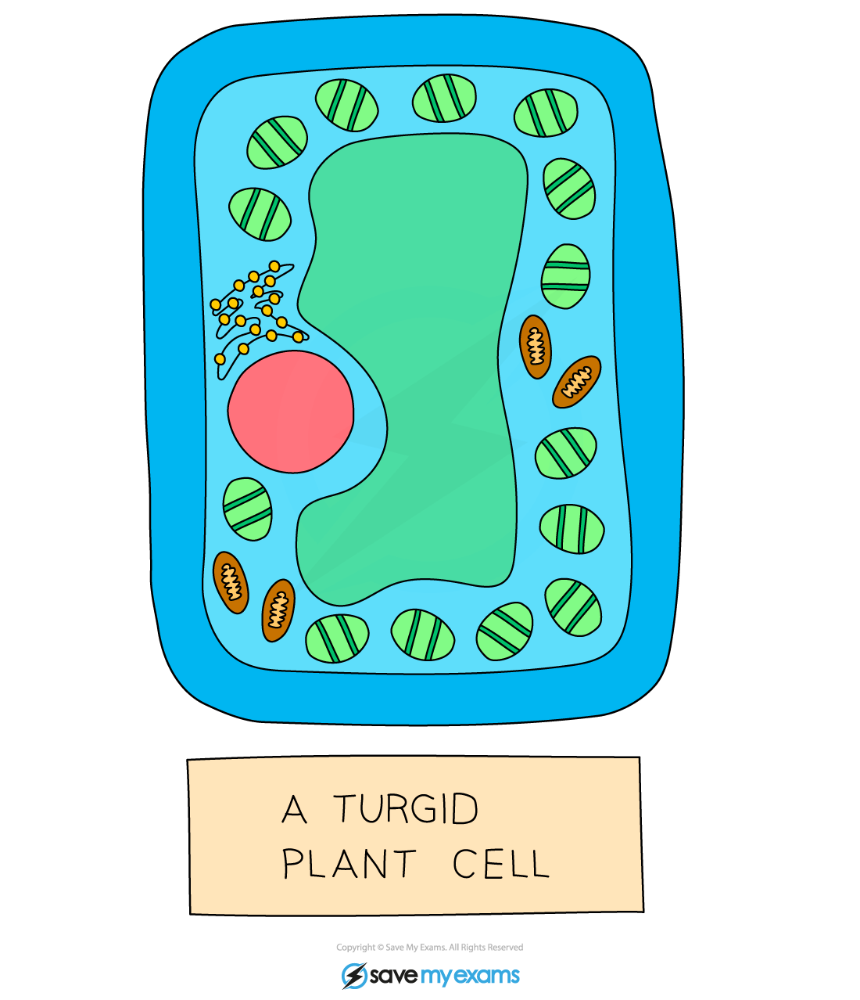

# Osmosis in Animals & Plants

## Osmosis in plant tissues

> **Spec point** — `spcpt_FVz2QYpwRd5bKWfx`

## Osmosis in plant tissues

- When water moves into a plant cell, the vacuole gets bigger, **pushing the cell membrane against the cell wall**
- Water entering the cell by osmosis makes the cell **rigid and firm**
- This is important for plants as the effect of all the cells in a plant being firm is to **provide support and strength for the plant** - making the plant stand upright with its leaves held out to catch sunlight
- The pressure created by the **cell wall** stops too much water entering and **prevents the cell from bursting**
- If plants do not receive enough water the cells cannot remain rigid and firm (turgid) and the plant **wilts**

## Osmosis: Extended

> **Spec point** — `spcpt_VCWcZxVHZqTfWqTZ`

## Osmosis: Extended

- Osmosis is the net movement of water molecules from a region of **higher water potential** (dilute solution) to a region of **lower water potential** (concentrated solution), through a **partially permeable membrane**
- **To understand this topic with clarity, it is important to understand the following:**

  - High water potential = dilute solution = low solute concentration (right side of diagram)
  - Low water potential = concentrated solution = high solute concentration (left side of diagram)

> **Exam Hint**
> The best explanations to do with osmosis will refer to **water potential**, so if you are aiming for an A* or A grade (or a grade 7, 8 or 9) you will need to understand the concept and use it in your explanations.

## Osmosis in animals & plants: Extended

> **Spec point** — `spcpt_mpCWHqP24s9pMgwG` · Explain the effects on plant cells of immersing them in solutions of different concentrations by using the terms: turgid, turgor pressure, plasmolysis, flaccid
Explain the importance of water potential and osmosis in the uptake and loss of water by organisms

## Osmosis in animals & plants: Extended

### Plant cells in solutions of different concentrations

- When plant cells are placed in a solution that has a **higher water potential** (dilute solution) than inside the cells (e.g. distilled water) then water moves into the plant cells via osmosis
- These water molecules push the cell membrane against the cell wall, increasing the **turgor pressure** in the cells which makes them **turgid**

*A turgid plant cell*

- When plant cells are placed in a **concentrated** solution (with a lower water potential than inside the cells) water molecules will move **out of the plant cells by osmosis**, making them flaccid

  - If plant cells become flaccid it can negatively affect the plant's ability to support itself
- If looked at underneath the microscope, the plant cells might be **plasmolysed**, meaning the cell membrane has pulled away from the cell wall

*A plasmolysed plant cell*

### Animal cells in solutions of different concentrations

- **Animal cells** also lose and gain water as a result of osmosis
- As animal cells **do not have a supporting cell wall**, the results on the cell are more severe
- If an animal cell is placed into a **strong sugar solution** (with a lower water potential than the cell), it will lose water by osmosis and become **crenated** (shrivelled up)
- If an animal cell is placed into **distilled water** (with a higher water potential than the cell), it will gain water by osmosis and, as it has **no cell wall to create turgor pressure**, will continue to do so until the cell membrane is stretched too far and **it bursts**

*Effect of osmosis on animal cells*
