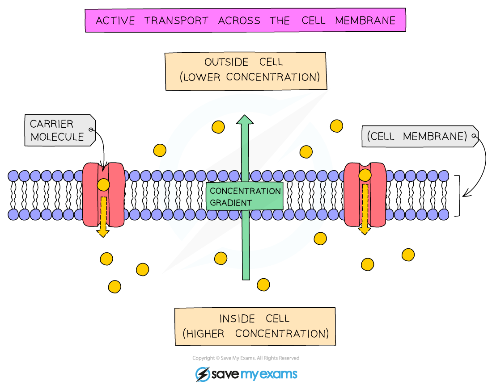

# Active Transport

## Active transport

> **Spec point** — `spcpt_5hV5kjJHpS3SK7Q2` · Describe active transport as the movement of particles through a cell membrane from a region of lower concentration to a region of higher concentration (i.e. against a concentration gradient), using energy from respiration

## Active transport

- Active transport is the movement of particles through a cell membrane from a region of **lower concentration** to a region of **higher concentration** using [energy from respiration](https://www.savemyexams.com/igcse/biology/cie/23/revision-notes/12-respiration/12-1-respiration/12-1-1-respiration-in-cells/?_ai=internal-linking)

*The process of active transport*
