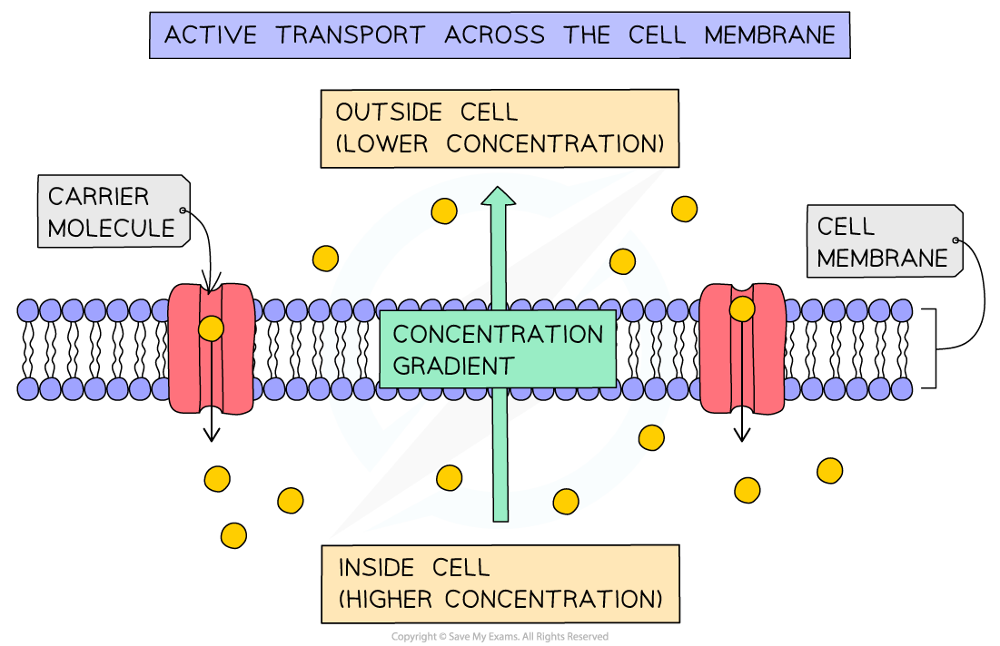

# Proteins & Active Transport

## Importance of active transport: Extended

> **Spec point** — `spcpt_Pw3NYqTnYDxkPQn9` · Explain the importance of active transport as a process for movement of molecules or ions across membranes, including ion uptake by root hairs

## Importance of active transport: Extended

- Energy is needed because particles are being moved **against a concentration gradient**, in the opposite direction from which they would naturally move ([by diffusion](https://www.savemyexams.com/igcse/biology/cie/23/revision-notes/3-movement-into-and-out-of-cells/3-1-diffusion-osmosis-and-active-transport/3-1-1-diffusion-in-biology/?_ai=internal-linking))
- Active transport is vital process for the movement of molecules or ions across membranes
- Including:

  - **uptake of glucose** by epithelial cells in the [villi of the small intestine](https://www.savemyexams.com/igcse/biology/cie/23/revision-notes/7-human-nutrition/7-1-human-diet-and-digestion/7-1-14-adaptations-of-the-small-intestine/?_ai=internal-linking) and by kidney tubules in the nephron
  - **uptake of ions** from soil water by root hair cells in plants

## Protein carriers: Extended

> **Spec point** — `spcpt_fNTrwszyVryZCrxD` · State that protein carriers move molecules or ions across a membrane during active transport

## Protein carriers: Extended

- Active transport works by using **carrier proteins** embedded in the cell membrane to pick up specific molecules and take them through the cell membrane against their concentration gradient:

1. Substance combines with carrier protein molecule in the cell membrane
2. Carrier transports substances across membrane using energy from respiration to give them the kinetic energy needed to change shape and move the substance through the cell membrane
3. Substance released into cell

*Carrier proteins in active transport*

> **Exam Hint**
> You don't need to know anything about the phospholipid bilayer when it comes to active transport!
