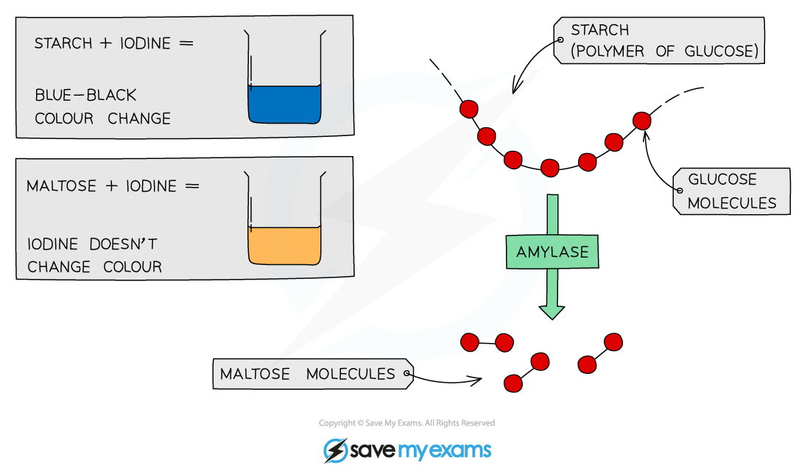
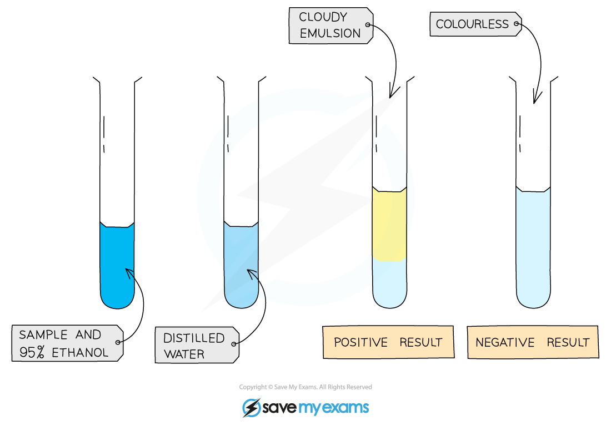
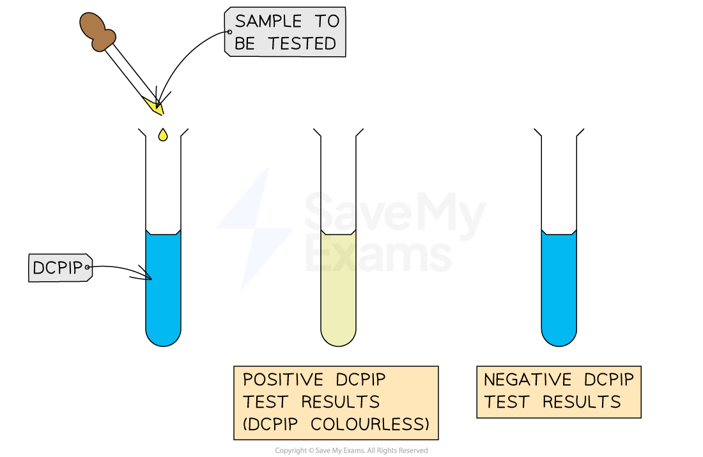

# Food Tests

## Food tests

> **Spec point** — `spcpt_zWw6jqdvgXTt2kdq` · Describe the use of:
(a) iodine solution test for starch
(b) Benedict’s solution test for reducing sugars
(c) biuret test for proteins
(d) ethanol emulsion test for fats and oils
(e) DCPIP test for vitamin C

## Food tests

### Food test for glucose (a reducing sugar)

- Add **Benedict's solution** into sample solution in test tube
- **Heat** at 80 °C in a water bath for **5 minutes**
- Take test tube out of water bath and observe the colour
- A positive test will show a colour change from **blue to orange or brick red**

*A positive test for glucose will show a colour change from blue to orange or brick red *

<u>[Use this image](https://www.savemyexams.com/info/policies/using-our-illustrations-images-fair-use/)</u>

### Food test for starch

- Iodine is used to test for the presence or absence of starch in a food sample

*We can use iodine to test for the presence or absence of starch in a food sample*

<u>[Use this image](https://www.savemyexams.com/info/policies/using-our-illustrations-images-fair-use/)</u>

- Add drops of **iodine solution** to the food sample
- A positive test will show a colour change from **orange-brown to blue-black**

*A positive test for starch will show a colour change from orange-brown to blue-black*

<u>[Use this image](https://www.savemyexams.com/info/policies/using-our-illustrations-images-fair-use/)</u>

### Food test for protein

- Add drops of **Biuret solution** to the food sample
- A positive test will show a colour change from **blue to violet / purple**

*A positive test for protein will show a colour change from blue to violet / purple*

[Use this image](https://www.savemyexams.com/info/policies/using-our-illustrations-images-fair-use/)

### Food test for lipids

- Food sample is mixed with **2 cm****3**** of ethanol** and shaken
- The ethanol is added to an equal volume of **cold water**
- A positive test will show a **cloudy emulsion** forming

*A positive test for lipids will show a cloudy emulsion forming*

[Use this image](https://www.savemyexams.com/info/policies/using-our-illustrations-images-fair-use/)

### Food test for vitamin C

- Add **1 cm****3**** of DCPIP solution** to a test tube
- Add a small amount of food sample (as a solution)
- A positive test will show the **blue colour of the dye disappearing**

*A positive test for vitamin C will show the blue colour of the dye disappearing*

<u>[Use this image](https://www.savemyexams.com/info/policies/using-our-illustrations-images-fair-use/)</u>

> **Exam Hint**
> When describing food tests in exam answers, make sure you give the **starting colour** of the solution and **the colour it changes to** for a positive result.
