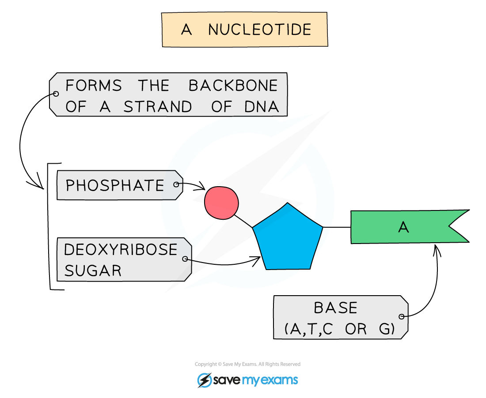

# DNA Structure

## Structure of a DNA molecule: Extended

> **Spec point** — `spcpt_t3B3xMSn7SSPcWfd` · Describe the structure of a DNA molecule:
(a) two strands coiled together to form a double
helix
(b) each strand contains chemicals called bases
(c) bonds between pairs of bases hold the strands together
(d) the bases always pair up in the same way: A with T, and C with G (full names are not required)

## Structure of a DNA molecule: Extended

### Extended Tier Only

- DNA, or deoxyribonucleic acid, is the molecule that contains the instructions for the growth and development of all organisms
- It consists of two strands of DNA wound around each other in what is called a **double helix**

*DNA, chromosomes and the nucleus*

- The individual units of DNA are called **nucleotides**

*A nucleotide*

- All nucleotides contain the same phosphate and deoxyribose sugar, but differ from each other in the **base** attached
- There are four different bases, **Adenine (A), Cytosine (C), Thymine (T) and Guanine (G)**
- The bases on each strand pair up with each other, holding the two strands of DNA in the double helix
- The bases always pair up in the same way:

  - Adenine always pairs with Thymine **(A-T)**
  - Cytosine always pairs with Guanine **(C-G)**

*DNA base pairs*

- The phosphate and sugar section of the nucleotides form the ‘backbone’ of the DNA strand (like the sides of a ladder) and the base pairs of each strand connect to form the rungs of the ladder

*The DNA helix is made from two strands of DNA held together by hydrogen bonds*

- It is this sequence of bases that holds the code for the formation of proteins

> **Exam Hint**
> You do not need to learn the names of the bases, **just their letter**. Make sure you **know which bonds with which**, as this is the most commonly asked question about this topic.
