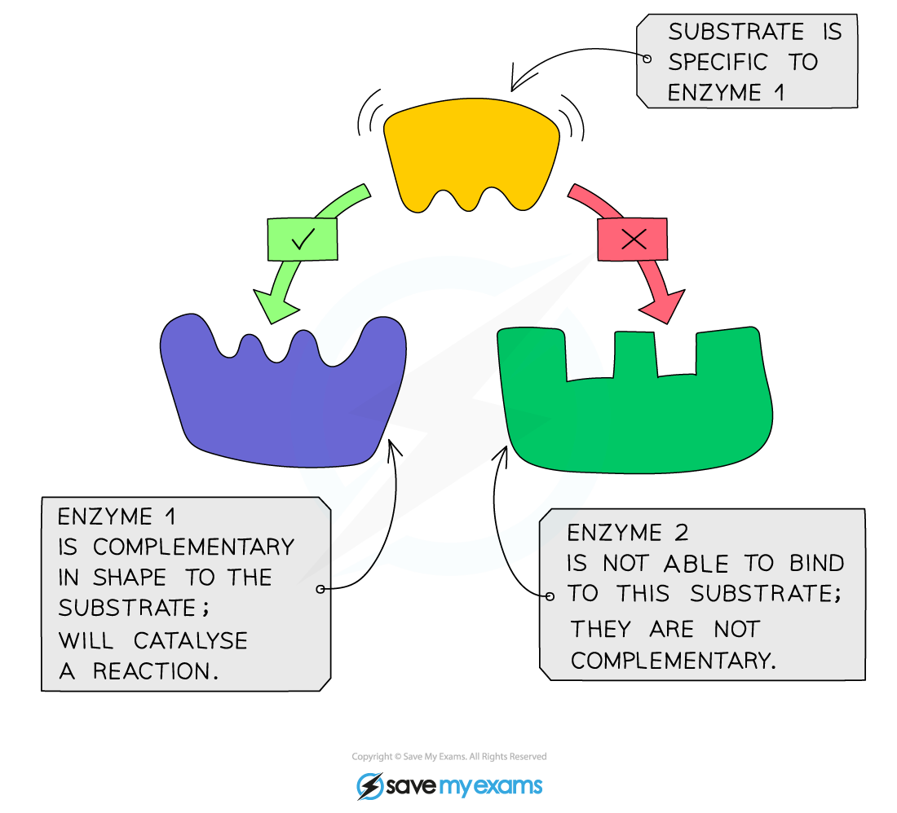

# Enzymes

## What are enzymes?

> **Spec point** — `spcpt_C2dQvBXgHvs5ckf4` · Describe a catalyst as a substance that increases the rate of a chemical reaction and is not changed by the reaction
Describe enzymes as proteins that are involved in all metabolic reactions, where they function as biological catalysts
Describe why enzymes are important in all living organisms in terms of a reaction rate necessary to sustain life

## What are enzymes?

- Enzymes are:

  - **catalysts** that **speed up** the rate of a chemical reaction **without being changed** or used up in the reaction
  - **proteins**
  - **biological catalysts** (biological because they are **made in living cells**, catalysts because they speed up the rate of chemical reactions without being changed)
  - necessary to all living organisms as they **maintain reaction speeds** of all metabolic reactions (all the reactions that keep an organism alive) at a rate that can **sustain life**
  
    - Without digestive enzymes, one meal would take around 2–3 weeks to digest; with enzymes it takes 3-4 hours

## How do enzymes work?

> **Spec point** — `spcpt_R8x9sGg5kRFnCtCM` · Describe enzyme action with reference to the shape of the active site of an enzyme being complementary to its substrate and the formation of products

## How do enzymes work?

*Enzyme substrate specificity*

- Enzymes are **specific** to one particular substrate (molecule/s that get broken down or joined together in the reaction) as the enzyme is a complementary shape to the substrate
- The product is made from the substrate(s) and is released

*Enzyme specificity: lock and key model of enzyme activity*
