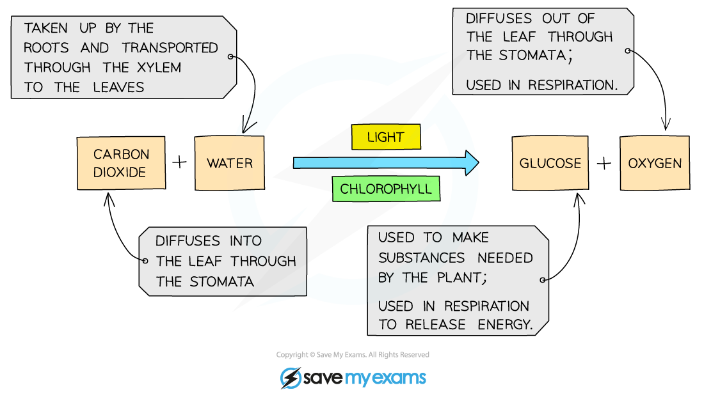

# Photosynthesis

## Photosynthesis

> **Spec point** — `spcpt_BX3yd2fGdZ5rnyXr` · Describe photosynthesis as the process by which plants synthesise carbohydrates from raw materials using energy from light

## Photosynthesis

- Green plants make the carbohydrate **glucose** from the raw materials **carbon dioxide** and **water**
- At the same time **oxygen** is made and released as a waste product
- The reaction requires **energy** which is obtained by the pigment **chlorophyll** trapping light from the Sun
- So photosynthesis can be defined as **the process by which plants manufacture carbohydrates from raw materials using energy from light**

> **Exam Hint**
> If asked for the raw materials required for photosynthesis, the answer is **carbon dioxide** **and water.**
> 
> Although required for the reaction to take place, light energy is not a substance and therefore cannot be a raw material.

## Photosynthesis word equation

> **Spec point** — `spcpt_5PsDhK6cgBrSCHFD` · State the word equation for photosynthesis as: carbon dioxide + water → glucose + oxygen in the presence of light and chlorophyll

## Photosynthesis word equation

- The photosynthesis word equation can be summarised as:

$carbondioxide+water\rightarrowglucose+oxygen_{}$

- The reaction between carbon dioxide and water to form glucose and oxygen occurs **in the presence of light and chlorophyll**

*The inputs, outputs, and requirements of photosynthesis.*
