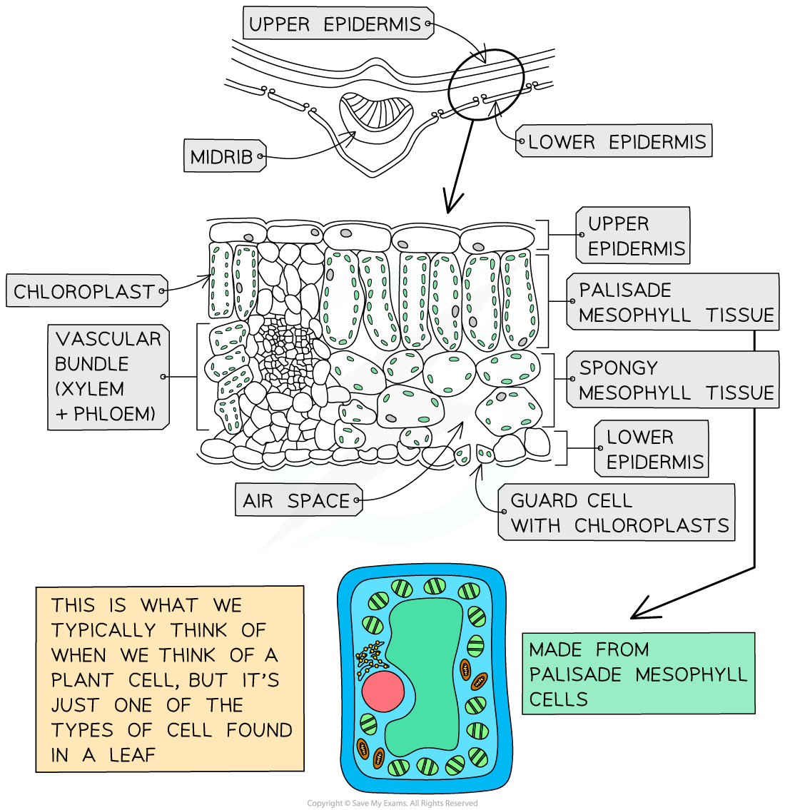

# Leaf Structure

## Leaf structure & adaptations for photosynthesis

> **Spec point** — `spcpt_QpJ9pvTTFqX996sr` · State that most leaves have a large surface area and are thin, and explain how these features are adaptations for photosynthesis

## Leaf structure & adaptations for photosynthesis

### Leaf structure

*Diagram showing the cross-section of a leaf*

*How photosynthesising cells obtain carbon dioxide*

- Pathway of carbon dioxide from the atmosphere to chloroplasts by diffusion:

atmosphere → air spaces around spongy mesophyll tissue → leaf mesophyll cells → chloroplast

#### Leaf structure table

| Structure | Description |
|---|---|
| Wax cuticle | Protective, waterproof layer on top of the leaf that reduces water loss by evaporation, helping maintain the water needed for photosynthesis |
| Upper epidermis | Thin and transparent, allowing light to pass through to the palisade mesophyll beneath |
| Palisade mesophyll | Column-shaped cells tightly packed with chloroplasts to absorb as much light as possible, maximising the rate of photosynthesis |
| Spongy mesophyll | Contains large air spaces between cells, increasing the surface area available for gas exchange, so carbon dioxide can diffuse quickly to the palisade cells and oxygen can diffuse out |
| Lower epidermis | Contains stomata and guard cells, which control gas exchange and water loss (see below) |
| Guard cell | Changes shape as it absorbs or loses water, causing the stomata to open or close. This controls the diffusion of carbon dioxide in and oxygen out, and helps regulate water loss |
| Stomata (singular: stoma) | - Small pores that allow gas exchange between the leaf and the atmosphere - Usually open during the day and closed at night, matching when photosynthesis occurs - Also the main site of water loss by transpiration - In most plants, found in higher numbers on the lower epidermis to reduce water loss (less exposure to direct sunlight/heat) |
| Vascular bundle | Contains xylem and phloem, which transport substances to and from the leaf |
| Xylem | Transports water (and dissolved mineral ions) up to the mesophyll cells for use in photosynthesis, and to replace water lost during transpiration |
| Phloem | Transports sucrose and amino acids around the plant (translocation), including away from the leaf to where they are needed or stored |

#### Adaptations of leaf structure for photosynthesis table

| Feature | Adaptation |
|---|---|
| Large surface area (leaf) | Increases surface area for the diffusion of carbon dioxide and absorption of light for photosynthesis |
| Thin | Allows carbon dioxide to diffuse to palisade mesophyll cells quickly |
| Chlorophyll | Absorbs light energy so that photosynthesis can take place |
| Network of veins | Allows the transports of water to the cells of the leaf for photosynthesis and carbohydrates (as a product of photosynthesis) away from the leaf |
| Stomata (singular: stoma) | Allows carbon dioxide to diffuse into the leaf and oxygen to diffuse out |
| Epidermis is thin and transparent | Allows as much light as possible to reach the palisade cells |
| Thin cuticle made of wax | To protect the leaf without blocking sunlight |
| Palisade cell layer (tissue) at the top of leaf | Maximises the absorption of light as it will hit chloroplasts in the cell directly |
| Spongy layer | Air spaces allow carbon dioxide to diffuse through the leaf, increasing the surface area |
| Vascular bundles | Thick cell walls of the tissue in the bundles help to support the stem and leaf |
