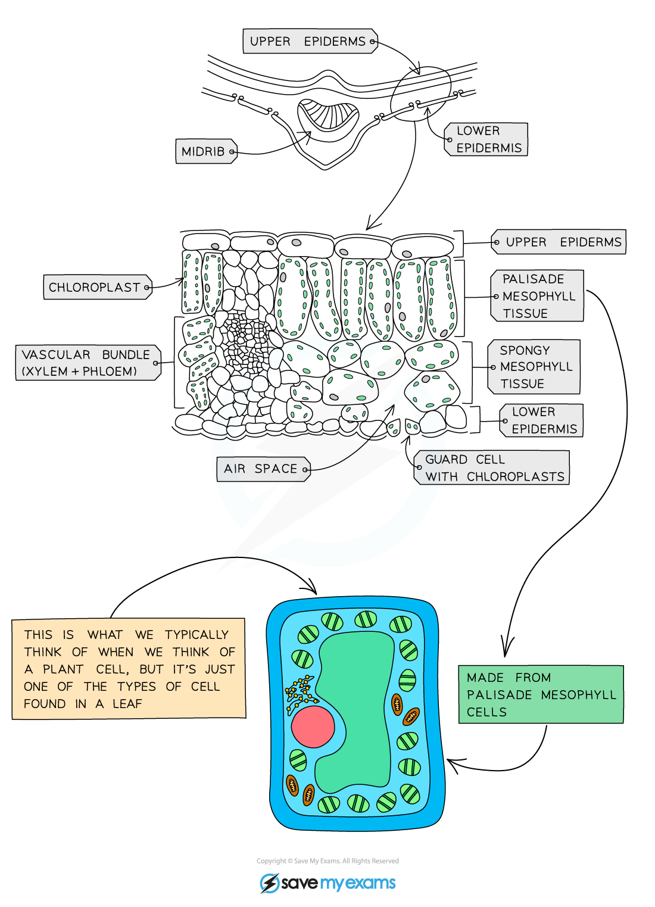
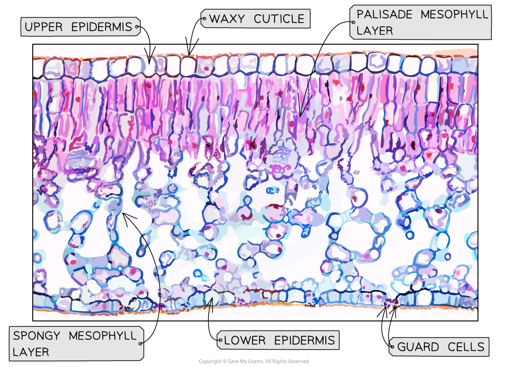

# Identifying Leaf Structures in a Dicotyledonous Plant

## Identifying leaf structures in a dicotyledonous plant

> **Spec point** — `spcpt_vBM84MMDRcwhh8MN` · Identify in diagrams and images the following structures in the leaf of a dicotyledonous plant: chloroplasts, cuticle, guard cells and stomata, upper and lower epidermis, palisade mesophyll, spongy mesophyll, air spaces, vascular bundles, xylem and phloem
Explain how the structures adapt leaves for photosynthesis

## Identifying leaf structures in a dicotyledonous plant

- The following structures should be identifiable in the leaf of a dicotyledonous plant:

  - Chloroplasts
  - Cuticle
  - Guard cells
  - Stomata
  - Upper and lower epidermis
  - Palisade mesophyll
  - Spongy mesophyll
  - Air spaces
  - [Vascular bundles (xylem and phloem)](https://www.savemyexams.com/igcse/biology/cie/23/revision-notes/8-transport-in-plants/8-1-transport-in-plants/8-1-1-xylem-and-phloem/?_ai=internal-linking)

*Diagram showing the cross-section of a leaf*

* An electron micrograph of a leaf*
