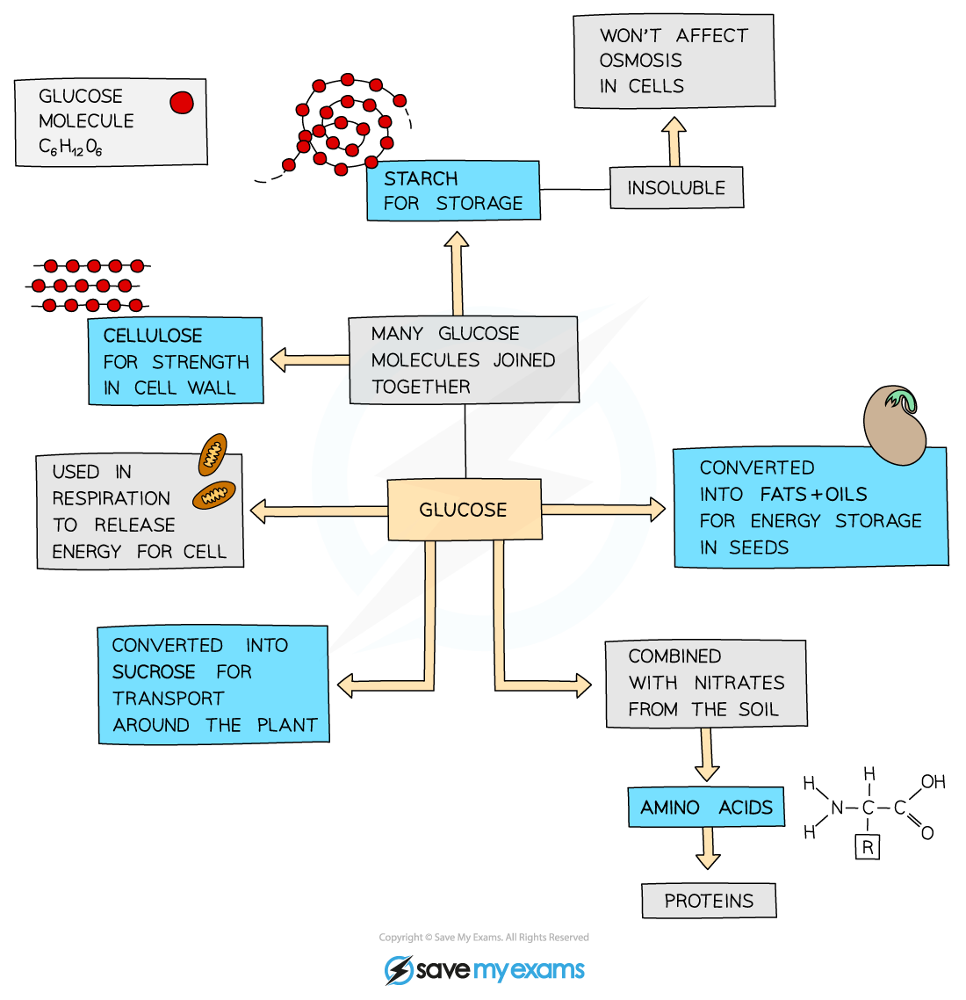

# Use & Storage of Carbohydrates

## Use & storage of carbohydrates

> **Spec point** — `spcpt_GNBx3NXrNW2bNwX8` · Outline the subsequent use and storage of the carbohydrates made in photosynthesis, limited to:
(a) starch as an energy store
(b) cellulose to build cell walls
(c) glucose used in respiration to provide energy
(d) sucrose for transport in the phloem
(e) nectar to attract insects for pollination

## Use & storage of carbohydrates

### How are the products of photosynthesis used?

- The carbohydrates produced by plants during photosynthesis can be:

  - converted into **starch** molecules which act as an effective **energy store**
  - converted into **cellulose** to build **cell walls**
  - glucose can be used in [respiration ](https://www.savemyexams.com/igcse/biology/cie/23/revision-notes/12-respiration/12-1-respiration/12-1-1-respiration-in-cells/?_ai=internal-linking)to provide energy
  - converted to sucrose for** **[transport in the phloem](https://www.savemyexams.com/igcse/biology/cie/23/revision-notes/8-transport-in-plants/8-1-transport-in-plants/8-1-8-translocation/?_ai=internal-linking)
  - as **nectar** to attract insects for pollination
- Plants can also convert the carbohydrates they make into **lipids** for an energy source in seeds and into **amino acids** (used to make proteins) when combined with [nitrogen and other mineral ions absorbed by roots](https://www.savemyexams.com/igcse/biology/cie/23/revision-notes/6-plant-nutrition/6-1-photosynthesis-and-leaf-structure/6-1-4-minerals-in-plants/?_ai=internal-linking)

*The uses of glucose produced by photosynthesis in plants*
