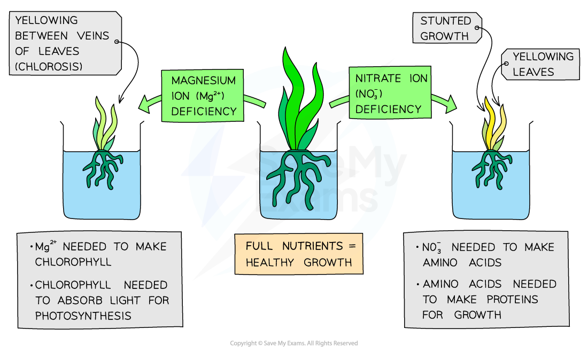

# Minerals in Plants

## Minerals in plants

> **Spec point** — `spcpt_R35kB4QywtG2qyYy` · Explain the importance of:
(a) nitrate ions for making amino acids
(b) magnesium ions for making chlorophyll

## Minerals in plants

- [Photosynthesis produces carbohydrates](https://www.savemyexams.com/igcse/biology/cie/23/revision-notes/6-plant-nutrition/6-1-photosynthesis-and-leaf-structure/6-1-3-use-and-storage-of-carbohydrates/?_ai=internal-linking), but plants contain many other types of biological molecule; such as proteins, lipids and nucleic acid (DNA)
- As plants do not eat, they need to **make these substances themselves**
- Carbohydrates contain the elements carbon, hydrogen and oxygen but proteins, for example, contain **nitrogen** as well (and certain amino acids contain other elements too)
- Other chemicals in plants contain different elements as well, for example chlorophyll contains **magnesium** and **nitrogen**
- This means that without a source of these elements, plants cannot photosynthesise or grow properly
- Plants obtain these elements in the form of **mineral ions actively absorbed from the soil by root hair cells**
- ‘Mineral’ is a term used to describe any naturally occurring inorganic substance

*Mineral deficiencies in plants*

### Mineral deficiencies table

| Mineral ion | Function | Deficiency |
|---|---|---|
| Magnesium | Magnesium is needed to make chlorophyll | Causes yellowing between the veins of leaves (**chlorosis**) |
| Nitrate | Nitrates are a source of nitrogen which is needed to make **amino acids** (which are used to build proteins) | Causes **stunted growth** and **yellowing of leaves** |
