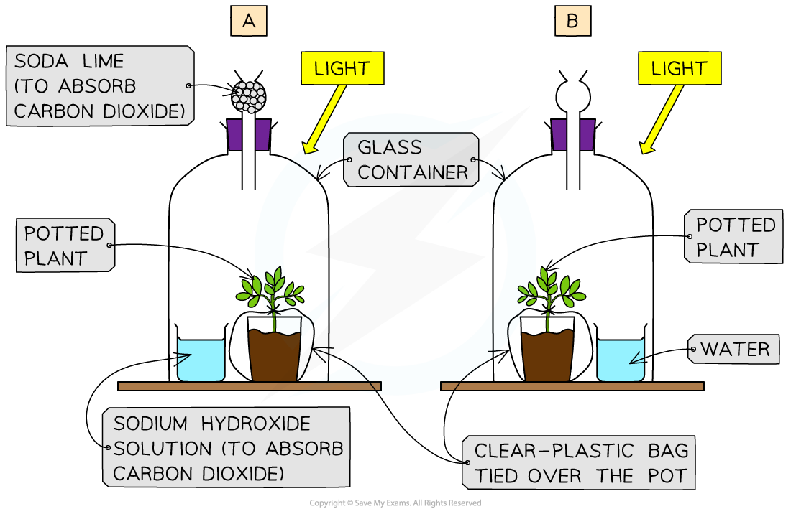

# Investigating the Need for Chlorophyll, Light & Carbon Dioxide

## Investigating the need for chlorophyll

> **Spec point** — `spcpt_Hq7NkC4XhTcFMwqb` · Investigate the need for chlorophyll, light and carbon dioxide for photosynthesis, using appropriate controls

## Investigating the need for chlorophyll

- Although plants make glucose in photosynthesis, **leaves cannot be tested for its presence** as the glucose is quickly used, converted into other substances and transported or stored as starch
- Starch is stored in chloroplasts where photosynthesis occurs so **testing a leaf for starch** is a reliable indicator of which parts of the leaf are photosynthesising
- Leaves can be tested for starch using the following procedure:

  - a leaf is dropped in **boiling water** to **kill the cells and break down the cell membranes**
  - the leaf is left for 5-10 minutes in hot **ethanol** in a boiling tube. This **removes the chlorophyll** so colour changes from iodine can be seen more clearly
  - the leaf is dipped in boiling water to soften it
  - the leaf is spread out on a white tile and covered with **iodine solution**
  - in a green leaf, the entire leaf will turn **blue-black** as photosynthesis is occurring in all areas of the leaf
  - this method can also be used to test whether chlorophyll is needed for photosynthesis by using a **variegated** leaf (one that is partially green and partially white)
  - the white areas of the leaf contain no chlorophyll and when the leaf is tested **only the areas that contain chlorophyll stain blue-black**
  - the areas that had no chlorophyll remain orange-brown as **no photosynthesis is occurring here and so no starch is stored**

*Method for testing a variegated leaf for starch*

- Care must be taken when carrying out this practical as **ethanol is extremely flammable**, so at that stage of the experiment the Bunsen burner should be turned off
- The safest way to heat the ethanol is in an electric water bath rather than using a beaker over a Bunsen burner with an open flame

## Investigating the need for light

> **Spec point** — `spcpt_BwK89dHxRfBFMjzg` · Investigate the need for chlorophyll, light and carbon dioxide for photosynthesis, using appropriate controls

## Investigating the need for light

- The same procedure as above can be used to investigate if light is needed for photosynthesis
- Before starting the experiment the plant needs to be **destarched** by placing in a dark cupboard for 24 hours
- This ensures that **any starch already present in the leaves will be used up** and will not affect the results of the experiment
- Following destarching, a leaf of the plant can be **partially covered with aluminium foil** and the plant placed in sunlight for a day
- The leaf can then be removed and tested for starch using iodine
- The area of the leaf that was covered with aluminium foil will **remain orange-brown** as it did not receive any sunlight and could not photosynthesise, while the area exposed to sunlight will turn **blue-black**
- This proves that light is necessary for photosynthesis and the production of starch

## Investigating the need for carbon dioxide

> **Spec point** — `spcpt_79pKS5qMBVm9kChz` · Investigate the need for chlorophyll, light and carbon dioxide for photosynthesis, using appropriate controls

## Investigating the need for carbon dioxide

- Destarch two plants by placing in the dark for a prolonged period of time
- Place one plant in a bell jar which contains a beaker of **sodium hydroxide** (which will **absorb carbon dioxide** from the surrounding air)
- Place the other plant in a bell jar which contains a beaker of water (control experiment), which will **not absorb carbon dioxide** from the surrounding air
- Place both plants in bright light for several hours
- Test both plants for starch using iodine
- The leaf from the plant placed near sodium hydroxide will **remain orange-brown** as it could not photosynthesise due to lack of carbon dioxide
- The leaf from the plant placed near water should turn blue-black as it had all necessary requirements for photosynthesis

*An example setup for an experiment to test whether carbon dioxide is necessary for photosynthesis in plants.*
