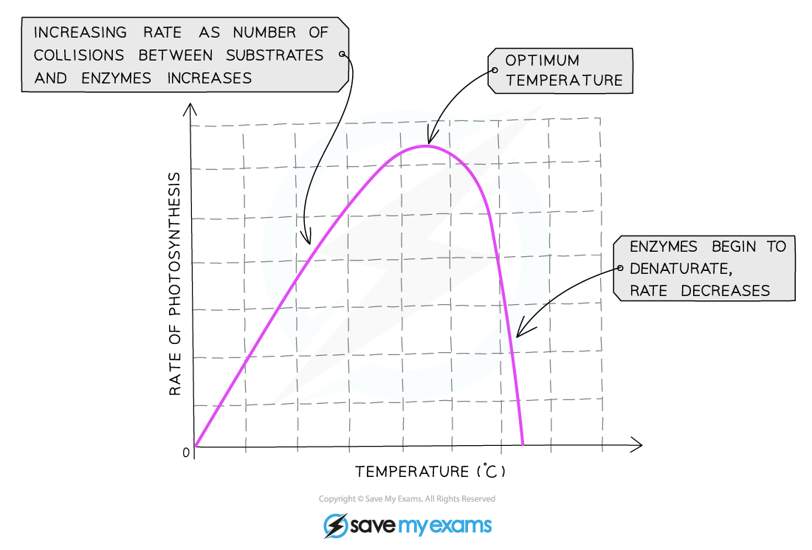
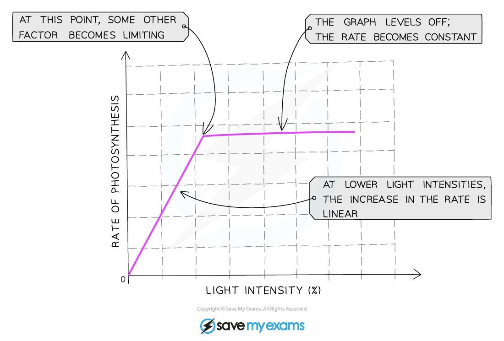
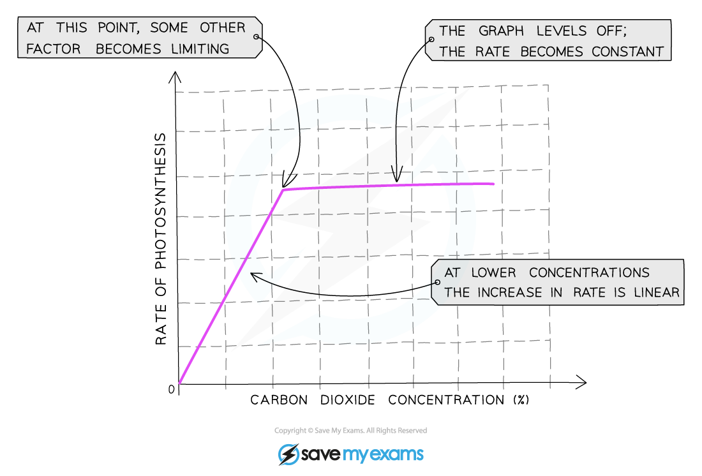

# Limiting Factors

## Limiting factors: Extended

> **Spec point** — `spcpt_nYfWmvbhbsQwyQVT` · Identify and explain the limiting factors of photosynthesis in different environmental conditions

## Limiting factors: Extended

### Extended Tier Only

- If a plant is given unlimited sunlight, carbon dioxide and water and is at a warm temperature, the limit on the rate (speed) at which it can photosynthesise is its own ability to absorb these materials and make them react
- However, most often plants do not have unlimited supplies of their raw materials so their rate of photosynthesis is **limited** by **whatever factor is the lowest at that time**
- **So a limiting factor can be defined as something present in the environment in such short supply that it restricts life processes**
- There are **three** main factors which limit the rate of photosynthesis:

  - **Temperature**
  - **Light intensity**
  - **Carbon dioxide concentration**

- Although water is necessary for photosynthesis, it is **not considered a limiting factor** as the amount needed is relatively small compared to the amount of water transpired from a plant so there is hardly ever a situation where there is not enough water for photosynthesis

#### Temperature

- As temperature increases the rate of photosynthesis increases as the reaction is **controlled by enzymes**
- However, as the reaction is controlled by enzymes, this trend only continues up to a certain temperature beyond which the enzymes begin to **denature** and the rate of reaction **decreases**

*Graph showing the effect of temperature on the rate of photosynthesis*

#### Light intensity

- The **more light** a plant receives, the **faster the rate** of photosynthesis
- This trend will continue until some other factor required for photosynthesis prevents the rate from increasing further because it is now in short supply

*Graph showing the effect of light intensity on the rate of photosynthesis*

- At low light intensities, increasing the intensity will initially increase the rate of photosynthesis. At a certain point, increasing the light intensity stops increasing the rate. The rate becomes constant regardless of how much light intensity increases as something else is limiting the rate
- The factors which could be limiting the rate when the line on the graph is horizontal include **temperature not being high enough** or **not enough carbon dioxide**

#### Carbon dioxide concentration

- Carbon dioxide is one of the raw materials required for photosynthesis
- This means the **more carbon dioxide** that is present, the **faster the reaction** can occur
- This trend will continue until some other factor required for photosynthesis prevents the rate from increasing further because it is now in short supply

*Graph showing the effect of carbon dioxide concentration on the rate of photosynthesis*

- The factors which could be limiting the rate when the line on the graph is horizontal include **temperature not being high enough** or **not enough light**

> **Exam Hint**
> Interpreting limiting factors graphs where light intensity or carbon dioxide are on the x axis can be confusing for many students, you should tackle the graph in sections. In the first section of the graph where the rate is increasing (the line is going up), the limiting factor is whatever the label on the x axis (the bottom axis) of the graph is. In the next section of the graph where the rate is not increasing (the line is horizontal ), the limiting factor will be something other than what is on the x axis – choose from temperature, light intensity or carbon dioxide concentration.
