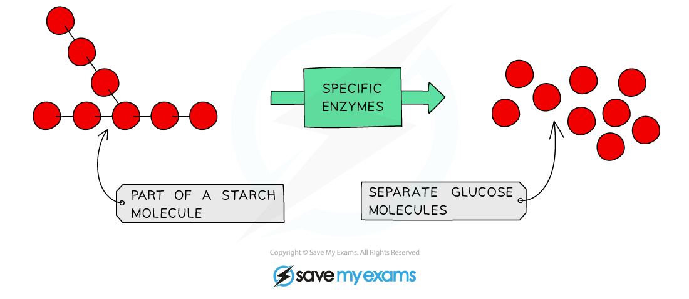

# Digestion of Starch

## Digestion of starch: Extended

> **Spec point** — `spcpt_YV6VK3BryrsFrXsG` · Describe the digestion of starch in the digestive system:
(a) amylase breaks down starch to maltose
(b) maltase breaks down maltose to glucose on
the membranes of the epithelium lining the small intestine

## Digestion of starch: Extended

### Extended Tier Only

- **Amylases** are produced in the **mouth** and the **pancreas** (secreted into the **duodenum**)
- Amylases digest **starch into smaller sugars**

*The digestion of starch*

- **Amylase** is secreted into the alimentary canal in the **mouth** and the **duodenum** (from the pancreas) and digests **starch to maltose** (a disaccharide)
- **Maltose** is digested by the enzyme **maltase** into **glucose** on the membranes of the [epithelium lining of the small intestine](https://www.savemyexams.com/igcse/biology/cie/23/revision-notes/7-human-nutrition/7-1-human-diet-and-digestion/7-1-14-adaptations-of-the-small-intestine/?_ai=internal-linking)
