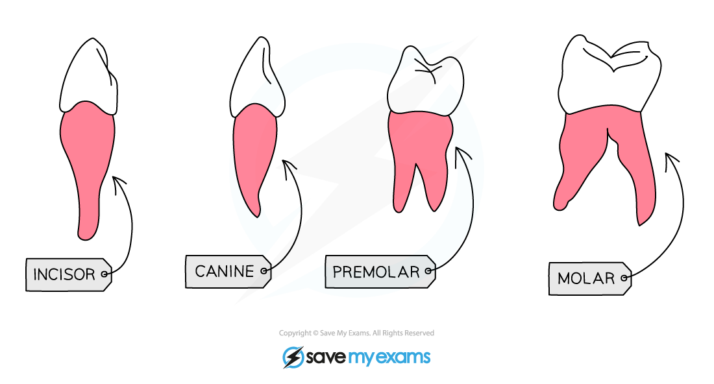
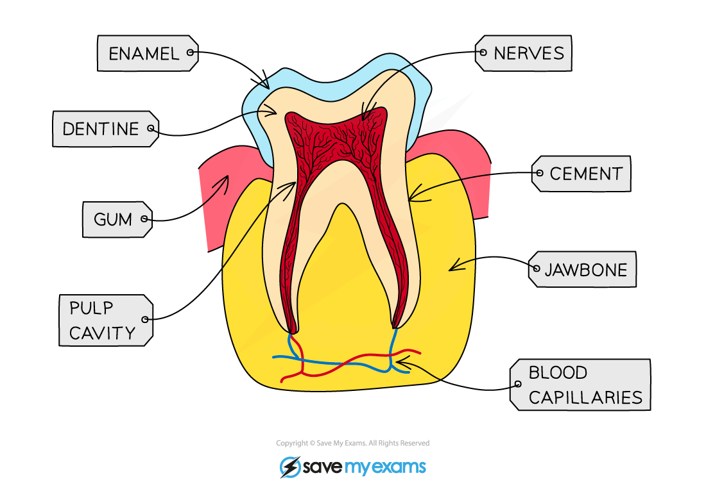

# Teeth & Digestion

## Types of Human Teeth

> **Spec point** — `spcpt_rYJcG2WKcNnQQQXX` · Identify in diagrams and images the types of human teeth: incisors, canines, premolars and molars Describe the functions of the types of human teeth in physical digestion of food

## Types of human teeth

- Mechanical digestion is the **breakdown of food into smaller pieces** without chemical change to the food molecules
- It is carried out by the:

  - **chewing** action of **teeth**
  - **churning** action of the **stomach**
  - **emulsification of fats** by **bile** in the duodenum
- Teeth are located in the bone of the jaws
- They are used for chewing **to increase the surface area of the food**

  - This increases the food's exposure to **saliva** and [digestive enzymes](https://www.savemyexams.com/igcse/biology/cie/23/revision-notes/7-human-nutrition/7-1-human-diet-and-digestion/7-1-7-chemical-digestion/?_ai=internal-linking) so that it can be **broken down** more quickly
- Different teeth have different shapes, enabling them to perform slightly different functions:

  - **incisors** are chisel-shaped for biting and cutting
  - **canines** are pointed for tearing, holding and biting
  - **premolars and molars** are large, flat surfaces with ridges for chewing and grinding up food

*Teeth are shaped to carry out different roles in mechanical digestion of food*

## Structure of a Tooth

> **Spec point** — `spcpt_5gXKZW52SxXqZmcx` · Describe the structure of human teeth, limited to: enamel, dentine, pulp, nerves, blood vessels and cement, and understand that teeth are embedded in bone and the gums

## Structure of a tooth

- Teeth are embedded in the gums and within the bone of the jaw
- The structure of human teeth includes:

  - **enamel**: the hard, outer layer that protects the teeth
  - **dentine**: the layer beneath the enamel that protects the nerves
  - **pulp**: the soft, internal tissue of the tooth that contains **nerves** and **blood vessels**
  - **cement**: a hard layer around the root of a tooth that helps to anchor it within the jaw

*Teeth are embedded in the gums and within the bone of the jaw*
