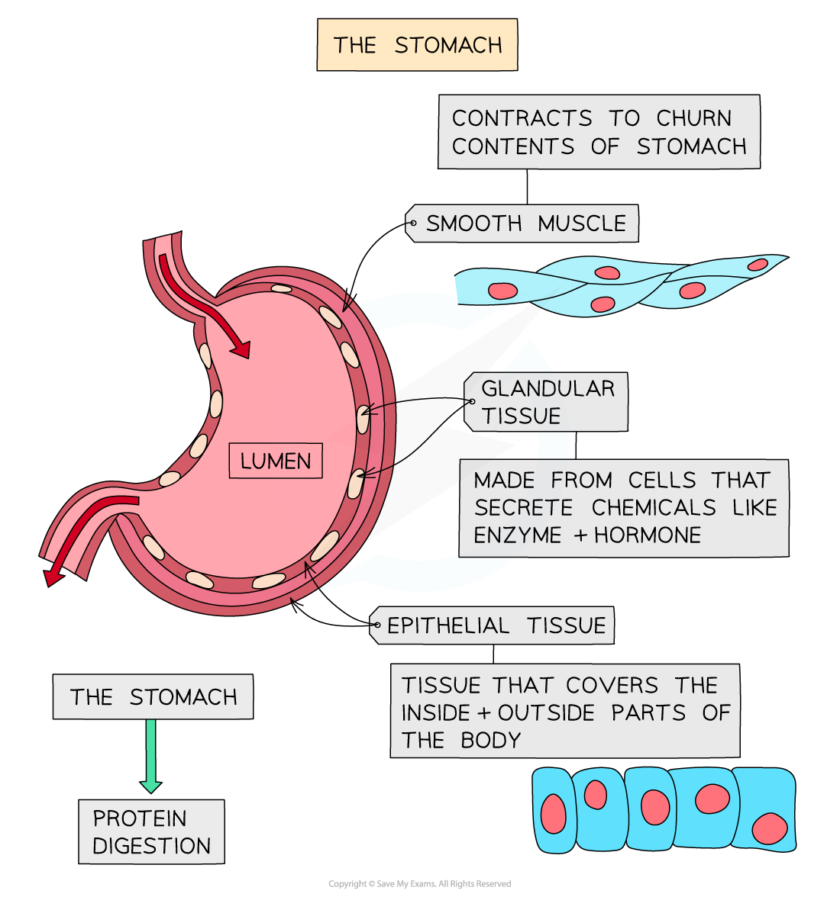

# The Stomach

## The stomach

> **Spec point** — `spcpt_JMhtwpHsd9cP4wdS` · Describe the function of the stomach in physical digestion

## The stomach

- The stomach is one of a number of organs that make up the digestive system
- The role of the digestive system is to break down large insoluble molecules into smaller, soluble food molecules to provide the body with nutrients
- The stomach lining contains **muscles** which contract to **physically squeeze** and mix the food with the strong digestive juices that are present

  - This is known as "stomach **churning**"
- Food is digested within the stomach for several hours

*Three types of tissue found in the stomach are muscular, epithelial and glandular tissue*
