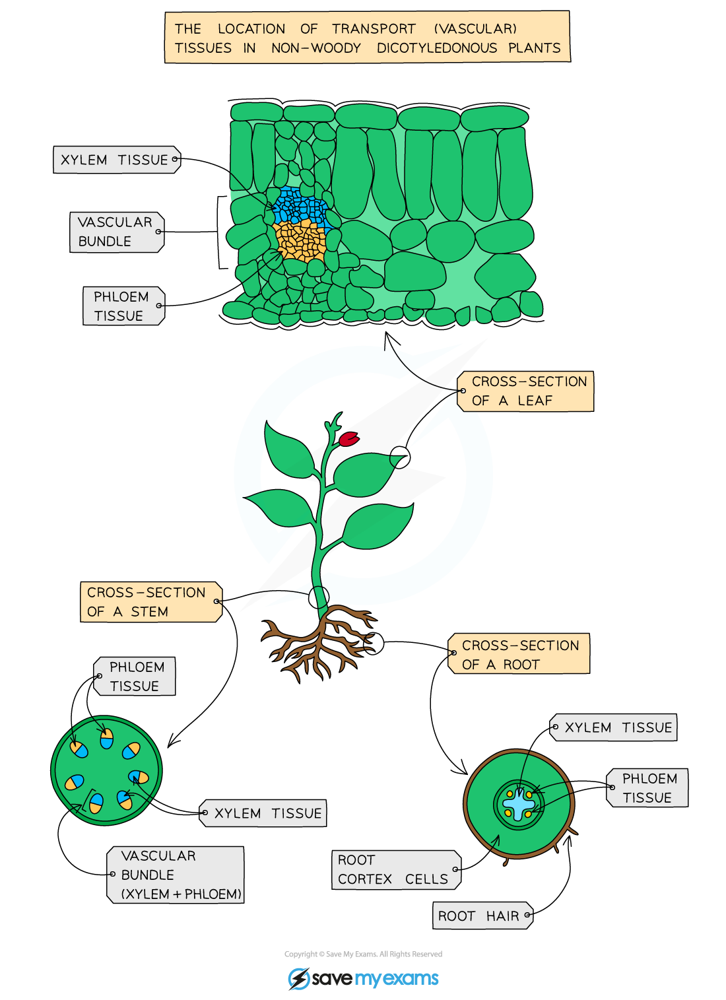
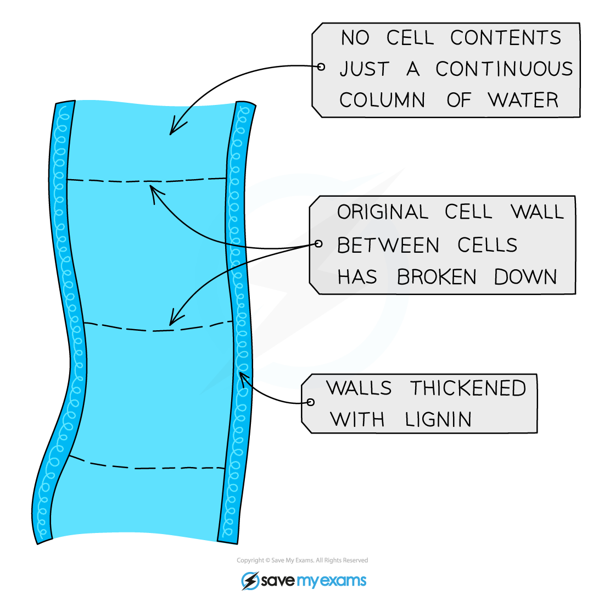

# Xylem & Phloem

## The Xylem & Phloem

> **Spec point** — `spcpt_bH8PcsMVGRmpSKPw` · State the functions of xylem and phloem:
(a) xylem – transport of water and mineral ions, and support
(b) phloem – transport of sucrose and amino acids
Identify in diagrams and images the position of xylem and phloem as seen in sections of roots, stems and leaves of non-woody dicotyledonous plants

## The xylem & phloem

### What is the function of the xylem and phloem

- Plants contain two types of transport vessel:

  - **Xylem vessels** (pronounced: zi-lem) [transport water and minerals](https://www.savemyexams.com/igcse/biology/cie/23/revision-notes/8-transport-in-plants/8-1-transport-in-plants/8-1-3-pathway-taken-by-water/?_ai=internal-linking) roots to the stem and leaves
  - **Phloem vessels** (pronounced: flow-em) [transport food materials (mainly sucrose and amino acids)](https://www.savemyexams.com/igcse/biology/cie/23/revision-notes/8-transport-in-plants/8-1-transport-in-plants/8-1-8-translocation/?_ai=internal-linking) made by the plant from photosynthesising leaves to non-photosynthesising regions in the roots and stem

- These vessels are arranged throughout the root, stem and leaves in groups called **vascular bundles**

*Transport tissue in a dicotyledonous plant*

> **Exam Hint**
> If you are asked to identify the xylem or phloem in a diagram showing a cross-section of a root, stem or leaf just remember that **xylem is always on the inside and phloem is always on the outside.**

## Adaptations of Xylem Vessels: Extended

> **Spec point** — `spcpt_xMzRHjyKZYKgGt7j` · Relate the structure of xylem vessels to their function, limited to:
(a) thick walls with lignin (details of lignification are not required)
(b) no cell contents
(c) cells joined end to end with no cross walls to form a long continuous tube

## Adaptations of xylem vessels: Extended

- Function: transport tissue for water and dissolved mineral ions
- Adaptations:

  - Cells joined end to end with **no cross walls** to form a long continuous tube
  - Cells are essentially **dead,** without cell contents, to allow **free passage of water**
  - Outer walls are **thickened** with a substance called **lignin**, strengthening the tubes, which helps **support** the plant

*Xylem cells lose their top and bottom walls to form a continuous tube through which water moves through from the roots to the leaves*
