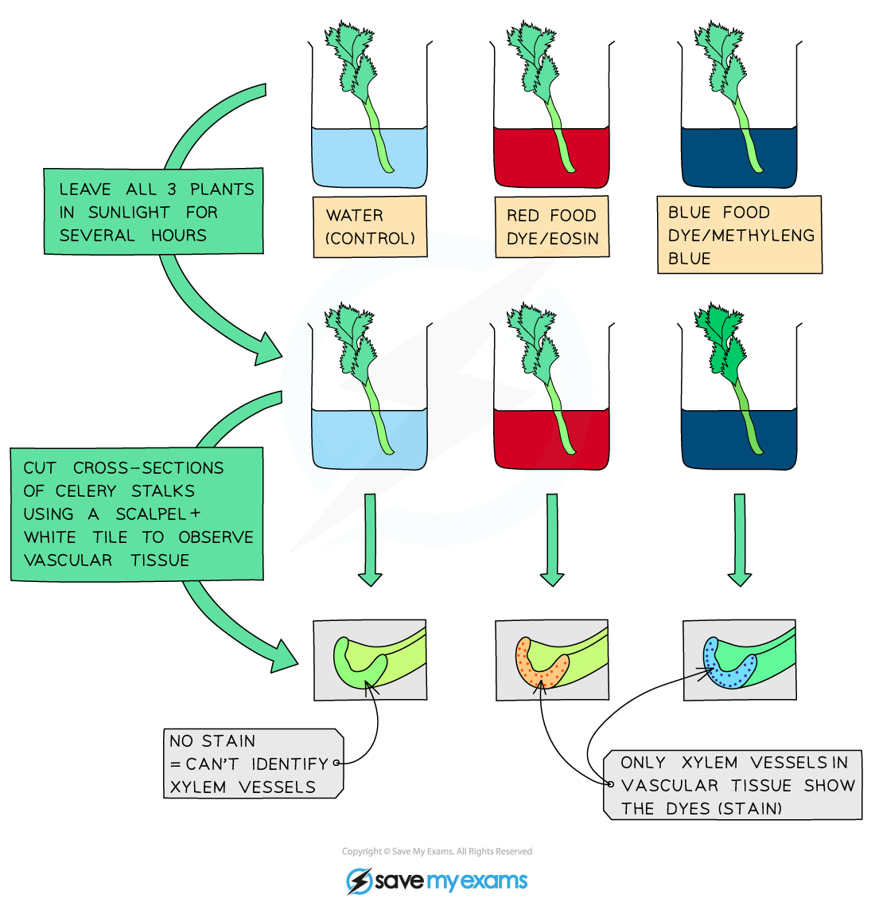

# Pathway Taken by Water

## Pathway Taken by Water

> **Spec point** — `spcpt_v7XgMvCgz4NwX2Tp` · Outline the pathway taken by water through the root, stem and leaf as: root hair cells, root cortex cells, xylem, mesophyll cells

## Pathway taken by water

- Water is taken up from the soil into root hair cells
- Water then moves across the root *cortex* and into the [xylem](https://www.savemyexams.com/igcse/biology/cie/23/revision-notes/8-transport-in-plants/8-1-transport-in-plants/8-1-1-xylem-and-phloem/?_ai=internal-linking) vessels by [osmosis](https://www.savemyexams.com/igcse/biology/cie/23/revision-notes/3-movement-into-and-out-of-cells/3-1-diffusion-osmosis-and-active-transport/3-1-4-osmosis/)

*Pathway of water into and across a root*

- Water is then transported in the **xylem** to the leaves where it enters the leaf **mesophyll cells**
- So the pathway is:

**root hair cell → root cortex cells → xylem → leaf mesophyll cells**

## Investigating Water Movement in Plants

> **Spec point** — `spcpt_hSJhh8dvRpmpDjNF` · Investigate, using a suitable stain, the pathway of water through the above-ground parts of a plant

## Investigating water movement in plants

- The pathway taken by water through a plant can be studied using a **suitable stain**, or dye, as follows:

  - place a plant stem, e.g. celery, into a beaker of water that has had a stain added to it
  - leave for a few hours, or until the leaves of the celery turn the same colour as the dyed water (indicating that the dye has travelled all the way up the xylem)
  - cut a cross-section of the stem and view the position of the coloured dye, which will correspond with the location of the xylem vessels

*It is possible to study the pathway taken by water in a plant stem using a suitable stain*
