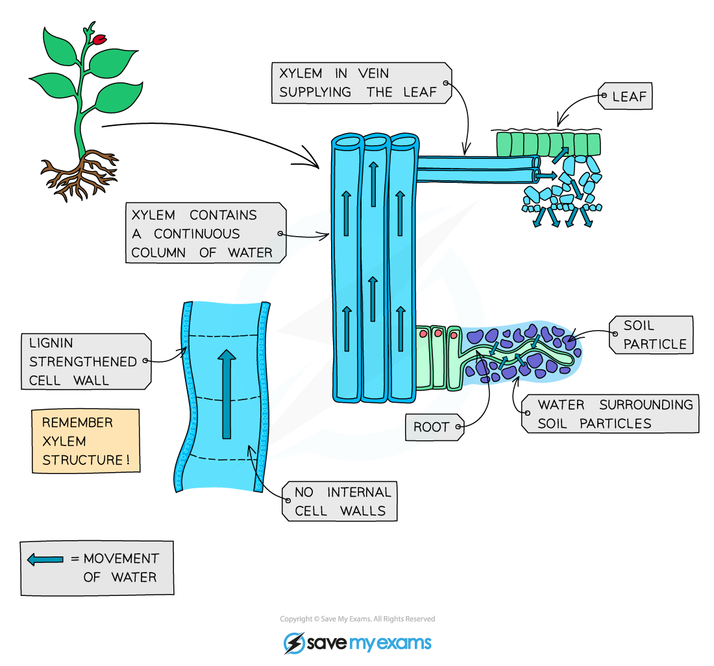

# Transpiration

## Transpiration

> **Spec point** — `spcpt_wnsYq9ZtzYsVC62X` · Describe transpiration as the loss of water vapour from leaves
State that water evaporates from the surfaces of the mesophyll cells into the air spaces and then diffuses out of the leaves through the stomata as water vapour

## Transpiration

- **Water** travels up **xylem** from the roots into the leaves of the plant to replace the water that has been lost due to **transpiration**
- Transpiration is defined as the **loss of water vapour from plant leaves by evaporation of water at the surfaces of the mesophyll cells followed by diffusion of water vapour through the stomata**
- Xylem is adapted in many ways:

  - A substance called **lignin** is deposited in the cell walls which causes the xylem cells to die
  - These cells then become **hollow** (as they lose all their organelles and cytoplasm) and join end-to-end to form a **continuous tube** for water and mineral ions to travel through from the roots
  - Lignin makes the walls of the **xylem vessels strong and rigid**, which provides **structural support** to the plant and prevents the vessel from collapsing under the pressure created by water movement
- Movement in xylem **only takes place in one direction** - from **roots to leaves** (unlike phloem where movement takes place in different directions)

*Water uptake, transport and transpiration*

*Transpiration in plants*

- **Transpiration has several functions in plants:**

  - transporting **mineral ions**
  - providing **water to keep** [cells turgid](https://www.savemyexams.com/igcse/biology/cie/23/revision-notes/3-movement-into-and-out-of-cells/3-1-diffusion-osmosis-and-active-transport/3-1-6-osmosis-in-animals-and-plants/?_ai=internal-linking) in order to support the structure of the plant
  - providing **water** to leaf cells for **photosynthesis**
  - keeping the **leaves cool** (the conversion of water (liquid) into water vapour (gas) as it leaves the cells and enters the airspace requires heat energy. The using up of heat to convert water into water vapour helps to cool the plant down)
