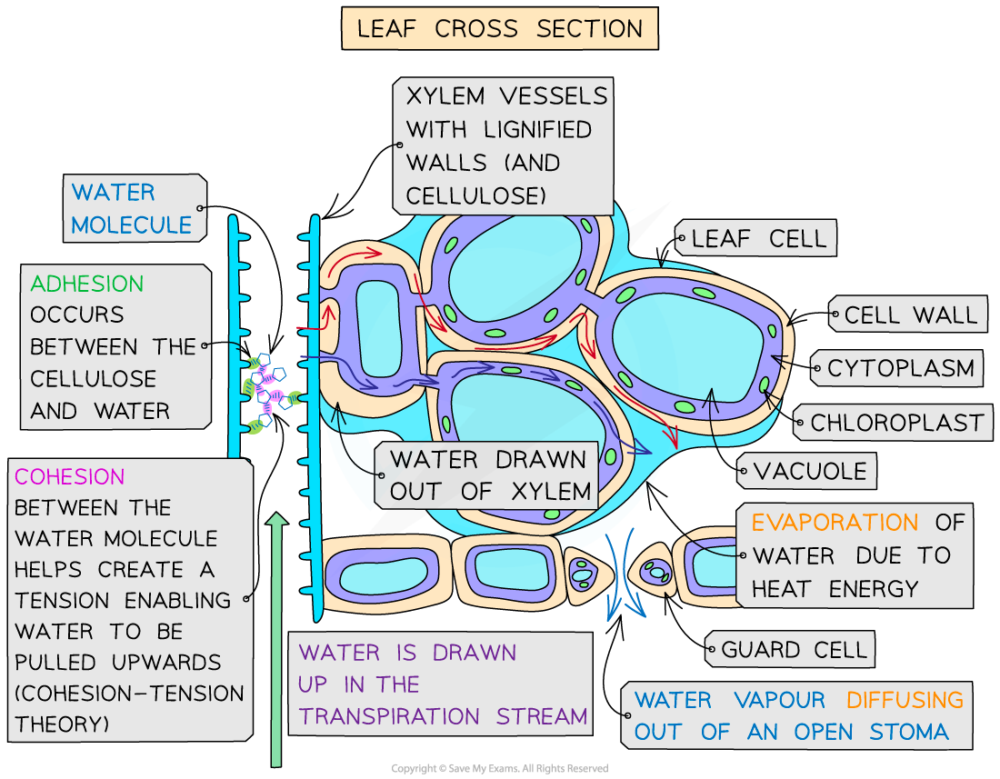

# Transpiration Stream

## Water vapour loss: Extended

> **Spec point** — `spcpt_mR2cSq4d5fPwQNRT` · Explain how water vapour loss is related to:
the large internal surface area provided by the interconnecting air spaces between mesophyll cells and the size and number of stomata

## Water vapour loss: Extended

### Extended Tier Only

- **Evaporation** takes place from the surfaces of spongy mesophyll cells
- The **many interconnecting air spaces** between these cells and the stomata create a **large surface area**
- This means evaporation can happen rapidly **when stomata are open**

## Transpiration stream: Extended

> **Spec point** — `spcpt_Rp6X4q34Qb99Qrhd` · Explain the mechanism by which water moves upwards in the xylem in terms of a transpiration pull that draws up a column of water molecules, held together by forces of attraction between water molecules

## Transpiration stream: Extended

### Extended Tier Only

- Water molecules are attracted to each other (**cohesion**), forming a continuous column of water up the plant
- Water moves through the [xylem vessels](https://www.savemyexams.com/igcse/biology/cie/23/revision-notes/8-transport-in-plants/8-1-transport-in-plants/8-1-1-xylem-and-phloem/?_ai=internal-linking) in a continuous **transpiration stream** from [roots to leaves](https://www.savemyexams.com/igcse/biology/cie/23/revision-notes/8-transport-in-plants/8-1-transport-in-plants/8-1-3-pathway-taken-by-water/?_ai=internal-linking) via the stem
- Transpiration produces a **tension** or ‘pull’ on the water in the xylem vessels by the leaves
- As water molecules are held together by **cohesive forces** (each individual molecule ‘pulls’ on the one below it), so water is pulled up through the plant
- If the [rate of transpiration](https://www.savemyexams.com/igcse/biology/cie/23/revision-notes/8-transport-in-plants/8-1-transport-in-plants/8-1-7-explaining-the-effects-of-temperature-wind-speed-and-humidity/?_ai=internal-linking) from the leaves **increases**, water molecules are pulled up the xylem vessels **quicker**

*The generation of the transpiration stream*
