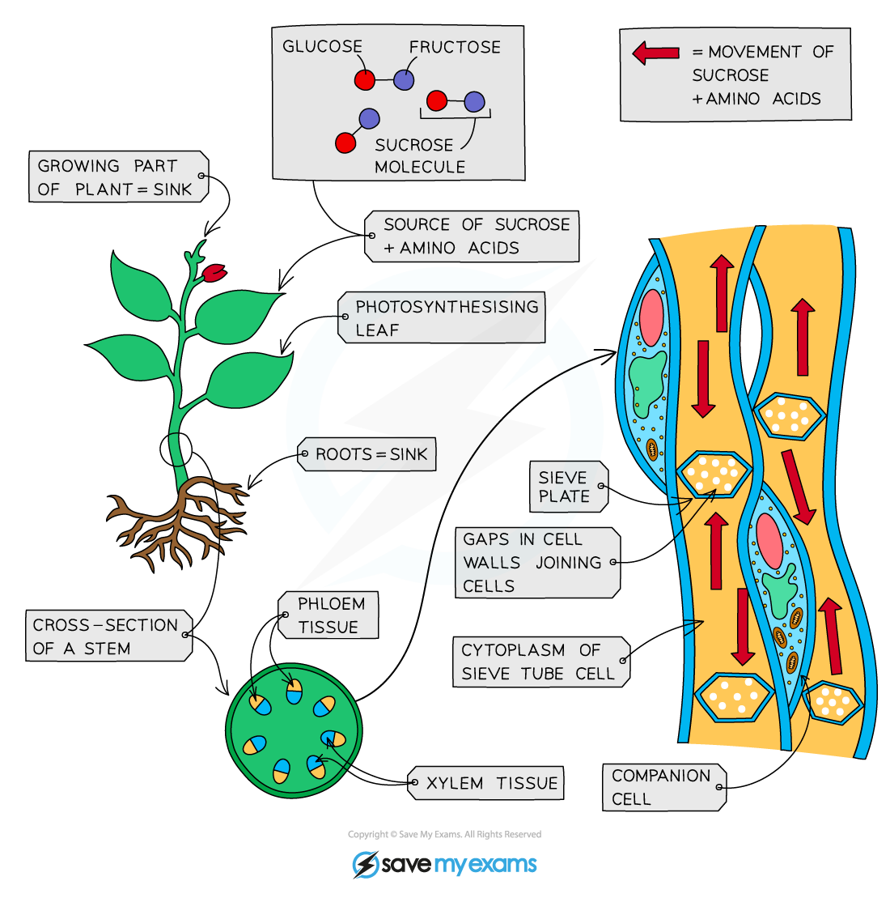

# Translocation

## Translocation: Extended

> **Spec point** — `spcpt_89yR3KvRWvS93cMn` · Describe translocation as the movement of sucrose and amino acids in phloem from sources to sinks
Describe:
(a) sources as the parts of plants that release sucrose or amino acids
(b) sinks as the parts of plants that use or store sucrose or amino acids
Explain why some parts of a plant may act as a source and a sink at different times

## Translocation: Extended

- The main substances transported in the phloem are **sugars** (mainly **sucrose**, made from the **glucose** produced in photosynthesis) and **amino acids** (made using glucose and nitrates absorbed from the soil)
- These are transported around the plant in the **phloem tubes** which are made of living cells (as opposed to [xylem vessels which are made of dead cells](https://www.savemyexams.com/igcse/biology/cie/23/revision-notes/8-transport-in-plants/8-1-transport-in-plants/8-1-1-xylem-and-phloem/?_ai=internal-linking))
- The cells are joined end to end and contain holes in the end cell walls (called **sieve plates**) which allow **easy flow of substances** from one cell to the next
- The transport of sucrose and amino acids in the phloem, from regions of production to regions of storage or use, is called **translocation**
- The direction of transport in the phloem depends on the stage of development of the plant or the time of year; however dissolved substances are always transported from a **source** (where they are made or released) to a **sink** (where they're stored or used)

  - During **winter**, when many plants have no leaves, the phloem tubes may transport dissolved sucrose from the storage organs to other parts of the plant so that respiration can continue, and amino acids for the maintenance and repair of cells
  - During a **growth period** (e.g. during the spring), the storage organs (roots) would be the source and the many growing areas of the plant would be the sinks
  - **After the plant has grown** (usually during the summer), the leaves are photosynthesising and producing large quantities of sugars; so they become the source and the roots become the sinks, where the sucrose is converted back into [glucose and stored as starch](https://www.savemyexams.com/igcse/biology/cie/23/revision-notes/6-plant-nutrition/6-1-photosynthesis-and-leaf-structure/6-1-3-use-and-storage-of-carbohydrates/?_ai=internal-linking) until it is needed again

*Translocation through the phloem*

### Comparison between xylem and phloem tissue table

| Tissue | What is moved | Process | Direction of flow | Cells |
|---|---|---|---|---|
| Xylem | Water and mineral ions | Transpiration stream | One way from roots to leaves | Dead |
| Phloem | Sucrose and amino acids | Translocation | In all directions | Living |
