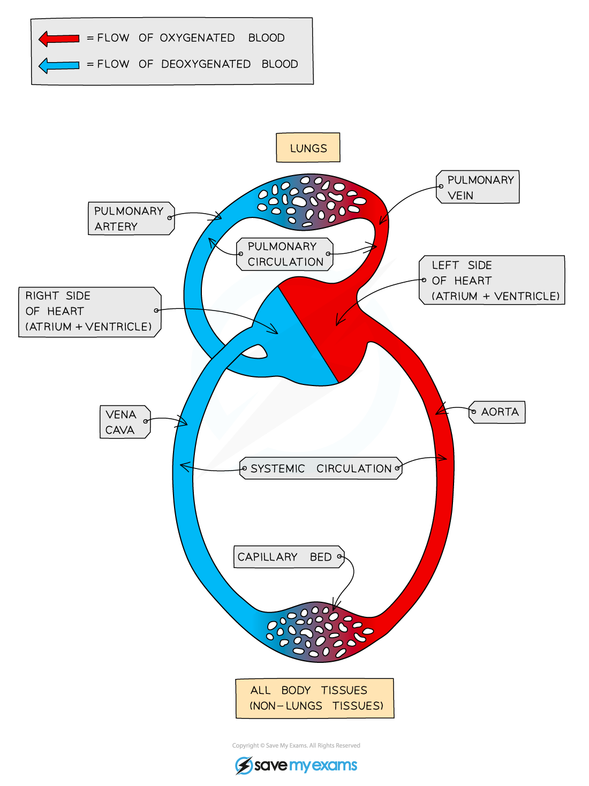

# Circulatory System

## Circulatory system

> **Spec point** — `spcpt_Yw8S6VKGKPWjGbd2` · Describe the circulatory system as a system of blood vessels with a pump and valves to ensure one-way flow of blood

## Circulatory system

- The circulatory system is an **organ system**, the role of which is to **transport blood** around the body
- Components of the circulatory system include:

  - **blood vessels**
  - **a pump**
  - **valves** to ensure **one-way flow** of blood

*The circulatory system consists of blood vessels and a pump*
