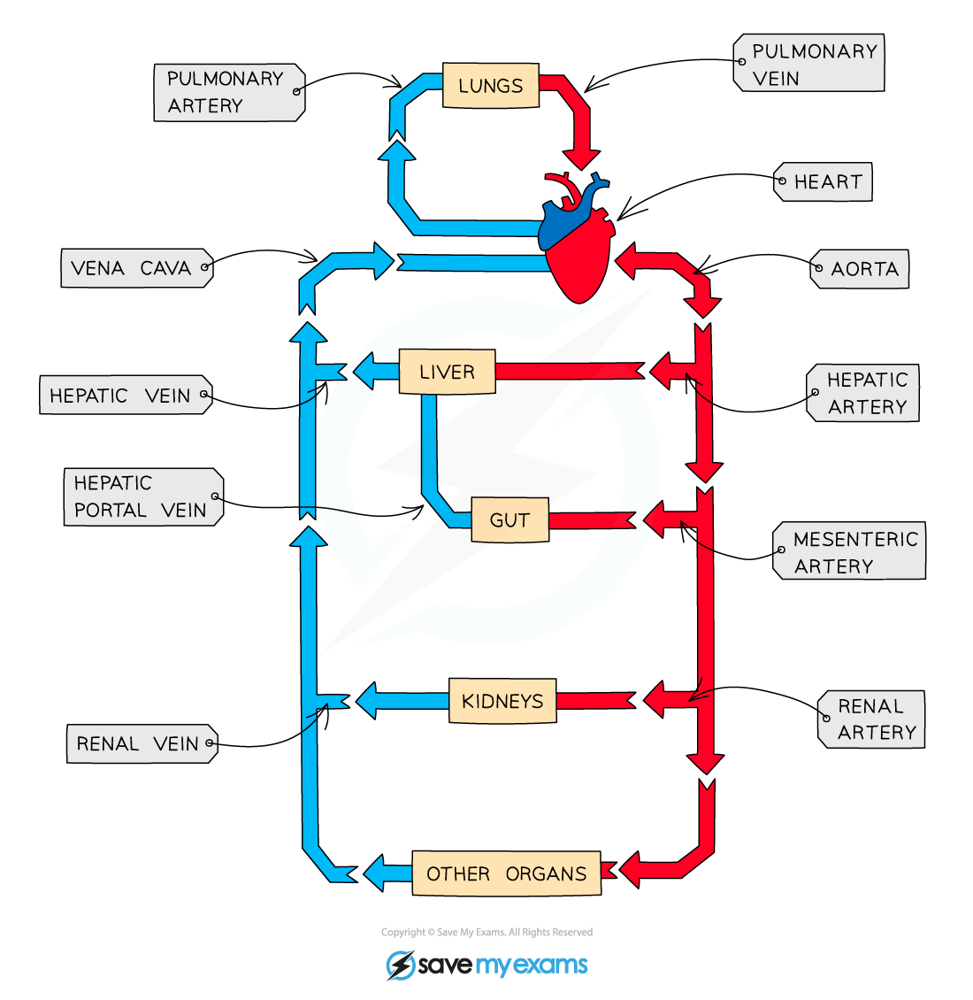

# Circulation Around the Body

## Main blood vessels in the body

> **Spec point** — `spcpt_2DvrMSXxfY6K6cBj` · Identify in diagrams and images the main blood vessels to and from the:
(a) heart, limited to: vena cava, aorta, pulmonary artery and pulmonary vein
(b) lungs, limited to: pulmonary artery and pulmonary vein
(c) kidney, limited to: renal artery and renal vein

## Main blood vessels in the body

- Blood is carried **away from the heart** and towards organs in **arteries**
- These narrow into arterioles and then capillaries as they pass through the organ
- The capillaries widen to venules and finally veins as they move away from the organs
- **Veins** carry blood back **toward the heart**

*The circulatory system*

### Important blood vessels table

| Organ | Towards organ | Away from organ |
|---|---|---|
| Heart | Vena cava and pulmonary vein | Aorta and pulmonary artery |
| Lungs | Pulmonary artery | Pulmonary vein |
| Kidneys | Renal artery | Renal vein |
