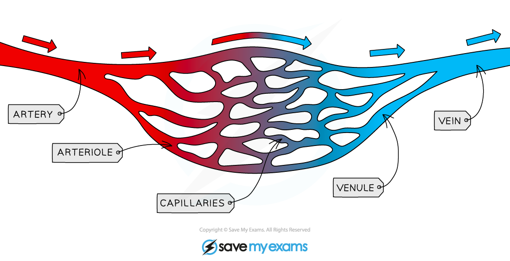

# Structure & Function of Blood Vessels

## How structure of blood vessels is adapted to their function: Extended

> **Spec point** — `spcpt_f7QfgwHdxPnCMZsh` · Explain how the structure of arteries and veins is related to the pressure of the blood that they transport
Explain how the structure of capillaries is related to their functions

## How structure of blood vessels is adapted to their function: Extended

### Extended Tier Only

#### Arteries

- Have thick muscular walls containing elastic fibres **to withstand the high pressure of blood and maintain the blood pressure as it recoils after the blood has passed through**
- Have a narrow lumen **to maintain high pressure**

#### Veins

- Have a large lumen **as blood pressure is low**
- Contain valves **to prevent the backflow of blood as it is under low pressure**

#### Capillaries

- Have walls that are one cell thick **so that substances can easily diffuse in and out of them**
- Have ‘leaky’ walls **so that blood plasma can leak out and form tissue fluid surrounding cells**

*Adaptations of blood vessels*

#### Arterioles and venules

- As arteries **divide more** as they get further away from the heart, they get **narrower**
- The narrow vessels that connect arteries to capillaries are called **arterioles**
- Veins also get narrower the further away they are from the heart
- The narrow vessels that connect capillaries to veins are called **venules**

*The blood vessel network*
