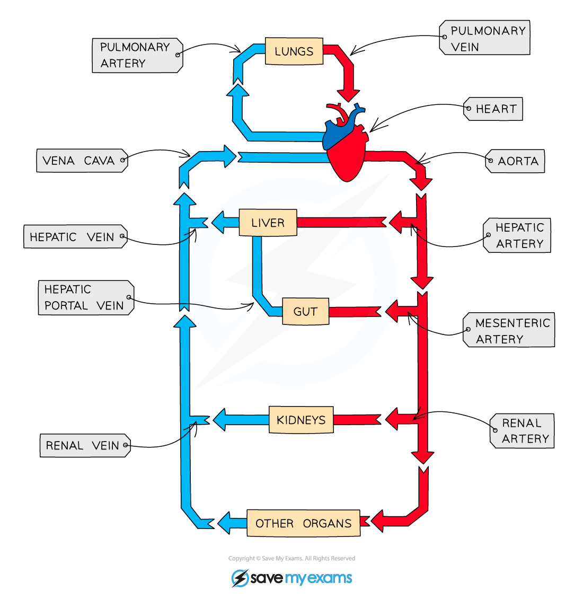

# Blood Vessels & the Liver

## Blood vessels & the liver: Extended

> **Spec point** — `spcpt_TYFvQtKGcj5Grmt6` · Identify, in diagrams and images, the main blood vessels to and from the liver as: hepatic artery, hepatic veins and hepatic portal vein

## Blood vessels & the liver: Extended

### Extended Tier Only

- The main blood vessels to and from the liver are:

  - the **hepatic artery** brings oxygenated blood from the heart to the liver
  - the **hepatic vein** brings deoxygenated blood from the liver back to the heart
  - the **hepatic portal vein** transports deoxygenated blood from the gut to the liver

*The liver is supplied with blood by the hepatic artery and the hepatic portal vein, and blood is carried away from the liver in the hepatic vein*
