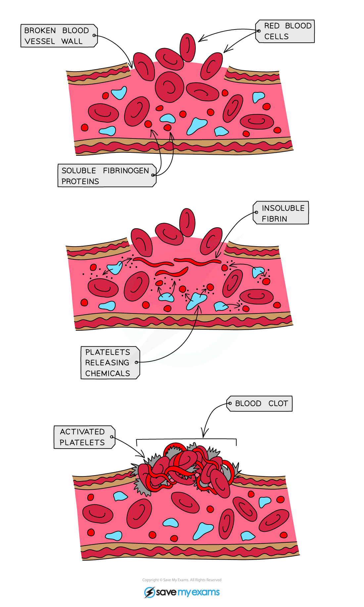

# Conversion of Fibrinogen

## Conversion of fibrinogen: Extended

> **Spec point** — `spcpt_p8gCygMcHqdNT53X` · Describe the process of clotting as the conversion of fibrinogen to fibrin to form a mesh

## Conversion of fibrinogen: Extended

### Extended Tier Only

- Platelets are **fragments of cells which are involved in blood clotting** and forming scabs where the skin has been cut or punctured
- Blood clotting **prevents continued / significant blood loss** from wounds
- Scab formation seals the wound with an insoluble patch that **prevents entry of microorganisms** that could cause infection
- It remains in place until new skin has grown underneath it, sealing the skin again

*How the blood clots*

- When the skin is broken (i.e. there is a wound) platelets arrive to stop the bleeding
- A series of reactions occur within the blood plasma
- Platelets release chemicals that cause **soluble fibrinogen proteins** to convert into **insoluble fibrin** and form an **insoluble mesh** across the wound, trapping red blood cells and therefore **forming a clot**
- The clot eventually dries and develops into a **scab** to protect the wound from bacteria entering
