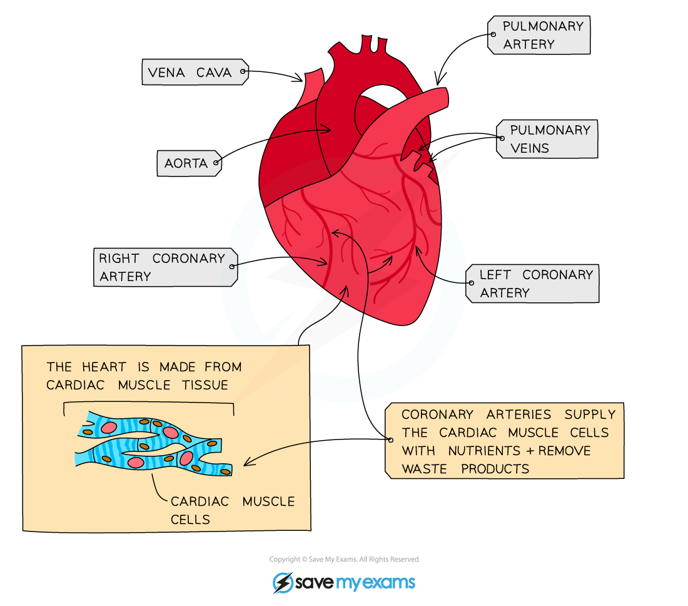

# Coronary Heart Disease

## Coronary heart disease

> **Spec point** — `spcpt_xZ27pNRDM9RQR999` · Describe coronary heart disease in terms of the blockage of coronary arteries and state the possible risk factors including: diet, lack of exercise, stress, smoking, genetic predisposition, age and sex

## Coronary heart disease

*The coronary arteries*

- The heart is made of **muscle cells** that need their own supply of blood to deliver oxygen, glucose and other nutrients and remove carbon dioxide and other waste products
- The blood is supplied by the **coronary arteries**
- If a coronary artery becomes partially or completely **blocked by fatty deposits called ‘plaques’** (mainly formed from **cholesterol**), the arteries are not as **elastic** as they should be and therefore cannot stretch to accommodate the blood which is being forced through them - leading to **coronary heart disease** (**CHD**)
- **Partial blockage** of the coronary arteries creates a restricted blood flow to the cardiac muscle cells and results in severe chest pains called **angina**
- **Complete blockage** means cells in that area of the heart will not be able to respire and can no longer contract, leading to a **heart attack**

*Buildup of plaque in the coronary arteries restricts blood flow*

*Effect of narrowing of arteries*

### Risk factors for CHD table

| Factor | Explanation |
|---|---|
| Poor diet | A diet high in **saturated fat** increases blood **cholesterol** levels, increasing the risk of fatty plaques building up in the artery walls |
| Stress | Stress can trigger the release of **hormones** that raise **blood pressure**, increasing the risk of damage to the coronary arteries and the buildup of fatty plaques |
| Smoking | **Nicotine** causes **blood vessels to narrow**, raising blood pressure and increasing the risk of fatty plaques building up in the coronary arteries |
| Genetic predisposition | People with a family history of CHD are more likely to develop it themselves, suggesting a **genetic component** to the condition |
| Age | The risk of developing CHD increases with age |
| Sex | **Males** are **more likely** to develop CHD than females |

## Diet, exercise & coronary heart disease

> **Spec point** — `spcpt_mBbxTX77c23XqD2b` · Discuss the roles of diet and exercise in reducing the risk of coronary heart disease

## Diet, exercise & coronary heart disease

- There are a number of ways to **reduce the risk of developing CHD**:

  - **improve diet**: reduce animal fats and eat more fruits and vegetables - this will reduce cholesterol levels in the blood and help with weight loss if overweight
  - **quit smoking** - reduces the risk of blood vessels narrowing and blood pressure rising, lowering the risk of fatty plaques building up
  - **exercise regularly** - this will help with weight loss, decrease blood pressure and cholesterol levels, and help reduce stress
