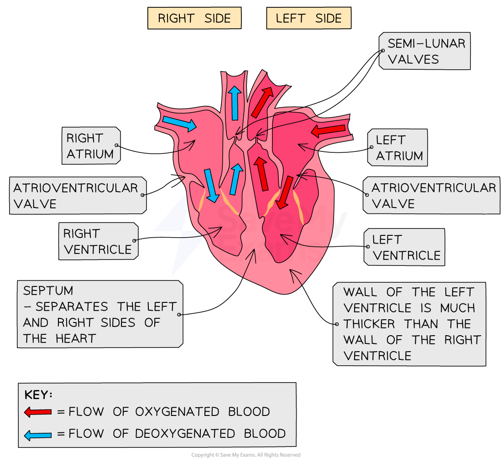

# Identifying Structures in the Heart

## Identifying structures in the heart: Extended

> **Spec point** — `spcpt_rvFkTdPTzPqgGn7y` · Identify in diagrams and images the atrioventricular and semilunar valves in the mammalian heart
Explain the relative thickness of:
(a) the muscle walls of the left and right ventricles
(b) the muscle walls of the atria compared to those of the ventricles
Explain the importance of the septum in separating oxygenated and deoxygenated blood

## Identifying structures in the heart: Extended

### Extended Tier Only

- The **ventricles** have thicker muscle walls than the atria as they are pumping blood out of the heart and so need to generate **a higher pressure**
- **The left ventricle has a thicker muscle wall than the right ventricle** as it has to pump blood at high pressure around the **entire body**, whereas the right ventricle is pumping blood at lower pressure to the **lungs**
- The **septum** separates the two sides of the heart and so **prevents mixing of oxygenated and deoxygenated blood**

*The structures in the heart maximise the efficiency with which it can pump blood around the body*

#### The function of valves

- The basic function of all valves is to **prevent blood from flowing backwards**
- There are two sets of valves in the heart: the **atrioventricular valves** and the **semilunar valves**
- The **atrioventricular valves** separate the atria from the ventricles:

  - The valve on the right side of the heart is called the **tricuspid** and the valve on the left side is called the **bicuspid**
  - The atrioventricular valves are **pushed open** when the **atria contract** and pressure in the atria is higher than in the ventricles; **when the ventricles then contract**, the **increase in pressure in the ventricles forces the valves shut**, preventing blood from flowing back into the atria
- The **semilunar valves** are found in the two blood arteries that come out of the top of the heart (pulmonary artery and aorta)

  - The semilunar valves are the **only valves** to be found in the arteries
  - These valves **open when the ventricles contract** so blood squeezes past them out of the heart, but then shut to avoid blood flowing back into the heart
