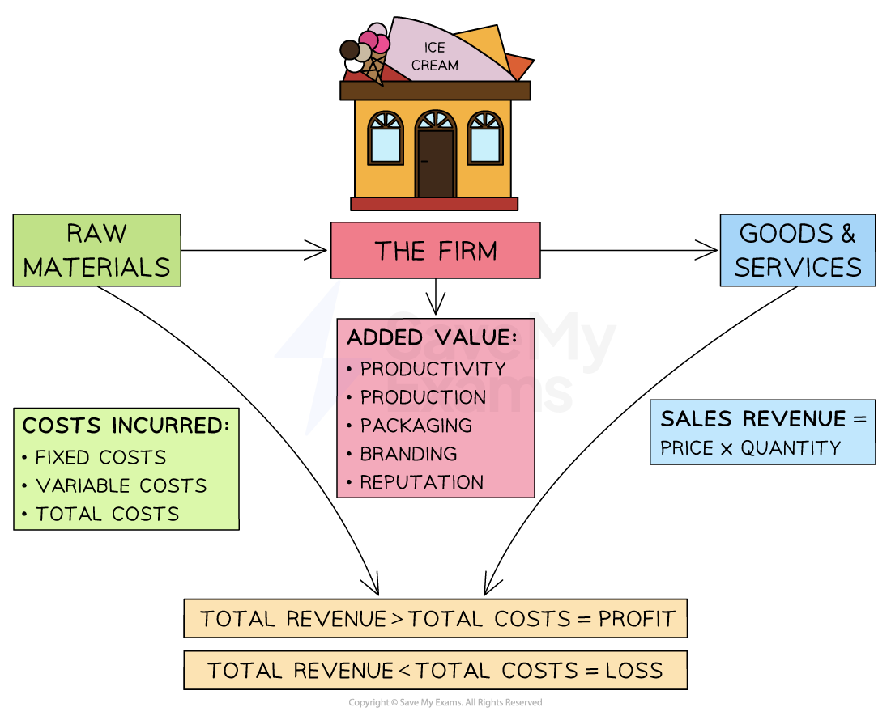

# The Nature of Business Activity

## Needs, Wants, Scarcity and Opportunity cost

> **Spec point** — `spcpt_wvG3S6r7SmnYXhQ4` · "• Concepts of needs, wants, scarcity and opportunity cost
• Importance of specialisation
• Purpose of business activity"

## Needs, wants, scarcity and opportunity cost

- Businesses thrive when they are able to **meet customer needs and wants**

  - Needs are considered to be **essential, **e.g. shelter or food
  - Wants are desires which are **not essential**, even if consumers consider them to be essential, e.g Nike trainers
- Due to the problem of **scarcity**, there is a **basic economic problem**

  - **Choices have to be made** by producers, consumers, workers and governments, about the most** efficient use of resources**
  - Resources, known as the factors of production, are ***land***, ***labour***, ***capital*** and ***Enterprise***
- **Opportunity cost **is the loss of the next best alternative when making a decision
- There is an **opportunity cost** in the allocation of resources:

  - When a **consumer **chooses to purchase a **new phone**, they may be **unable to purchase new jeans**
  
    - The jeans represent the loss of the next best alternative **(the opportunity cost)**
  - When a **producer** decides to allocate all of their resources to **producing electric vehicles**, they may be **unable to produce petrol vehicles**
  
    - The petrol vehicles represent the** **loss of the next best alternative (the **opportunity cost**)
  - When a **government** decides to **provide free school meals** to all primary students in the country, they may be **unable to fund some rural libraries**, which may have to close
  
    - The libraries represent the loss of the next best alternative **(the opportunity cost)**

## The Importance of Specialisation

> **Spec point** — `spcpt_cKqFJYx6k9hXK6DZ`

## The importance of specialisation

- **Specialisation** occurs when workers focus on one particular role or task and thereby gain significant skill in doing it

  - It is now more common due to specialised **technology **and **increasing global competition **
- **Specialisation** occurs on several different levels

  - On an** individual** level, through the **division of labour**
  
    - **Division of labour** is the separation of work processes into tasks that are completed by separate people or groups of people
  - On a **business** level, e.g. one firm may only specialise in manufacturing drill bits for concrete work
  - On a **regional** level, e.g. Silicon Valley has specialised in the tech industry
  - On a **global **level, as countries seek to trade, e.g. Bangladesh specialises in textiles & exports them to the world
- It results in higher **output per worker,** which increases productivity

## The Purpose of Business Activity

> **Spec point** — `spcpt_x5RPSW5TcR5kTs7v`

## The purpose of business activity

- The purpose of business activity is to **produce goods or services** that **meet customer needs** while **adding value**

*The purpose of business activity is to take inputs, add value to them, and create products which meet customer needs*

### To produce goods or services

- The primary purpose of business activity is to** produce goods or services** that satisfy a need or demand in the market

  - Goods are physical products, such as bicycles and T-shirts
  - Services are non-physical items such as hairdressing, tourism and manicures

### Meeting customer needs

- The ultimate goal is to create products that **meet the needs and preferences of customers** and provide value to them
- By meeting customer needs, businesses can **build customer loyalty**, increase brand awareness, and generate revenue

### To add value

- The third purpose of business activity is to ***add value*** to products or services
- Value-added features can ***differentiate*** products from competitors, create a ***unique selling point***, and increase customer satisfaction

  - E.g. A product that is easier to use, has a better design, or is of higher quality than competitors can create a competitive advantage for a business
