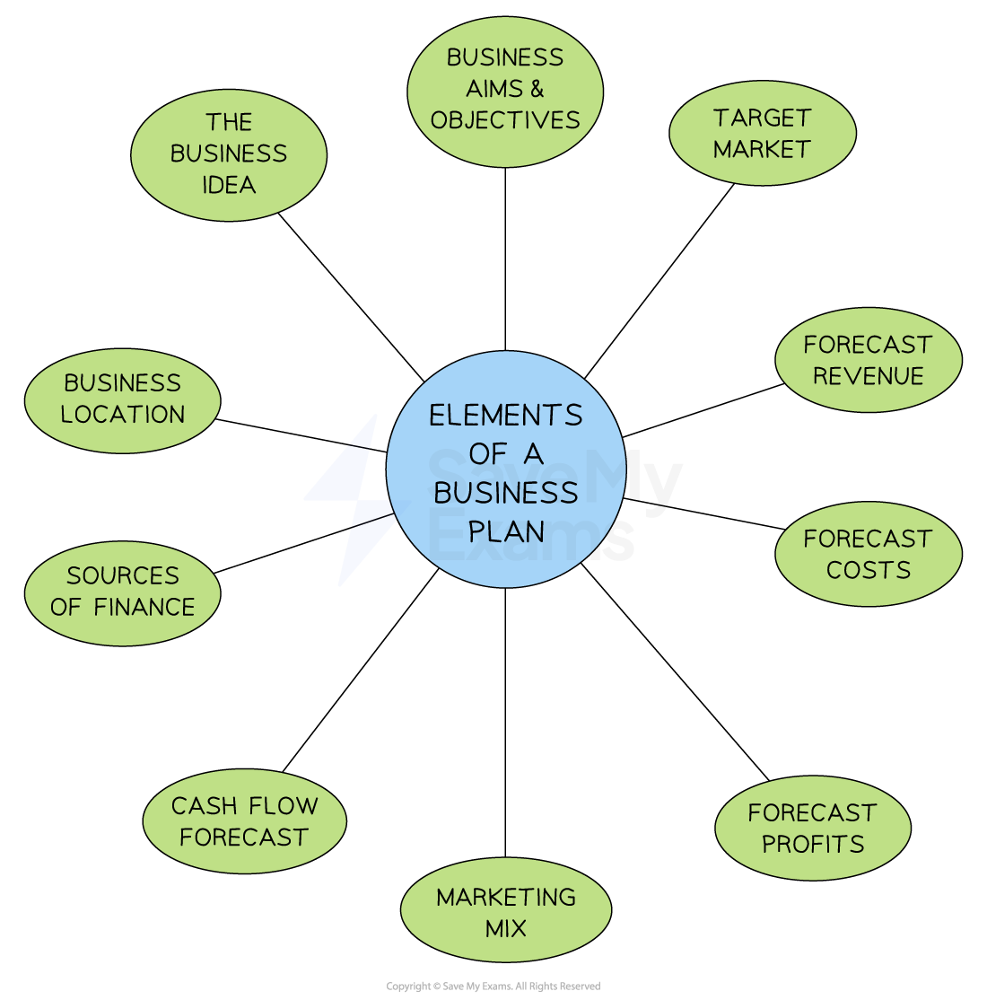

# Business Plans & Government Support

## Contents of a Business Plan

> **Spec point** — `spcpt_KHh9f2YcRQqwKC3V` · "• Contents of a business plan and how business plans assist entrepreneurs
• Why and how governments support business start-ups, e.g. grants, training schemes"

## Contents of a business plan

- A business plan is a document produced by the owner at start-up, which provides forecasts of items such as sales, costs and cash flow

*The main elements included in a business plan, although some differ slightly depending on the nature of the business*

- Producing a business plan forces the owner to think about every aspect of the business **before they start**, which should **reduce the risk** of failure

### Elements of a business plan

- **The business idea**

  - A clear explanation of the goods or services provided by the business, helping to attract investors
  - May also include the history of the business idea
- **Business aims and objectives**

  - What the business wants to achieve in the medium and long term
  - Aims can be both financial and non-financial depending on the business
- **Target market**

  - Explains who the business aims to serve, including age, gender, and income
  - Forms part of the firm's marketing strategy
- **Forecast revenue**

  - Projects the business’s anticipated income from sales
  - Calculated as: **Sales Revenue = Price x Quantity Sold**
  - Helps plan for break-even levels of output
- **Forecast costs**

  - Predicts fixed, variable, and total costs to manage spending effectively
  - New businesses often have high startup costs, such as initial stock
- **Profit forecasts**

  - Investors review profit forecasts to assess the business’s ability to repay borrowed funds, such as bank loans
- **Marketing mix**

  - Outlines the marketing strategy for attracting customers
  - Includes Product, Place, Price, and Promotion
- **Cash-flow forecast**

  - Explains management of cash inflows and outflows monthly to prevent liquidity issues
- **Sources of finance**

  - Details funding sources for the new business, such as loans, owner’s funds, or venture capital
- **Business location**

  - Describes the proposed business location, including a map and advantages like good transport links or customer proximity

## How Business Plans help Entrepreneurs

> **Spec point** — `spcpt_Z4XKvDRGMhjhdKDQ`

## How do business plans help entrepreneurs?

- The main aim of producing a business plan is to **reduce the risk **associated with starting a new business and help the owners **raise finance**
- Having carried out research to support the plan, the business will be **well-informed about the potential problems and chance of success**
- A well-written business plan can **help a business obtain finance**

  - Lenders (e.g. banks) and other investors will be able to explore the plan and **make an informed decision** about whether the business is credible and worth the financial risk
  - Investors (e.g. ***venture capitalists***) will use the business plan to explore whether there is an opportunity to **increase the value of their investment **and make a worthwhile profit
- A clear action plan **provides direction for the business** and helps lenders and investors have confidence in the future success of the business
- Most high street banks can provide a detailed **template** for business owners to complete when applying for finance

## Government Support of Business Start-ups

> **Spec point** — `spcpt_V9fqFVty4n3c7rT8`

## Government support of business start-ups

- Governments often provide support to entrepreneurs

  - This encourages them to set up new businesses or take steps to grow their business
- Reasons for providing **government support **include:

  - Increase the country's level of output to achieve **economic growth**
  - Reduce the level of **unemployment **as new or growing businesses create jobs
  - Improve **choice for consumers **by providing ***competition***** **for existing businesses
  - Encourage entrepreneurs to set up ***social enterprises*** which may support disadvantaged groups or improve communities

### How governments support business start-ups

1. **Training and support sessions**

  - **Advice regarding finance, operations and marketing** can often be accessed through local authorities
  - **Support sessions** offered by business mentors allow entrepreneurs to ask specific questions related to their business
2. **Enterprise zones**

  - Enterprise zones are geographic areas which provide tax breaks and Government support to help businesses grow
  
    - Enterprise Zones can provide access to **low-cost premises** and incentives such as reduced ***business rates***
    - They are often linked with **universities** that share expertise and facilities, especially in less economically-developed regions
3. **Finance**

  - Some governments provide low-***interest*** **start-up loans **and ***grants*** for new or growing businesses that create jobs or invest in training workers
