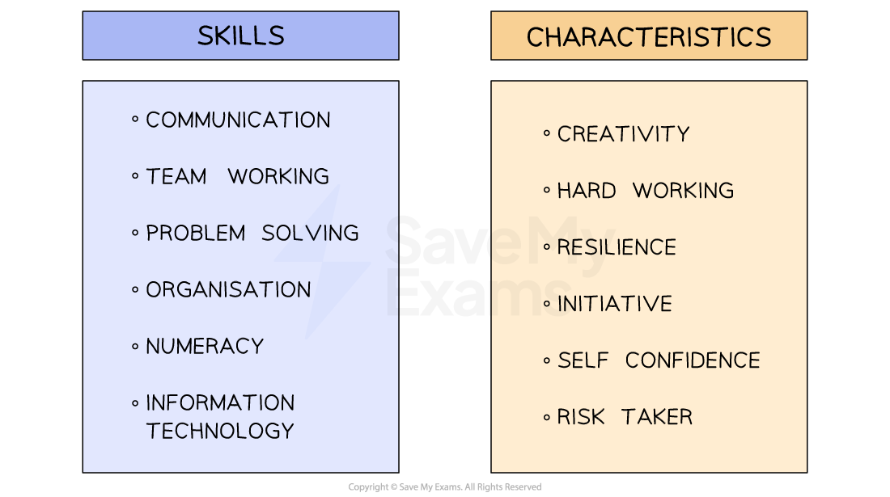

# Characteristics of Successful Entrepreneurs

## Entrepreneurs Create & set-up a Business

> **Spec point** — `spcpt_psCs2zp22jFmvwkX`

## Entrepreneurs create and set-up a business

- An entrepreneur is a person who is **willing and able to create a new business idea** or invention and **takes risks** in pursuing success

  - Successful entrepreneurs can identify and pursue opportunities, **create value for customers **and build thriving businesses

### What do entrepreneurs do?

1. **They organise resources**

  - An entrepreneur must be able to gather and **coordinate the resources** necessary to start and operate a business
  - E.g. When Michael Dell started his computer company from his garage, **he had to organise resources** such as space, computers, software tools, and employees, and manage the finances
2. **They make business decisions**

  - Entrepreneurs must be able to make decisions that will determine the **success or failure of their business**
  - E.g. A restaurant owner may need to decide what type of food to serve, where to locate the restaurant, and **what** **prices to charge**. These decisions require a combination of market research, creativity, and business skill
  - Making the wrong decisions can lead to wasted resources, lost opportunities, and **ultimately business failure**
3. **They take risks**

  - Entrepreneurship involves taking risks - financial, personal, or professional

  - E.g. An entrepreneur may invest their life savings into a new venture or **quit a secure job** to start their own business
  
    - They may also take risks by **introducing new products** or entering new markets
  - These risks can pay off with great rewards, but they can also lead to failure and financial loss

## Characteristics & Skills Required by Entrepreneurs

> **Spec point** — `spcpt_Fz3RH4ffTjm8Rcfw` · Entrepreneurs Create & set-up a Business
Characteristics of Successful Entrepreneurs

## Characteristics and skills required by entrepreneurs

- Entrepreneurs require a **unique set of characteristics and skills**

*The skills and characteristics required by entrepreneurs include communication, creativity and resilience*

- Successful entrepreneurs tend to be very persuasive in their communication and decisive in their decision-making

#### Characteristics of successful entrepreneurs

| **Characteristic** | **Explanation** |
|---|---|
| **Risk taker** | - Entrepreneurs take financial, personal, or professional risks - An entrepreneur may invest their life savings into a new venture or quit a secure job to start their own business    - They may also take risks by introducing new products or entering new markets   - These risks can payoff with great rewards, but they can also lead to failure and financial loss |
| **Decision maker** | - Entrepreneurs must be able to make decisions that will determine the success or failure of their business    - E.g. A restaurant owner needs to decide what type of food to serve, where to locate the restaurant, and what prices to charge   - These decisions require a combination of market research, creativity, and business skills   - Making the wrong decisions can lead to wasted resources, lost opportunities, and ultimately business failure |
| **Organised** | - An entrepreneur must be able to gather and coordinate the resources necessary to start and operate a business    - E.g. When Michael Dell started his computer company from his garage, he had to organise resources such as space, computers, software tools, employees, and finances |
| **Creative** | - Developing new solutions to solve existing or emerging problems is a key entrepreneurial role that helps a business stand out from rivals and achieve success    - During the 2020 COVID-19 pandemic, many businesses used their creativity to switch production techniques to cater for what the market wanted   - E.g Harrogate Gin switched from producing gin to hand sanitiser |
| **Great communicator** | - Entrepreneurs need to be persuasive communicators - Persuading lenders, investors and customers to support their business is central to achieving financial success |
| **Independent** | - Starting a business is often the sole responsibility of a single entrepreneur, who will need to be able to solve problems with limited support    - E.g. The owner of Gymshark, Ben Francis, started off the company by buying a sewing machine and making gym clothes in his parents garage with a few school friends        - This led to the growth of a multi million pound company employing hundreds of people |

> **Exam Hint**
> Think about why successful entrepreneurs are important in the country that you are based in. You should be able to explain why governments want to encourage more entrepreneurs to set up in businesses there. Entrepreneurship drives business growth and innovation, and knowing some examples of real life entrepreneurs who have inspired you may help you to remember their skills and qualities (Mark Zuckerberg or Elon Musk?)
