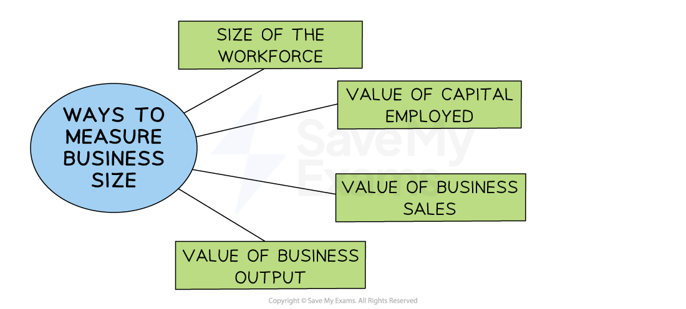

# Measuring Business Size

## Methods of Measuring Business Size

> **Spec point** — `spcpt_F4PGVD5CCPtkwftJ` · "• Methods of measuring business size, e.g. number of people employed, value of output, capital employed (profit is not a method of measuring business size)
• Limitations of methods of measuring business size"

## Methods of measuring business size

- A simple way to classify businesses is to consider their **size**

*Business size can be measured in several ways, including the size of the workforce, the value of capital employed and the value of sales or output*

### Size of the workforce

- A measure of how many workers are in the business
- Small and medium-sized businesses (**SME**s) employ less than 250 employees
- Large businesses have 250 or more employees

### Value of capital employed by the business

- A measure of all the capital (money, equipment, buildings) that is currently invested in a business

### Value of business sales

- The total ***sales revenue*** achieved during a trading period
- It is calculated using the formula Price x Quantity

### Value of business output

- The **financial worth of goods produced,** even though they may not all be sold
- It is calculated using the formula Total Costs x Quantity

#### Comparing business size

| **Company** | **Size of the workforce** | **Capital employed** | **Value of output** |
|---|---|---|---|
| **Futuristic Microchips** | - 4 Designers - 5 Maintenance staff - 9 Total employees | - High tech production line - \$100,000 | - 5,000 Microchips at \$100 = \$500,000 |
| **Tasty Satsumas** | - 400 Farm workers  - 18 Managers - 418 Total employees | - Basic fruit-picking tools - \$20,000 | - 500, 000 oranges at \$1= \$500,000 |

- **Futuristic Microchips **is the largest organisation using the measures of number of employees and capital employed
- **Tasty Satsumas is** the same size as **Futuristic Microchips** in terms of the value of output

### Why are stakeholders interested in business size?

- **Banks** wish to know how likely any ***loans*** will be repaid

  - Larger businesses may present less of a lending risk
- **Employees** wish to know how secure their jobs are

  - A growing business is likely to offer ***job security***
- **Suppliers** may prefer to sell products to larger businesses

  - Large business are likely to purchase in greater quantities
- **Investors** compare business size to distinguish between investment opportunities
- **Competitors** may set growth objectives or ***benchmark*** their progress against similar-sized rival businesses
- **Governments** apply different tax rates for small and large businesses

  - Larger firms may need careful monitoring to ensure they do not abuse their ***market power***

> **Exam Hint**
> When comparing business size, it is best to compare like with like, such as weighing up an orange producer with other fruit producers

## Limitations of the Methods of Measuring Business size

> **Spec point** — `spcpt_Qk8GFWqNwg7HrK8T`

## Limitations of the methods of measuring business size

- Each method of measuring business size has significant limitations

#### Limitations of measures of business size

| **Method** | **Limitations** |
|---|---|
| **Size of the workforce** | - The method of production can influence this metric significantly    - ***Capital-intensive*** businesses produce high levels of output with few employees   - ***Labour intensive*** businesses have many employees that may generate a small volume of output - The nature of workers' contracts can make this measure unreliable    - Some businesses hire many **part-time **workers, while others prefer** full-time** workers   - Short-term, ***zero hours*** or ***agency worker*** contracts may not be included in workforce measurement |
| **Value of capital employed** | - Not accurate when **comparing labour-intensive **and **capital intensive** production methods    - European manufacturing businesses tend to have high levels of **capital**,** such as robots or advanced machinery**, compared to those located in countries such as Vietnam and Indonesia   - **Property values** differ significantly across the world, and even between regions        - E.g. The value of property in Singapore is significantly greater than property in mainland China |
| **Value of sales** | - Businesses sell very **different products**    - Comparing a market stall selling sweets with a retailer of luxury handbags would be unrealistic, as their prices and volumes sold are very different - Selling **prices vary** between markets    - Businesses may sell products to customers in low-income markets at a lower price than in a higher-income market |
| ** Value of output** | - High value output can be produced by businesses with **very few employees** or with** limited capital employed**    - E.g. A bespoke jewellery maker may produce only a few expensive items each year - The value of output does not measure how successful a business has been at selling goods produced. If they are** left unsold**, they are a poor measure of business size |

> **Exam Hint**
> Profit is not a measure of business size. If a multinational like Netflix makes a loss, it does not mean that a sole-trader hairdresser who earns a profit is a larger organisation.
