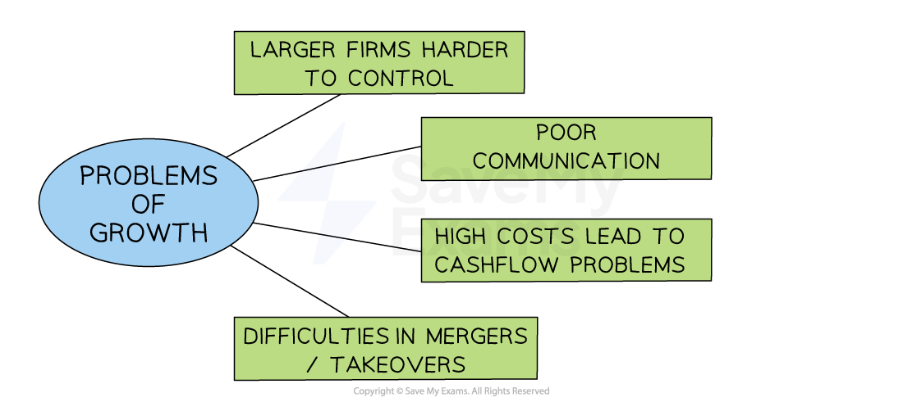

# Overcoming Business Growth Issues

## Problems Caused by Business Growth

> **Spec point** — `spcpt_XZWFsfqcRQqRWnnP` · • Problems linked to business growth and how these might be overcome

## Problems caused by business growth

- In some cases, growing the size of a business can fail to improve its ***profitability*** and can lead to ***cash flow*** and coordination problems

*Businesses are often faced with a range of challenges when they grow*

### Problems and solutions of business growth

1. **Poor communication**

  - Longer ***chains of command*** and wider ***spans of control*** for managers may lead to **slower decision-making times** and inefficiency
  - Solution:
  
    - **Use the latest communication technologies, **such as instant video calls,** **to improve communication between managers and workers
    - ***Decentralisation*** may help to delegate decision-making
2. **Larger firms are often harder to control**

  - As a business grows in size, it can experience ***diseconomies of scale*** such as poor co-ordination of resources
  - Solution:
  
    - Operate as a series of **smaller units** which allows local or ***functional area*** managers to have more control
    - Increase ***delegation*** in order to ***empower*** workers and get jobs done more quickly
3. **High costs and cashflow problems**

  - Expansion can be **very expensive** as it may involve developing a new product range or buying a new factory
  
    - **High costs in the short/medium term **means the business may need additional finance to avoid cashflow problems
  - Solution:
  
    - **Grow slowly** using profits rather than loans to fund gradual and less risky expansion
    - **Manage cash flow** carefully, making use of retained profits and short-term borrowing to counter cash flow shortfalls
4. **Difficulties of mergers and acquisitions**

  - A ***culture clash*** may occur if a merger or acquisition  takes place between two different firms due to different management styles
  - Solution:
  
    - Ensure good communication so employees are less likely to be resistant to change
    - Take time to carefully negotiate and plan mergers/acquisitions to reduce 'teething problems'
