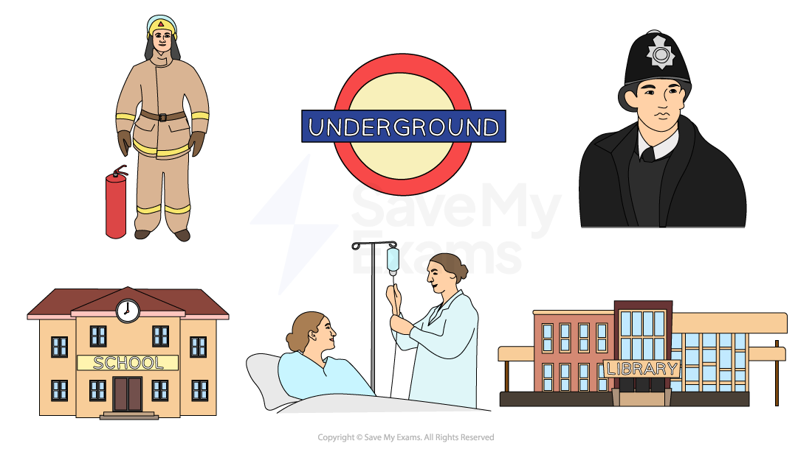

# Public Sector Businesses

## The Public Sector

> **Spec point** — `spcpt_hQt5RFvHByR9xVd3` · "Business organisations in the public sector,
e.g. public corporations"

## The public sector

- The public sector is a key element of ***mixed economies***
- Public sector firms are **owned and controlled by the government **and are usually **funded through taxation**
- Their **main goal** is to **provide services** such as education, healthcare or emergency services that may not be provided by profit-focused businesses

*Hospitals, schools and emergency services are often partly or fully provided by the public sector*

- Public sector firms operate on a **local, regional **or** national government level**

  - **Transport for London** provides local transport in the London region
  - **Caribbean Airlines** operates across several countries in the Caribbean, with ownership shared by the governments of Trinidad and Tobago, Jamaica and Guyana
  - **Comboios de Portugal** provides train services across the country and in to Spain
- Governments are likely to retain ownership of organisations in the public sector for several reasons

  - They are **strategically important **to the country, such as the defence or justice systems
  - They provide **essential **services such as water, electricity supply or emergency services
  - They are ***merit goods*** that may not be provided in sufficient quantities by private businesses, such as education or health services

### Public corporations

- Public corporations are **owned by the government**

  - They are usually businesses which were once owned by private individuals and have been ***nationalised***
  
    - In 2022, the German government nationalised **Uniper**, the country's largest importer of gas, to improve energy security as a result of the conflict between Russia and Ukraine
    - In 2008, the UK government nationalised **Northern Rock**, a bank which was on the verge of collapse as a result of the global financial crisis
- Government ministers **appoint a Board of Directors, **which manages the corporation

  - They are expected to run the corporation according to objectives set by the government
  - Although they **may be profitable**, the aim of corporations is to provide a public service
  - Governments **should not interfere** with day-to-day operations and decisions of the corporation

#### Evaluating public corporations

| **Advantages** | **Disadvantages** |
|---|---|
| - Government ownership is **essential for some crucial or sensitive industries**    - Examples include water, power and communications | - Due to a** lack of competition,** public corporations may become **inefficient **or have **no incentive to improve, **affecting consumer choice |
| - **Important public services, **such as TV and radio broadcasting, are often in the public sector    - Non-profitable but important programming can be made available to the public | - Corporations may become** complacent or have an unfair advantage over private sector rivals** as they can access government subsidies to help them if they are struggling |
| - The government can choose to **nationalise industries **that may be in financial trouble    - **Jobs** can be secured and consumers will still have **access to the important goods or services** the business provides | - **Funding can be cut** as a result of political decisions and **changes of governments** can cause significant disruption to corporation missions and operations |

### Other public sector enterprises

- In some cases, **profit-making companies are partly owned or controlled by the government**

  - They sell shares on the publicly listed ***stock exchanges*** so they are a mix of the private and public sector
  
    - In the US, **Amtrak** (passenger trains) is a state-owned for-profit enterprise whose shares are majority owned by the federal government
- Other businesses are funded by central and local government

  - They may still** levy charges for some services**
  
    - The** NHS** is free at the point of use for British citizens, but they must pay for medical prescriptions, some procedures and parking on hospital premises
    - The French state funds leisure facilities such as **swimming pools **and** public sports venues** but usually charges users a small fee for their use
    - Due to the** constraints of government spending** in many countries, many services are now being ***privatised*** or suffer from **insufficient funding**
