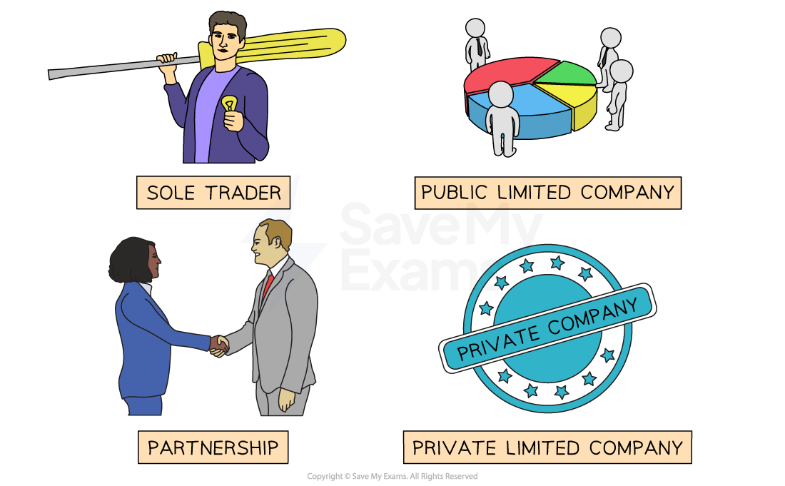

# The Main Types of Ownership

## Risk, Ownership and Limited Liability

> **Spec point** — `spcpt_Y6pvJxd3MZCVMFmm` · "• Concepts of risk, ownership and limited liability
• Sole traders, partnerships, private and public limited companies, franchises and joint ventures"

## Risk, ownership and limited liability

- When an entrepreneur starts a business, they need to consider **what kind of legal structure** they want for their business
- Their decision will depend upon a range of factors

  - The **level of personal risk** they are willing to take
  - The **advice** they receive
  - The **level of privacy** they would prefer in running the business

#### Types of business ownership

*Businesses can operate as sole traders, partnerships or companies *

- **Sole traders **and **partnerships** are **unlimited liability **businesses

  - They are **easy to set up** and start trading
  - Information about their financial performance **does not need to be shared outside of the business**
- **Private limited companies** and **public limited companies** offer the protection of ***limited liability*** to their owners (***shareholders***

  - Setting up a company is a **legal process** that takes time to arrange
  - Information about financial performance **needs to be shared with Companies House** and is available for scrutiny by any interested third party

#### A comparison of unlimited and limited liability

| **Liability** | **Description** | **Implications** |
|---|---|---|
| **Unlimited liability** | - The owners are fully **responsible for all debts **owed by the business  - Owners are also legally **responsible for any unlawful acts **committed by those connected to the business | - There is no legal distinction between the  owners and the business  - As a result, these business owners may have to use their own ***personal assets*** to pay debts or legal fees  - E.g. a sole proprietor may need to sell their home to pay ***creditors*** if their business fails |
| **Limited liability** | - Owners (shareholders) of private limited companies and public limited companies can only **lose the original amount they invested** in the business if it fails  - Shareholders are not responsible for business debts  - In most cases, shareholders **cannot be held responsible** for unlawful acts committed by those connected with the business | - Companies are  ***incorporated*** and owners are considered a separate legal entity to the business  - This means that if a company fails, the owners would **lose their investment** (shares) but would not have to use their assets to meet additional debts or legal fees  - E.g. In 2018 construction company Carillion entered ***liquidation*** and the shareholders lost their investments |

## Sole Traders, Partnerships and Limited Companies

> **Spec point** — `spcpt_H97q7SJJ7BVQ9w48`

## Sole traders, partnerships and limited companies

### 1. Sole traders

- When an entrepreneur starts a business, they will often **start operating as a *****sole trader***
- This is a business that has a **single owner**, who may choose to hire employees or operate alone

#### Evaluating sole trader businesses

| Advantages | Disadvantages |
|---|---|
| - Easy and inexpensive to set up - The owner has **complete control** over the business - All profits belong to the owner - Simple tax arrangements | - Unlimited liability, meaning the owner is **personally responsible for any debts** the business incurs - Limited access to finance and capital - Limited skill set of the entrepreneur |

- Over time - or if the business requires significant investment - they may change the legal structure of the business

### 2. Partnerships

- A sole trader may join with others to form a **partnership**
- A partnership is a formal arrangement by **two or more entrepreneurs** to manage and operate a business and share its profits
- Partnerships are often formed to **gain more funding**, **increase capacity** or **increase skills and experience in the business**
- Businesses commonly established as partnerships include** law firms, accountancy businesses **and **small-scale construction businesses**
- Partnerships can often be identified by suffixes such as '& Son' or 'and Partner'

#### Evaluating partnership businesses

| Advantages | Disadvantages |
|---|---|
| - Partnerships are easy and inexpensive to set up - Partners share responsibilities, decision-making and liability for debts - More skills and knowledge are available - Increased access to finance and capital | - Partners have unlimited liability - Potential for disputes between partners - Profits are often shared equally, regardless of the contribution - It is often difficult to transfer ownership to new owners |

### 3. Private limited companies

- An entrepreneur may choose to form a **private limited company** to** provide more financial security**, as they will benefit from ***limited liability***
- The ownership of the private limited company is broken down into a **specified number of shares**
- These shares can be held in their entirety by the entrepreneur, sold to friends and family or to ***venture capitalists***
- Decision-making often rests with the person appointed to run the company, often called the **Managing Director or CEO**

#### Evaluating private limited companies

| Advantages | Disadvantages |
|---|---|
| - Limited liability means owners are not personally responsible for the company's debts - Access to greater finance and capital - Easier to transfer ownership to new shareholders - Can provide a professional image and reputation | - They are expensive and time-consuming to set up - More complex legal requirements and regulations than sole traders - Annual financial reporting and auditing are required - Shareholders have little control over the company as the founder usually imposes their agenda |

### 4. Public limited companies

- When a business is growing rapidly, it may **require a significant amount of capital **to fund its expansion
- To secure this funding, it may choose to transition from a **private limited company (LTD) to a public limited company (PLC)**
- This is a complex legal process  which involves undergoing a ***stock market flotation***
- Public limited companies sell their shares to the public on the stock exchange, meaning they can have a large number of owners
- Public limited companies must publish their *annual reports* and hold an *AGM* each year

  - A **board of directors**,** **whose members are elected by shareholders at the AGM, acts as the governing body of a company,
  - ** **The board of directors appoints a ***CEO**** *to lead the company

#### Evaluating public limited companies

| Advantages | Disadvantages |
|---|---|
| - Significant amounts of capital can be **raised very quickly** - The risks associated with ownership are spread among a larger group of shareholders - Becoming a PLC raises a company's profile and increases its visibility with customers, suppliers, and potential investors | - The business is required to adhere to a range of **legal and financial regulations**, which can be costly and time consuming to comply with - Selling shares to the public creates many **shareholders**,** who have a say **in how the company is run - PLCs are expected to deliver **consistent growth **and** profits** to their shareholders |

## Franchises & Joint Ventures

> **Spec point** — `spcpt_tD86dcqrk8Y2gRcN`

## Franchises and joint ventures

### 1. Franchising

- Franchising involves a business **(franchisee)** buying the rights to operate an existing successful business model **(franchisor)**

  - This right includes the use of its **branding** and **software tools** as well as business support**,** in exchange for an initial lump sum plus ongoing ***royalties***

*Some of the many food franchises available in the US  *

- The franchisee operates the business under the **franchisor's established system** and receives training, marketing support, and ongoing assistance
- Franchisors usually require the franchisee to operate as a private limited company

#### Evaluating franchise ownership

| **Advantages** | **Disadvantages** |
|---|---|
| - A ready-made, **recognised brand name** which is promoted centrally by the franchisor - The franchisor **provides training,** such as how to make pizzas properly, so as to ensure quality and brand consistency - Equipment and consistent supplies are provided through the franchisor - The franchisor guarantees an exclusive geographical area or market to the franchisee so **competition is limited** - **Advice, training **and the **use of software systems** are ongoing - The franchisor may also provide loans, insurance and recruitment support | - The** cost of purchasing **a well-known franchise is likely to be high, compared to starting a business from scratch - Core decisions are made by the the franchisor, reducing the autonomy of **business owners** - **Royalties linked to the level of sales** must be paid regularly, regardless of profit - Required materials, supplies or equipment sold by the franchisor may be sold to the franchisee at **inflated prices** - If the franchisee does not **follow strict franchise rules** or fails to meet quality expectations, their franchise rights can be removed |

> **Exam Hint**
> A franchise is not a form of business ownership - it is an alternative to starting up a brand new business from scratch. In most cases franchisors require businesses to operate as private limited companies as this ownership type is considered to have more stability than sole traders or partnerships

### 2. Joint ventures

- A joint venture is a medium- to long-term agreement for **two or more separate businesses** to join together to **achieve a defined business outcome,** such as entry into a new market

  - A new **combined business entity** is formed
  - Risks and returns are **shared by the parties involved** in the joint venture
  - Businesses in a joint venture are usually looking to **benefit from complementary strengths and resources** brought to the venture
- Many **European companies have set up joint ventures with businesses in China**

  - Chinese managers and employees understand market needs and consumer tastes, which gives the venture a greater chance of success
  - The Chinese government encourages joint ventures rather than ***foreign direct investment (FDI)***
  - German car manufacturer BMW and Chinese rival Brilliance Auto Group formed a joint venture called BMW Brilliance in 2003 to produce and sell BMW cars in China

#### Evaluating joint ventures

| **Advantages** | **Disadvantages** |
|---|---|
| - Each partner in the joint venture benefits from **sharing expertise and resources,** such as distribution channels and R&D expertise - Joint ventures are **less risky than 'going it alone'** if  entering a new market or diversification - **Local knowledge **can be accessed when one of the joint venture partner companies is already based in the country - **Costs are shared** between joint venture companies, which is very important for expensive projects such as new aircraft | - If the joint venture is successful, profits have to be shared between the partner businesses - **Disagreements may occur **regarding important decisions due to the input of managers in both businesses - The objectives of each business may change over time, leading to a **conflict of objectives** between joint venture partners - **I**f the joint venture fails, it may need to be **dismantled, reorganised **or** sold,** which is likely to take significant time and resources |
