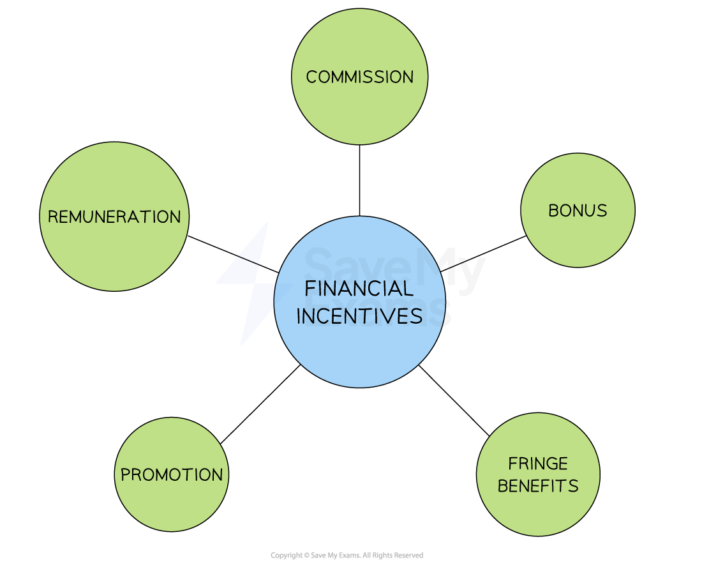

# Financial Methods of Motivation

## Financial Methods of Motivation

> **Spec point** — `spcpt_47pdymbdMKWtcN3P` · • Financial rewards, e.g. wage, salary, bonus, commission and profit sharing

## Financial methods of motivation

- Financial incentives are **rewards or payments** given to employees in return for their labour - or improved performance
- The different theories of human motivation offer varying perspectives on the **role of money in motivating staff**

  - **Herzberg's Two Factor Theory** says that money is not generally a motivator, but the lack of it leads to dissatisfaction
  - **Maslow's Hierarchy of Needs** argues that people move through levels of needs that motivate them - their lower-order needs are closely linked to financial rewards, whilst higher-order needs are rarely linked to pay
  
    - **Physiological** and **safety **needs can be partially met by providing adequate pay
    - **Love and Belonging** needs are often met by encouraging aspects such as team working

#### Financial methods of motivation

*Financial incentives motivate some employees, depending upon the importance that they place on monetary items/money as a reward*

#### Explaining the financial incentives

| **Incentive Type** | **Explanation** |
|---|---|
| **Remuneration** | - This refers to the **basic wage **or** salary** that a worker receives for their labour - Employees who work on an hourly rate are paid **wages** and accrue benefits such as annual leave according to the hours they work - Some workers may be paid a** piece rate** according to how many items they produce or sell - Salaries are paid to full time staff and usually accompanied by benefits such as a fixed number of days of annual leave |
| **Commission** | - A percentage of **sales revenue **is paid to workers who sell products or services - Commonly used in sales roles and motivates staff to sell more and ***upsell*** |
| **Bonus** | - An additional payment given to staff awarded for achieving specific goals, completing projects on time or **exceeding performance expectations** - The opportunity to **earn more money** may motivate staff to work harder and achieve better results |
| **Promotion** | - Promotion usually demands a **higher level of responsibility** from an employee in the job role    - **Higher pay **is usually offered to reflect the increased responsibility - A clear **promotion pathway** can act as a motivator to improve productivity and staff performance |
| **Fringe benefits** | - These are **additional benefits** usually offered to salaried employees    - Fringe benefits could include the use of a company car, private healthcare or gym membership   - Employees can be **motivated to work hard** in order to keep their job and the associated fringe benefits |
