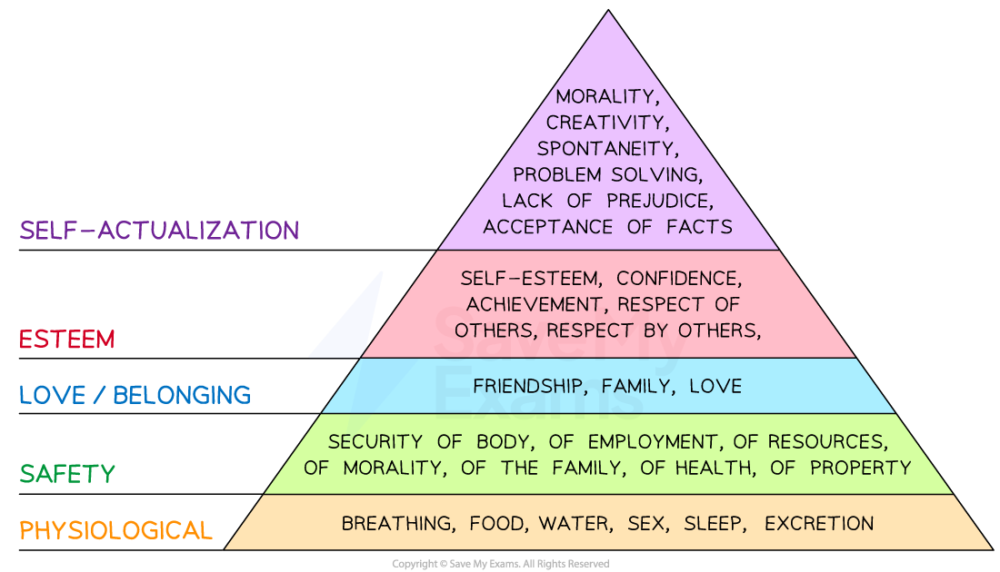
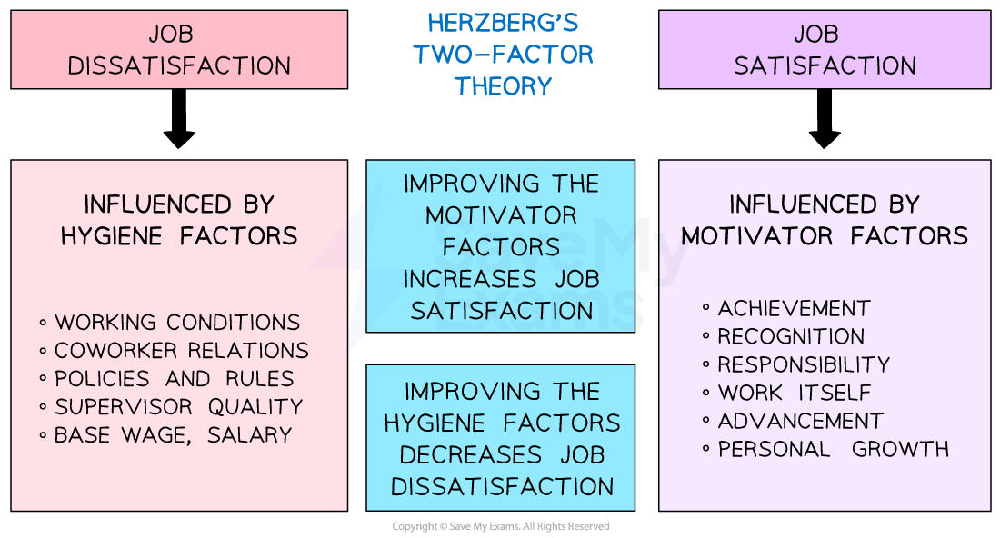

# Motivational Theories

## An Introduction to Motivational Theories

> **Spec point** — `spcpt_rY6mScYmh9jzq4WW`

## An introduction to motivational theories

- Motivation theories offer varied perspectives on the **role of money in motivating staff** and how non-financial factors may drive workers to improve their effort and output
- The main theories include

  - **Maslow's Hierarchy of Needs** **Theory **which argues that people move through levels of needs that motivate them and once a need is met it no longer serves to motivate
  - **Taylor's Scientific Management Theory** which states that workers are motivated mainly by pay and need tightly-defined tasks and close supervision
  - **Herzberg's Two Factor Theory** which believes that money is not a motivator but that the lack of money leads to dissatisfaction, whereas workers are motivated by factors such as the **opportunity to develop their skills**

## Maslow's Hierarchy of Human Needs

> **Spec point** — `spcpt_s2nBkzJqbRHb2VH7`

## Maslow's hierarchy of human needs

- Maslow's Hierarchy of Needs outlines** five tiers of human needs **that must be met for individuals to reach their full potential
- Once a tier of needs has been met, it is **unlikely to continue to motivate **

  - For example, once safety needs are met through satisfactory pay employees will **look for the next set of needs** - love and belonging needs - to be met

#### Maslow's hierarchy of needs

*Maslow's Hierarchy of Needs explains human motivation based on the pursuit of different levels of needs being fulfilled*

**1. Physiological needs**

- Businesses can **provide necessities** for their employees, e.g **comfortable work environment,** access to clean water and food, and adequate rest breaks

**2. Safety needs**

- Businesses can provide job security, fair pay, benefits, and **safe working conditions** for their employees

**3. Love and belonging needs**

- Businesses can encourage teamwork and generate a **sense of community** and belonging within the workplace

**4. Esteem needs**

- Businesses can provide recognition for employees' accomplishments, and provide a positive work culture that **values individual contributions**

**5. Self-actualisation needs**

- Businesses can help employees achieve this need by offering opportunities for employees to **pursue their passions** and interests
- For example, Barclays Bank is known for supporting elite sportspeople by allowing them time off work in the day to continue their training (the focus was on getting the job done, not having to be present at work at a certain time)

#### Evaluating the use of Maslow's hierarchy

| **Advantages** | **Disadvantages** |
|---|---|
| - By meeting employees' needs a more satisfying work environment is established    - This can lead **to increased productivity** and** lower staff turnover rates** - Offering **incentives that align** with their specific needs and desires can improve staff loyalty - Employees who feel valued and supported by their employers are more likely to **perform at a higher level** | - Businesses need to tailor their approach to meet the individual needs of their employees as **one size does not fit all** - Meeting many individual needs can be **expensive **especially when offering costly perks such as the use of a company car - **Determining the best way to motivate **requires significant effort from management to connect individually with workers |

## Taylor 's Scientific Management Theory

> **Spec point** — `spcpt_kbs6hT2v7xX6Srxw`

## Taylor 's scientific management theory

- Developed by Frederick Taylor in the early 20th century
- It focuses on **breaking down complex tasks** into simpler ones, standardising work processes and providing workers with **clear instructions and training** to achieve maximum efficiency
- Many **manufacturing businesses** use Taylor's principles to structure their staff benefits

  - ***Piece rate*** pay systems link output to financial rewards
  - Production lines involving human labour are often set up based on these principles

#### Taylor's theory of motivation

*Taylor's method starts with a scientific analysis of what is involved in a job and then breaks it down into parts for which employees can be trained *

**1. Study and analyse the work process**

- Carefully analyse each step of the work process
- Break down **complex tasks** into simpler ones and identify the most efficient and **effective way to perform each task**

**2. Standardise the work process**

- This involves creating **detailed procedures and instructions **for each task so that workers can follow these procedures consistently

**3. Select and train workers**

- Workers should be carefully selected based on their **skills and abilities**
- Train workers to perform their tasks efficiently and effectively

  - This training includes both **technical skills** and the **proper attitudes/behaviours** required to be successful (e.g patience in a repetitive task)

**4. Provide incentives for performance**

- Scientific management emphasises the **use of incentives** to motivate workers

  - This may include **bonuses **or** piece-rate pay**

#### Evaluating the use of Taylor's motivation theory

| **How businesses use Taylor's approach** | **Advantages** | **Disadvantages** |
|---|---|---|
| - Workers are trained to **perform only one task,** which they become very skilled at - Workers are usually paid for the **completed work (piece rate pay)** e.g. \$0.16 per T-shirt completed by garment workers in Bangladesh | - **Increased efficiency** lowers costs - **Standard procedures **that everyone follows reduce errors and inconsistencies - **Specialisation of labour** leads to greater efficiency and productivity - **Clear hierarchy** and lines of authority lead to more efficient decision-making and communication - **Better training **and development improves employee performance and job satisfaction | - **Overemphasis on efficiency** reduces worker satisfaction and creativity - **Workers may disengage** from work if they are reduced to working in a machine-like system - **Limited applicability **as this approach may not work for roles that require high levels of creativity, problem-solving, or interpersonal skills - **Potential for exploitation** as this approach may be used to extract more work from workers without compensating them fairly e.g many 'sweat shop' labourers get paid using this method |

## Herzberg's Motivation Theory

> **Spec point** — `spcpt_8m7tXN2rcBrz8jCF`

## Herzberg's motivation theory

- **Herzberg's theory** suggests that there are two influencers that determine employee motivation and job satisfaction - hygiene factors and motivators

  - **Hygiene factors** are elements that do not necessarily lead to job satisfaction, but their absence can cause dissatisfaction which decreases motivation e.g poor teamwork in the workplace
  - **Motivators** are elements that lead to job satisfaction and motivation e.g. increased responsibility

#### Herzberg's two-factor theory

*An explanation of how the lack of hygiene factors causes dissatisfaction while addressing the motivators increases satisfaction. Increased satisfaction leads to increased productivity and profitability*

### Using hygiene factors to decrease dissatisfaction

- **Pay fair wages/salaries**

  - If an employee is not paid a fair wage for their work they may become dissatisfied and demotivated
- **Offer excellent working conditions**

  - If the workplace is dirty, unsafe or uncomfortable employees may become dissatisfied and demotivated
  - Google has a reputation for providing amazing workplaces which include gourmet restaurants, laundry services and dog care
- **Offer employment contracts which provide job security**

  - If employees feel that their job is not secure they may become anxious and demotivated and contribute less to the business goals

### Using motivating factors to increase satisfaction

- **Build a recognition and rewards culture**

  - When employees are recognised and rewarded for their hard work they are motivated to continue performing well
  - Examples include sales person of the month award, regular staff social events
- **Offer opportunities for growth and development**

  - When employees are given opportunities to learn new skills and advance in their careers they are motivated to continue working for the company
  - Examples may include personalised growth plans which help workers achieve professional goals or sabbaticals which allow workers to periodically pursue a valued interest
- **Provide challenging work which requires problem solving**

  - When employees are given challenging work that allows them to use their skills and abilities they are motivated to continue performing well
  - Examples may include ***job rotation*** or job enlargement through ***delegation***

> **Exam Hint**
> Motivation is a popular exam topic and can be used to build analysis on a variety of topics. Always consider how decreased motivation can lead to increased business costs, which will reduce its profitability. Using principles gained from these three motivational theories can help wise managers to increase motivation, raise productivity, and decrease business costs.
