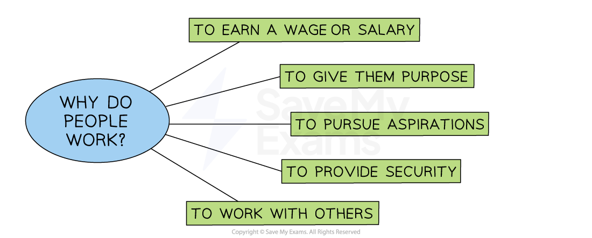

# The Benefits of Motivated Employees

## Introduction to Motivation

> **Spec point** — `spcpt_R5tpY4pp3mVpwpFS` · "• Why people work and what motivation means
• The benefits of a well-motivated workforce: labour productivity, reduced absenteeism and labour turnover"

## An introduction to motivation

- Motivation refers to the **inner desire or willingness** that drives a person to take action and **achieve a specific goal or outcome**

  - Motivation can be **intrinsic**, coming from within a person (values, beliefs etc)
  - Motivation can be **extrinsic**, coming from external factors (rewards or punishments)

### Why do people work?

- **People work for many different reasons**

  - They **need to earn money** to fund their lifestyle and ensure they have the necessities required
  - For some, **work is voluntary** or low-paid and done to give them a purpose
  - Some people work for the opportunity to **mix with other people**
  - For many, employment allows them to** fulfil their aspirations**

#### Why people work

*Individuals go to work for a variety of reasons, including earning a wage or salary and to give them a purpose*

## Benefits of a well Motivated Workforce

> **Spec point** — `spcpt_Ng2RhvmYqJqDRbYC`

## Benefits of a well motivated workforce

- Motivation plays a **critical role in business success**

  - Motivated employees are **more productive and efficient**
  
    - They are likely to be **engaged in their work** and **use their initiative** to meet or exceed their goals
    - They will generate higher levels of **output **and** quality**
    - Increased productivity results in **higher profits **for the business
  - ***Labour turnover*** rates tend to be lower when a workforce is well motivated
  
    - Motivated employees are more** likely to stay with the company** long-term
    - Lower turnover rates reduce the need for costly recruitment and training
  - **The reliability **and** loyalty** of motivated workers are likely to be high
  
    - Motivated employees **take pride** in their work, show up on time, meet deadlines and take fewer sick days
    - This leads to **increased trust** between the business and its employees and encourages a positive ***organisational culture***
