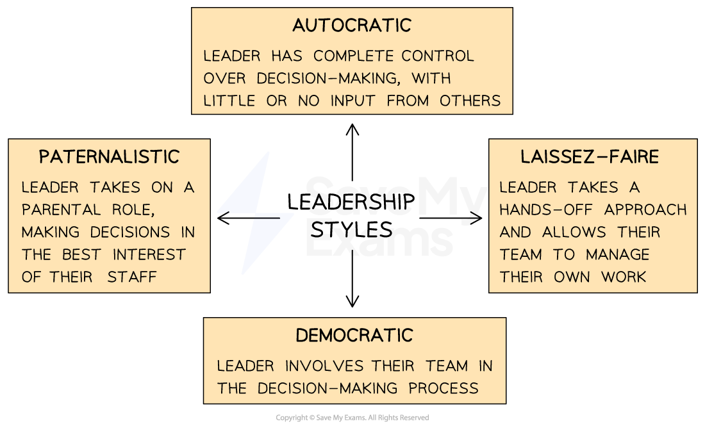
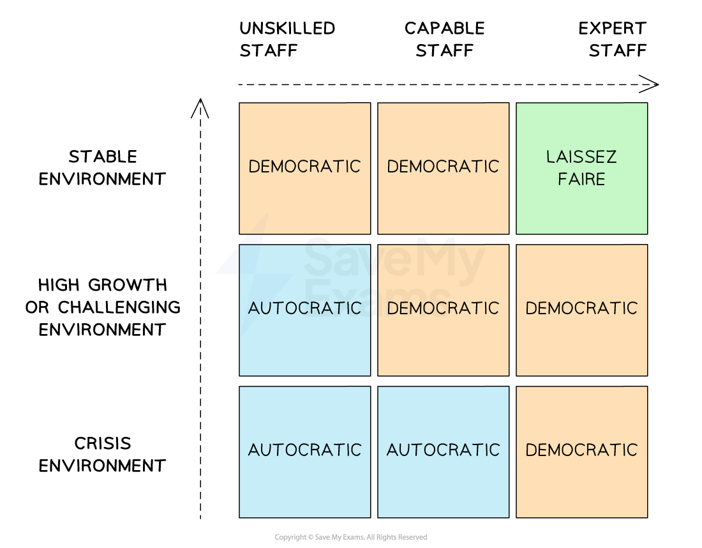

# Leadership Styles

## Types of Leadership Styles

> **Spec point** — `spcpt_29jrC48VrMSqP5Xq` · "• Features of the main leadership styles, e.g. autocratic, democratic and laissez-faire
• Recommend and justify an appropriate leadership
style in given circumstances"

## Types of leadership styles

### What is leadership?

- Leadership is about having a **vision**, sharing that vision with others and **providing direction**
- Leadership is necessary in many different contexts

  - A leader in sport could be the captain of a national football or basketball team
  - A political leader could be a president, prime minister of leader of a political group
- Leaders can** inspire **and **motivate **others to **work towards a common goal**

  - This contributes to the **meeting of aims and objectives** and supports the **development of a motivated workforce**

### Leadership styles

- Leadership styles reflect the **behaviours and attitudes of a leader towards their team members** and influence the ***organisational culture***, productivity and performance of a business
- A successful leader will be able to **use a variety of leadership styles,** depending on the situation, to achieve the best results for their business

#### Different leadership styles

*Most leaders operate using an autocratic, democratic or laissez-faire leadership style*

#### 1. Autocratic leadership

- An autocratic leader holds **absolute power and authority** within a business

  - Leaders set the direction and goals of the business and makes decisions without seeking input or agreement from others
  - The opinions, ideas or expertise of team members are not generally considered
  - Decisions are generally **not open for discussion** or debate
  - Strict **obedience **and **compliance** is expected from subordinates
  - Communication in business is mainly one-way: downward or 'top-down'

#### Evaluating autocratic leadership

| **Advantages** | **Disadvantages** |
|---|---|
| - Autocratic leaders can make **swift decisions without the need for lengthy discussions**    - Speeds up decision-making   - Can be crucial in emergency situations - **Coordination **and **efficiency **may be improved as roles and tasks are clearly stated | - **Reduced employee morale** as workers have no input into decision-making    - Lack of input from team members limits ideas for **problem-solving and innovation**  - **Limited creativity **as employees are required to follow strict instructions and are closely monitored |

#### 2. Democratic leadership

- Democratic leaders actively** involve employees** in the decision-making process and **encourage discussion**, though they have the final say

  - Consultation, collaboration, ***delegation*** and teamwork are common features
  - It is most effective in organisations with **skilled **and** experienced employees**
  - It works well in **creative industries** when managers give workers responsibility to work on projects together and manage their own time
- James Parker, the ex CEO of **Southwestern Airlines, **is well-known for his democratic style of leadership

  - In his book Do the Right Thing he states **“**I’ve always tried to expect the best of people and to trust them, and I have almost never been disappointed. Part of trusting people is empowering them to make decisions**”**

#### Evaluating democratic leadership

| **Advantages** | **Disadvantages** |
|---|---|
| - Encouraging participation from employees in decision-making processes    - Can lead to higher levels of **employee engagement** and **job satisfaction** - Individuals feel **valued and empowered** when their opinions and ideas are considered - Encourages **creativity and innovation** within a business    - Employees are more likely to **share ideas **and **think outside the box** when they have a say in decision-making | - Decision-making can be **time-consuming** as ***consensus*** or majority agreement is sought    - ***Competitive advantage*** may be lost as decisions take longer than rivals   - Making compromises may cause further delays  - **Conflicts** and **disagreements **may arise when different views are sought    - Resolving conflicts can be challenging and time-consuming   - Leaders need to possess **strong conflict resolution skills** to ensure that disagreements do not escalate |

#### 3. Laissez-faire leadership

- Laissez-faire leaders play a **minimal role** in managing subordinates or business teams

  - Leaders** provide little guidance**, direction or supervision to employees
  - Employees have significant **autonomy **and** freedom** in making decisions and completing tasks
  - Laissez-faire leadership is most appropriate where leaders are working with a **highly skilled **and** self-motivated team** that requires minimal supervision
  - **Communication may suffer** in this type of organisation as clear direction is not given

#### Evaluating laissez-faire leadership

| **Advantages** | **Disadvantages** |
|---|---|
| - Laissez-faire leadership can **encourage creativity and innovation** within the business    - Employees have the **freedom to explore ideas** and make decisions independently   - This allows for **diverse perspectives** and fresh approaches to problem-solving  - Employees are **empowered** because they have autonomy and ownership over their work    - Team members feel trusted and valued   - This enhances **job satisfaction**, **motivation**, and a **sense of responsibility** | - Some **employees may struggle with decision-making**    - This can lead to **inefficiency **and a **lack of coordination** within the team   - **Productivity may fall** as individuals struggle to prioritise tasks or make informed decisions  - Without clear guidelines or standards, there is a **risk of inconsistency** in the quality of output    - Different employees may have varying approaches   - This may lead to a **lack of cohesion** and potential **conflicts** in the team |

## Recommending an Appropriate Leadership Style

> **Spec point** — `spcpt_bC4ZDH7zxGRC79yv`

## Recommending an appropriate leadership style

- The **choice of leadership style** can be influenced by a range of factors

  - Business **circumstances** including the nature and size of the business
  - **Aims **and** objectives** to be achieved
  - **Personality, experience **and** skills** of the leader
- In particular, the **skills and abilities of the** **workforce **and the** nature of the competitive** **business environment** will impact upon the style of leadership adopted

#### Appropriate leadership styles

*The leadership style adopted will depend on the skills of workers and the environment in which a business operates*

### Choosing the most appropriate style

- When a business faces a **crisis situation** and its workers are unskilled, **autocratic leadership** is likely to be most appropriate

  - However, if the workers are highly skilled, a democratic approach would be more effective
- When a business operates in a **stable environment** and its workers are unskilled, a** democratic** approach is likely to be most appropriate

  - However, if the workers are highly skilled, a laissez-faire approach would be more effective
- When a business operates in a **high growth/challenging** environment and its workers are unskilled, an** autocratic** approach is likely to be most appropriate

  - However, if the workers are highly skilled, a democratic approach would be more effective

> **Exam Hint**
> Exam questions often ask you to recommend an appropriate leadership style for a business or to elaborate on the advantages or disadvantages of a particular style. Often the choice of style depends upon the current situation of the business. Leaders may not be autocratic all of the time, but at certain times it may be the best best approach.
